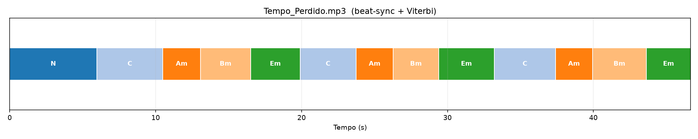
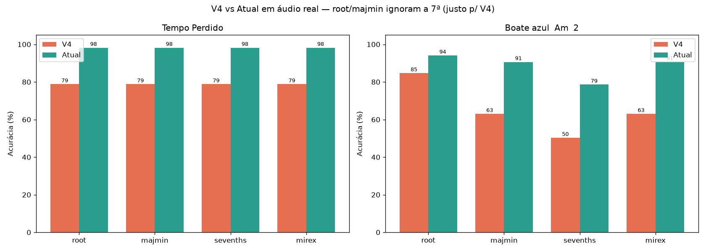

# Decifrae — módulo de reconhecimento de acordes (violão)

Reconhecimento de acordes em áudio de violão para o [decifrae.com.br](https://decifrae.com.br):
**HPSS → chroma CQT sincronizado por batida → similaridade de cosseno contra
60 templates → Viterbi → segmentos de acorde**. Inclui o baseline V4 original,
um bench sintético e um benchmark em áudio real pontuado com `mir_eval`.



Documentação completa em [`docs/`](docs/):

| Documento | Para quê |
|---|---|
| [docs/DOSSIE_TECNICO.md](docs/DOSSIE_TECNICO.md) | Referência central: fluxo, módulos, decisões, inconsistências conhecidas, resultados |
| [docs/TEMPLATES_ACORDES.md](docs/TEMPLATES_ACORDES.md) | Os 13 tipos, os 60 templates do vocabulário MEDIUM, ambiguidades |
| [docs/HIPERPARAMETROS.md](docs/HIPERPARAMETROS.md) | Todos os hiperparâmetros, onde vivem, valores e faixas |
| [docs/GROUND_TRUTH.md](docs/GROUND_TRUTH.md) | Anotações de Tempo Perdido e Boate Azul; como anotar novas faixas |
| [docs/BENCHMARK.md](docs/BENCHMARK.md) | Como rodar os benchmarks, saídas brutas, uso como regressão |
| [docs/CHANGELOG.md](docs/CHANGELOG.md) | Progressão v0.1 (V4) → v1.0 |

## Como rodar

Requer Python ≥ 3.10 (testado em 3.14.6, librosa 0.11.0). Rodar sempre **de
dentro desta pasta** — os módulos se importam pelo nome de arquivo.

```bash
pip install -r requirements.txt

python musicas.py             # analisa Musicas/ -> segmentos no terminal + out/musicas/*_timeline.png
python benchmark_musicas.py   # V4 vs atual em Tempo Perdido e Boate Azul (mir_eval) -> out/musicas_bench/
python run_bench.py           # bench sintético cosseno vs V4 -> out/*.png
```

As duas faixas do benchmark em áudio real (Tempo Perdido e Boate Azul) não estão no
repositório por direitos autorais. Para reproduzir os números, coloque os áudios em `Musicas/`
como `Tempo_Perdido.mp3` e `Boate azul (Am) 2.mp3`; as anotações de acordes usadas como gabarito
estão em `benchmark_musicas.py` e em [docs/GROUND_TRUTH.md](docs/GROUND_TRUTH.md). Sem elas, o
benchmark avisa quais faltam.

Smoke tests individuais: `python chord_templates.py`, `python classifier.py`,
`python viterbi.py`, `python pipeline.py`, `python evaluate.py`.

Para usar o pipeline em código:

```python
import librosa
from chord_templates import build_templates, MEDIUM
from classifier import CosineChordClassifier
from pipeline import analyze_track

y, sr = librosa.load("Musicas/Sol_1.mp3", sr=22050, mono=True)
clf = CosineChordClassifier(templates=build_templates(MEDIUM),
                            complexity_penalty=0.06, ext_sharpness=4.0)
for seg in analyze_track(y, sr, clf):          # defaults = valores de musicas.py
    print(f"{seg['start']:.1f}-{seg['end']:.1f}s  {seg['label']}")
```

## Módulos

| Arquivo | Papel |
|---|---|
| `chord_templates.py` | Vocabulário de acordes (13 tipos) + templates binários de 12 dim. Base de tudo. |
| `classifier.py` | Classificador por **cosseno** com viés pró-tríade **adaptativo** + `emission()` p/ Viterbi + gates. **Versão atual.** |
| `classifier_V2.py` | Versão anterior da mesma classe (prior fixo). Ainda importada por `pipeline.py`, `bench.py` e `run_bench.py` — ver dossiê §4.1. |
| `viterbi.py` | Suavização temporal por **Viterbi/HMM** sobre as emissões de cosseno. |
| `pipeline.py` | Segmentação por **beat-sync** (igual V4) + emissão + Viterbi + merge → `analyze_track`. |
| `evaluate.py` | Pontuação com `mir_eval.chord` (root / majmin / sevenths / mirex). |
| `musicas.py` | Analisa a pasta `Musicas/` e gera timeline por faixa. Hiperparâmetros no topo. |
| `benchmark_musicas.py` | Benchmark em áudio real: ground truth embutido, V4 vs atual → `out/musicas_bench/`. |
| `synth.py` | Síntese de acordes por série harmônica + pausas (bench sintético). |
| `noise.py` | Bateria de ruídos: branco, rosa, desafinação, percussão, reverb. |
| `bench.py` | Motor do bench sintético: matriz de confusão, teste de pausa, varredura. |
| `run_bench.py` | Bench sintético: compara **cosseno vs V4**. |
| `legacy_v4.py` | **V4 + comparar_metodos preservados** e intocados (baseline). |
| `Api/` | Cópia do backend FastAPI: `audio_processing_v2.py` é o pipeline novo standalone. Ver dossiê §2.5. |
| `Musicas/` | Áudios de teste gravados para o projeto (Sol_1, Re_2, TrocaDeAcordes). Tempo_Perdido e Boate azul não são versionados por direitos autorais; ver abaixo. |
| `out/` | Saídas geradas (timelines, PNGs do bench, `metrics.json`, logs). |

## Pipeline de análise de faixa

Ordem: **HPSS → beat-sync chroma → cosseno (emissão) → Viterbi → mescla**.

Pontos-chave da V2 (frente à primeira versão do musicas.py):
- **Beat-sync**: o chroma é extraído UMA vez no áudio inteiro e sincronizado
  por batida (como o V4). Isso acabou com os segmentos de ~22ms e os avisos
  `n_fft too large` que vinham de extrair chroma de pedacinhos.
- **Viterbi**: colapsa o flicker (ex.: `G / Gmaj7 / Gsus2` viram um `G` limpo).
  A penalidade de troca é **fixa** (independente do tamanho do vocabulário),
  evitando o "acorde preso" que acontece com matriz de transição normalizada.
- **Estado N ajustável**: silêncio real vira N (gate de RMS por segmento), mas
  mix densa (violão + voz, tipo Tempo_Perdido) volta a receber acordes em vez
  de "tudo N" — sem depender do gate fixo de 0.72.
- **Bug corrigido**: não há mais HPSS duplicado.

Parâmetros no topo de `musicas.py` (tabela completa em [docs/HIPERPARAMETROS.md](docs/HIPERPARAMETROS.md)):
- `CHANGE_PENALTY` (≈2.0): maior = timeline mais suave/grudenta.
- `TEMP` (≈0.1): menor = emissão mais decidida.
- `N_LOGPROB` (≈-2.5): mais negativo = N só em silêncio real.
- `REL_GATE` (≈0.2): silêncio = RMS abaixo de 20% da MEDIANA da faixa. É
  RELATIVO ao nível da gravação -- foi o que destravou o Tempo_Perdido, que
  é silencioso (RMS ~0.01) e um gate absoluto marcava 100% como N.
- `MIN_DUR` (≈0.8): absorve segmentos curtos (blips de transição) no vizinho.
- `complexity_penalty` (no CLF, ≈0.06): viés pró-tríade. Suprime o flicker
  maj7/7 que vem de cordas soltas ressoando. Para repertório com tétrades
  reais (jazz/MPB), reduza p/ ~0.02 ou 0. **No classificador o default é 0**
  (p/ o bench medir cosseno puro); o viés é setado só na instância do musicas.

Vocabulário atual: **MEDIUM** (maior, menor, 7, maj7, m7) = 60 templates.

## Resultados

### Áudio real (`out/musicas_bench/metrics.json`, mir_eval)

| Faixa | Nível | V4 | Atual |
|---|---|---:|---:|
| Tempo_Perdido (C Am Bm Em) | root = majmin = sevenths = mirex | 78,8 % | **98,2 %** |
| Boate azul (Am) 2 | root | 84,7 % | **94,1 %** |
| | majmin | 63,0 % | **90,6 %** |
| | sevenths | 50,3 % | **78,6 %** |

Qualitativo (28/06): Tempo_Perdido sai N (intro) + três ciclos limpos de
C Am Bm Em (antes: 100 % N); Sol_1 sai N + G limpo; TrocaDeAcordes sai
C, G, A, F na ordem com resíduos de ~0,9 s nas trocas.



### O que o bench sintético revelou

1. **Cosseno escala para tétrades; V4 não.** O V4 só conhece maior/menor, então
   em qualquer acorde de 4 notas ele devolve uma tríade. O cosseno acerta 7,
   maj7, m7, m6, dim, sus2 a 100% sem nenhum bias manual — é o efeito da
   auto-normalização pela norma do template.

2. **Ambiguidades harmônicas reais (não são bugs).** Alguns acordes têm o
   *mesmo conjunto de notas* e o chroma (que dobra oitavas e descarta o baixo)
   não consegue separá-los:
   - `Csus4 = Fsus2`  ({C,F,G})
   - `C6 = Am7`       ({C,E,G,A})
   - `Cm7b5 = Ebm6`   ({C,Eb,Gb,Bb})
   - Acordes simétricos: `aug` (3 raízes equivalentes → ~33%), `dim7` (4 →
     ~25%). O bench confirma a teoria: a ambiguidade é exatamente o fator de
     simetria. Nenhuma dessas ambiguidades existe dentro de MEDIUM.
     **Solução:** detecção de baixo/raiz (conecta com o módulo de baixo / PYIN).

3. **Gate de "sem acorde" funciona.** Nas pausas com ruído crescente, o cosseno
   mantém 0% de falso-positivo; o V4 começa a alucinar acordes a partir de ruído
   moderado (~37% em ruído 0.02, 100% em 0.05), porque não tem detecção real de
   silêncio.

4. **Cosseno é robusto ao vazamento harmônico.** Na varredura de 1 a 12
   harmônicos a acurácia se mantém em 100% (maj/m/7/maj7) — o cosseno não cai
   no maj→7 que derrubaria um scoring por soma de energia.

## Próximos passos

- Unificar `classifier.py` / `classifier_V2.py` e centralizar os hiperparâmetros
  (hoje em 4 lugares — ver dossiê §4.3).
- Fazer a API importar o núcleo em vez da cópia standalone em `Api/`.
- Detecção de raiz/baixo para quebrar as ambiguidades de rotação e simetria
  (necessário só ao ampliar o vocabulário além de MEDIUM).
- Anotar mais faixas (ex.: `TrocaDeAcordes(C-G-A-F)`) para um número
  comparável/publicável.

## O que aprendi

- **Processamento de áudio na prática:** separação harmônico-percussiva (HPSS), chroma por CQT
  sincronizado com a batida, pYIN para altura e separação por corda, e por que cada etapa existe.
- **A bancada de testes foi a decisão que mais mudou o resultado.** Gerar acordes sintéticos com
  gabarito conhecido, ruído controlado e pausas mostrou onde o V4 falhava (tétrades, ruído em
  silêncio) antes de testar em música real.
- **Trabalhar em etapas e medir cada uma:** ajustar uma função até ela funcionar bem, registrar o
  resultado na documentação e só então passar para a próxima.
