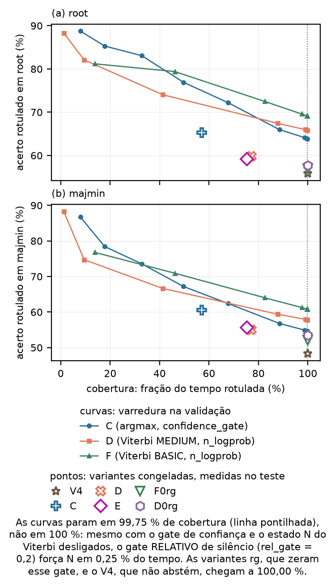
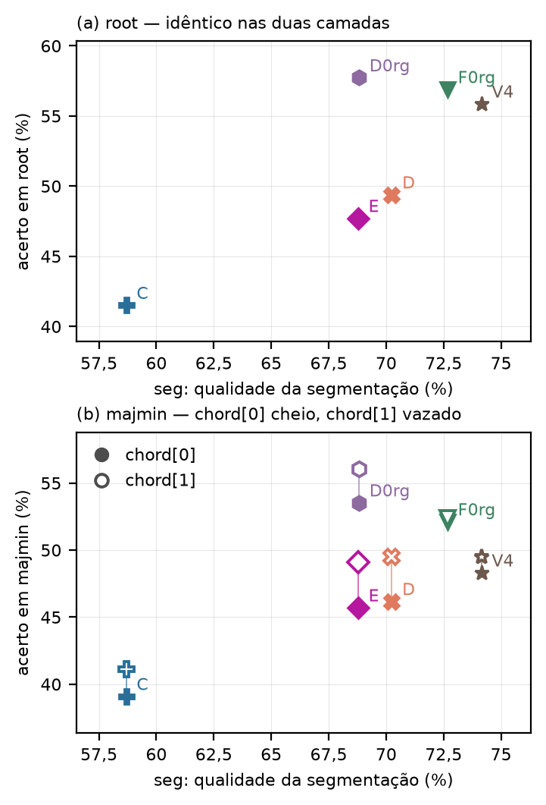

# Resultados

Todos os números desta seção vêm de CSVs em `data/results/`; a §6 lista a
origem de cada um. Os valores do **conjunto de teste** (58 excertos dos
músicos 04 e 05) são os principais; os da validação (120 excertos dos músicos
00–03) aparecem entre parênteses, sempre identificados como tais. O conjunto
de teste foi medido em duas invocações do runner, uma por camada de referência
(`--ref-layer 0` e `--ref-layer 1`), ambas com as seis configurações
congeladas em `docs/CONGELAMENTO.md` antes da leitura, e cada uma commitada
antes da seguinte. Não houve nenhuma execução adicional sobre o conjunto de
teste, com nenhuma outra configuração.

A camada de referência é indicada em cada afirmação. As colunas `root`,
`N est`, `overseg`, `underseg`, `seg` e as contagens de segmentos são
**idênticas** nas duas camadas — elas compartilham fronteiras e tônicas, e
diferem apenas na qualidade do acorde. Por isso as afirmações sobre `majmin`,
`sevenths` e `mirex` sempre nomeiam a camada, e as demais não precisam.

**Convenção para os p-valores de Holm.** Toda correção de Holm citada é a da
camada **chord[0]**, salvo menção contrária. Isso vale mesmo para métricas cujo
valor bruto é idêntico nas duas camadas: o p ajustado depende da família
inteira de comparações, e a família muda quando `majmin`, `sevenths` e `mirex`
mudam. As diferenças são pequenas — a maior é `V4b vs V4` em `root`, 0,343 em
chord[0] contra 0,649 em chord[1] — e **em nenhum dos doze casos afetados a
classificação muda de camada**. Onde o número da outra camada importa para a
leitura, ele está citado.

## 0. Limitações do pré-registro que afetam a leitura desta seção

Três ressalvas que condicionam tudo o que segue.

**Duas das seis comparações pré-registradas não foram avaliadas no teste.** O
`docs/CONGELAMENTO.md` congelou seis configurações (§1) mas pré-registrou
pares que exigem oito variantes (§5): `C0rg` e `V4b` não constam da lista
congelada. Os pares `C0rg vs D0rg` (o Viterbi com cobertura igualada) e
`V4b vs V4` (a inércia temporal do baseline) existem apenas na validação. Não
foram executados no teste porque isso significaria uma segunda leitura do
conjunto de teste com variante fora do congelamento.

**Os p-valores de Holm não são comparáveis entre os dois conjuntos.** A
família de multiplicidade tem 15 comparações na validação e 11 no teste, pela
razão acima. A correção do teste é, portanto, sistematicamente menos
conservadora. Comparamos classificações e sinais entre os conjuntos, nunca os
p ajustados diretamente.

**A camada principal declarada e a camada do protocolo estatístico divergem.**
O `docs/CONGELAMENTO.md` §6 declara `chord[1]` como referência principal,
seguindo `docs/DATASETS.md` §2, mas o protocolo estatístico pré-registrado foi
ensaiado sobre `chord[0]`, que é também o default do runner. Reportamos as
duas camadas em paralelo e nomeamos a camada em cada afirmação; não elegemos
uma como principal nesta seção.

**Um erro de mecanismo no documento congelado.** A §4 de
`docs/CONGELAMENTO.md` atribui ao piso absoluto de RMS (`abs_floor = 5e-4`) os
0,25 % de tempo rotulado como `N` que restam nas variantes sem outras fontes
de `N`. A atribuição está errada: na validação, as variantes `rg`
(`rel_gate = 0`) têm `frac_n_est` **exatamente zero** em todas as 120 faixas,
e os 0,25 % pertencem ao gate **relativo** de silêncio, que as variantes `C0`,
`D0` e `F0` mantêm em 0,2. O documento congelado não foi corrigido — alterá-lo
depois da leitura do teste destruiria seu valor como pré-registro —, e o
registro correto fica aqui. No conjunto de teste o `abs_floor` tem efeito, mas
em **1 excerto de 58**.

## 1. Cobertura e acerto: o que o Viterbi realmente faz

O sistema pode recusar-se a rotular um trecho, devolvendo `N`. Como a
referência do GuitarSet não contém nenhum `N`, todo `N` emitido é erro na
métrica usual — mas é um erro de omissão, não de confusão. Separar os dois é o
que permite dizer o que cada etapa faz.

Na métrica usual, sobre a faixa toda, o Viterbi vale **+7,88 pontos** em
`root` (IC 95 % [+5,26, +10,48], Holm 0,0011, **confirmado**; validação
+13,90, confirmado; 45 faixas melhores contra 12). A direção da validação se
manteve, com efeito menor.

No tempo que o sistema de fato rotula, o mesmo Viterbi **piora** o acerto:
**−5,49 pontos** em `root` (IC [−9,23, −1,85], Holm 0,028 em chord[0] e 0,032
em chord[1], **confirmado** nas duas; validação −7,26, confirmado; 16 faixas
melhores contra 41). A direção também se manteve.

As duas medidas juntas dizem que o ganho do Viterbi na métrica usual **não vem
de classificar melhor**: vem de cobrir tempo que o argmax recusava. A variante
C rotula 57,10 % da faixa; D rotula 77,12 %. Chamar o Viterbi de "suavização
que aumenta a acurácia" descreve o efeito observado pela causa errada.

Na validação há uma comparação com a cobertura igualada — `C0rg vs D0rg`, as
duas rotulando 100 % do tempo —, e ali o Viterbi vale **+2,02 pontos** em
`root` (IC [+0,67, +3,40], Holm 0,024, confirmado) e +3,21 em `majmin` em
chord[0]. Esse par **não isola o Viterbi sozinho**: `C0rg` tem
`confidence_gate = 0`, e `D0rg` o mantém em 0,72, de modo que as duas
configurações diferem em três campos e não em um. É uma limitação do
pré-registro, não desta leitura. E **a comparação não existe no teste**, pela
lacuna da §0 — de modo que qualquer decomposição dos 7,88 pontos em "cobertura"
e "classificação" fica restrita à validação e sujeita a essa ressalva.

Sobre o eixo horizontal da figura: as curvas param em **99,75 %** de
cobertura, não em 100 %. A causa não é o piso absoluto de RMS — é o gate
**relativo** de silêncio, que as curvas mantêm em `rel_gate = 0,2`. As
variantes `rg`, que zeram esse gate e por isso não aparecem nas curvas,
alcançam **100,00 % exatos** na validação, assim como o V4. No conjunto de
teste as mesmas variantes `rg` ficam em 99,97 %, e aí o responsável é o
`abs_floor`, atuando em 1 excerto de 58.

## 2. A abstenção é informativa

> **Análise exploratória.** Nenhuma comparação desta subseção consta dos pares
> pré-registrados da §5 do congelamento, e portanto nenhuma tem IC, p-valor ou
> classificação. São contrastes descritivos entre colunas da mesma tabela,
> reportados como tais conforme a própria §5 exige.

| variante | cobertura | `root` faixa toda | `root` tempo rotulado | Δ |
|---|---:|---:|---:|---:|
| C | 57,10 % | 41,51 % | **65,26 %** | +23,74 |
| D | 77,12 % | 49,39 % | 59,76 % | +10,37 |
| E | 75,26 % | 47,71 % | 59,13 % | +11,42 |
| F0rg | 99,97 % | 56,89 % | 56,91 % | +0,01 |
| D0rg | 99,97 % | 57,73 % | 57,75 % | +0,02 |
| V4 | 100,00 % | 55,87 % | 55,87 % | 0,00 |

A variante que mais se abstém é a mais exata quando se arrisca: C acerta
**65,26 %** do tempo que rotula, acima de qualquer configuração que rotule
quase tudo (F0rg 56,91 %, D0rg 57,75 %, V4 55,87 %). O mesmo padrão aparece na
validação, com valores mais altos (C 74,69 %; V4 67,95 %).

O trecho descartado por C é, portanto, mais difícil que a média: a abstenção
não é aleatória. Na validação, a configuração que rotula 100 % do tempo
(`C0rg`) acerta **63,78 %**, contra os 74,69 % que C acerta no tempo que
escolhe rotular. Atribuir essa diferença ao `confidence_gate` sozinho seria
errado — `C0rg` difere de C também no `rel_gate` (0 contra 0,2) e no
`min_dur` —, então o que os dados sustentam é que **desligar as fontes de
abstenção** custa acurácia no tempo rotulado, não que um parâmetro específico
seja responsável. No teste essa medida não existe, porque `C0rg` não foi
congelada.

Esta é uma propriedade do sistema, não uma vantagem em nenhuma métrica
agregada: em `root` sobre a faixa toda, C é a **pior** das seis configurações
(41,51 %).

## 3. Acurácia e segmentação são objetivos distintos

### 3.1 A absorção de segmentos curtos troca acurácia por fronteiras

A etapa `min_dur = 0,8 s` (D → E) **custa** 1,68 pontos de `root` (IC
[−2,79, −0,66], Holm 0,0064 em chord[0] e 0,0072 em chord[1], **confirmado**
nas duas; validação −1,59, confirmado; 19 faixas melhores contra 31) e
**rende** 9,54 pontos de `overseg` (IC [+7,80, +11,33], Holm 0,0011,
**confirmado**; validação +9,39, confirmado; 54 faixas melhores contra 0
piores). As duas direções se mantiveram do conjunto de validação para o de
teste.

No `seg` — o mínimo entre `overseg` e `underseg` — o efeito **não se
sustentou**: −1,47 pontos, IC [−4,46, +1,47], Holm 1 em chord[0] e 0,985 em
chord[1], **empate** nas duas, contra +3,47 confirmado na validação. É uma das
quatro inversões de sinal entre os conjuntos — três delas em chord[0], mais
uma exclusiva de chord[1] (§5). O ganho de `overseg` de E é real; o efeito
líquido sobre o `seg` não é distinguível de ruído nestes 58 excertos.

A leitura defensável é que `min_dur` melhora a granularidade das fronteiras
(`overseg`) ao custo de acurácia (`root`), e que o saldo no `seg` fica
indeterminado.

### 3.2 A inércia temporal do baseline não produziu efeito detectável em `root`

O par pré-registrado é `V4b vs V4`, e a diferença reportada é `V4 − V4b`: o
efeito de **manter** os dois termos temporais (o bônus de +0,5 no acorde
repetido e a penalidade de −0,1 no nome mais longo). Na validação, manter esses
termos vale **+0,78 pontos** em `root` — IC [−0,82, +2,38], Holm 0,343,
**empate**, 63 faixas melhores contra 55. Removê-los, portanto, custa 0,78
pontos, quantidade que não se distingue de ruído em 120 faixas.

Em `overseg`, manter os mesmos termos vale **+17,54 pontos** (IC
[+15,66, +19,46], Holm 0,0015, confirmado, 116 faixas melhores contra 3).

**Esta comparação não foi avaliada no teste**, porque `V4b` não consta das
configurações congeladas. A afirmação vale para a validação e não foi
confirmada fora dela.

### 3.3 Número de segmentos não prediz qualidade de fronteira

O V4 produz 62,7 segmentos por excerto contra 12,0 da referência — mais de
cinco vezes — e ainda assim tem o **maior** `seg` das seis configurações
(74,14 % no teste). "Maior" e não "melhor": o único par pré-registrado em `seg`
que envolve o V4 é `V4 vs F0rg`, e ele é **empate** no teste (§4.1); as outras
quatro comparações de `seg` entre as seis configurações não foram
pré-registradas nem testadas. As duas contagens de segmentos desta subseção são
médias simples por excerto, não ponderadas por duração (§6).

Dentro do conjunto de validação, V4 e V4b produzem exatamente o mesmo número
de segmentos com `overseg` de 80,21 % e 62,67 %. A contagem de segmentos e a
concordância de fronteiras medem coisas diferentes.

## 4. Vocabulário: 24 contra 60 acordes

As duas configurações que rotulam quase tudo diferem **apenas** no vocabulário:
`F0rg` usa os 24 templates de `BASIC` (maior e menor) e `D0rg` os 60 de
`MEDIUM` (maior, menor, 7, maj7, m7).

Em `sevenths` sobre a camada **chord[0]** (o lead sheet instruído), `F0rg`
supera `D0rg` em **12,56 pontos** (IC [+9,48, +15,80], Holm 0,0011,
**confirmado**; validação +14,86 na mesma direção, confirmado; 50 faixas
melhores contra 6).

**Esse resultado não significa que um vocabulário de 24 acordes reconheça
sétimas melhor que um de 60 — ele não reconhece nenhuma.** O nível `sevenths`
exige tônica, qualidade e sétima corretas. O lead sheet instruído é composto
majoritariamente de tríades: 86,5 % do tempo é `maj` ou `min` e 9,0 % é `7`.
`MEDIUM` emite sétimas sobretudo em tempo que a referência rotula como tríade,
e cada uma dessas sétimas **falsas** é penalizada; `BASIC` não pode cometer
esse erro porque não tem o rótulo. A vantagem é a ausência de uma classe de
erro, não a presença de uma capacidade.

Na camada **chord[1]**, que registra o que foi efetivamente tocado, a vantagem
**desaparece**: `F0rg` fica 5,33 pontos **abaixo** de `D0rg` em `sevenths` (IC
[−12,07, +1,00], Holm 0,551, **empate**), contra +6,68 confirmado na validação
da mesma camada — a quarta inversão de sinal. Isso é compatível com a leitura
acima, mas não a confirma: um empate é ausência de efeito detectável, não
evidência a favor de um mecanismo.

Duas ressalvas sobre essa comparação em chord[1]. Primeira: o nível `sevenths`
dessa camada pondera apenas **64,3 %** do tempo anotado — o mir_eval descarta o
resto, porque a referência sai do vocabulário do nível (contra 95,5 % em
chord[0]). Segunda: com 58 excertos, o IC de [−12,07, +1,00] é largo o
suficiente para acomodar tanto vantagem quanto desvantagem substancial de
qualquer dos dois vocabulários.

Em `root` e `majmin`, as duas configurações **empatam** no teste: −0,84 pontos
em `root` (IC [−3,96, +2,52], Holm 1) e −1,42 em `majmin` em chord[0] (IC
[−4,70, +1,85], Holm 1). Na validação as duas eram confirmadas a favor de
`F0rg` (+3,35 e +3,07). Não há base nos dados de teste para preferir um
vocabulário ao outro em `root` ou `majmin`.

### 4.1 Contra o baseline

`F0rg` é a variante que a validação apontou como mais forte; nos números do
próprio teste ela não lidera: `D0rg` tem `root` mais alto (57,73 % contra
56,89 %) e `majmin`/chord[0] mais alto (53,53 % contra 52,12 %) — as duas
diferenças classificadas como **empate**. Os parágrafos abaixo a comparam com o
baseline porque ela é uma das seis configurações congeladas, não porque seja "a
melhor" no teste.

`F0rg` supera o V4 em `majmin` na camada chord[0] por **3,81 pontos** (IC
[+1,11, +6,58], Holm 0,030, **confirmado**; validação +4,02, confirmado; 33
faixas melhores contra 22). Na camada chord[1] o mesmo par é **empate** (+2,86,
IC [−0,52, +6,04], Holm 0,551).

Em `root`, `F0rg` e V4 **empatam**: +1,03 pontos, IC [−1,21, +3,40], Holm 1 —
27 faixas melhores contra 27. Na validação essa comparação já era a mais fraca
da tabela (classificada `frágil`: IC excluía zero por +0,06 mas Holm não
rejeitava). Não afirmamos superioridade em `root`.

Em `seg`, `F0rg` fica abaixo do V4 (−1,48, IC [−2,89, +0,10], Holm 0,322,
**empate**; validação −1,58, confirmado).

O resumo defensável: **`F0rg` supera o baseline em `majmin` na camada chord[0],
e empata com ele em `root`, em `seg` e em `majmin`/chord[1].** Qualquer
formulação mais forte que essa não se sustenta nos dados de teste.

## 5. Divergências entre validação e teste

Nenhuma comparação inverteu de sinal **e** permaneceu confirmada; todas as
inversões caíram para `empate`. Cinco comparações perderam força em chord[0] e
nenhuma ganhou.

| par | métrica | camada | validação | teste | inverteu? |
|---|---|---|---|---|---|
| D vs E | seg | ambas | +3,47 confirmado | −1,47 empate | sim |
| D0rg vs F0rg | root | ambas | +3,35 confirmado | −0,84 empate | sim |
| D0rg vs F0rg | majmin | chord[0] | +3,07 confirmado | −1,42 empate | sim |
| D0rg vs F0rg | sevenths | chord[1] | +6,68 confirmado | −5,33 empate | sim |
| V4 vs F0rg | root | ambas | +1,20 frágil | +1,03 empate | não |
| V4 vs F0rg | seg | ambas | −1,58 confirmado | −1,48 empate | não |
| V4 vs F0rg | majmin | chord[1] | +5,32 confirmado | +2,86 empate | não |

O que **sobreviveu** ao teste nas duas camadas, porque não depende da qualidade
do acorde: o efeito do Viterbi em `root` (+7,88, confirmado) e no tempo
rotulado (−5,49, confirmado); e o custo do `min_dur` em `root` (−1,68) com o
ganho em `overseg` (+9,54).

O que sobreviveu **apenas em chord[0]**: a vantagem de `F0rg` sobre `D0rg` em
`sevenths` (+12,56) e sobre o V4 em `majmin` (+3,81). Em chord[1] as duas são
empate.

Todas as seis configurações pontuam mais baixo no teste que na validação — o V4
vai de 67,95 % para 55,87 % em `root`, e as demais acompanham. Não sabemos a
causa: os excertos dos músicos 04 e 05 podem ser mais difíceis de reconhecer,
mas diferença de anotação, de instrumento ou de mixagem produziria o mesmo
padrão. Distinguir essas hipóteses exigiria medir o conjunto de teste
novamente, o que o protocolo não permite.

## 6. Origem dos números

Cada arquivo tem um `_meta.json` ao lado, com versões de biblioteca, o commit
do projeto e o estado da árvore de trabalho na geração.

A convenção de agregação é a **média ponderada pela duração da faixa**
(`duracao_s`), agrupada por variante, para todas as colunas de fração e de
acurácia. As **contagens de segmentos** (`n_segmentos_est`, `n_segmentos_ref`,
citadas na §3.3) são médias **simples** por excerto, porque são contagens e não
frações de tempo — ponderá-las daria 66,36 e 12,46 em vez de 62,7 e 12,0.

| Número citado | Arquivo | Filtro |
|---|---|---|
| Ablação do teste, chord[0] (§1, §2, §3.1, §3.3, §4) | `data/results/ablation_20260927_014253_ref0.csv` | `split=test`; ver a convenção acima |
| Ablação do teste, chord[1] (§4, §5) | `data/results/ablation_20260927_014445_ref1.csv` | idem |
| Ablação da validação, chord[0] (parênteses de §1–§4) | `data/results/ablation_20260927_005629_ref0.csv` | `split=val`; idem |
| Ablação da validação, chord[1] (§4, §5) | `data/results/ablation_20260927_010621_ref1.csv` | idem |
| Estatística do teste, chord[0] (Δ, IC, Holm, classe) | `data/results/stats_test_ref0_20260927_020514.csv` | linha por `(par, metrica)`; colunas `diferenca`, `ic95_min`, `ic95_max`, `p_bootstrap_holm`, `classificacao`, `b_melhor`/`b_pior`/`empate` |
| Estatística do teste, chord[1] | `data/results/stats_test_ref1_20260927_020516.csv` | idem |
| Estatística da validação, chord[0] | `data/results/stats_val_ref0_20260927_020511.csv` | idem |
| Estatística da validação, chord[1] | `data/results/stats_val_ref1_20260927_020513.csv` | idem |
| Cobertura do nível `sevenths` em cada camada — 64,3 % e 95,5 % (§4) | `data/results/coverage.csv` | `dataset=guitarset`, `nivel=sevenths`, coluna `comparavel_frac`, por `camada` |
| Distribuição de qualidades de chord[0] — 86,5 % de tríades, 9,0 % de `7` (§4) | `data/results/coverage.csv` | `camada=chord[0]`, coluna `top_qualidades` |
| Curvas de cobertura × acerto (figura §1) | `data/results/curvas_20260926_015602.csv` | `split=val`, chord[0]; agrupado por `(curva, valor)` |
| Cobertura = 1 − `frac_n_est` | os CSVs de ablação acima | coluna `frac_n_est` |
| `rel_gate = 0,2` e `abs_floor = 5e-4` (§0, §1) | `data/results/ablation_20260927_005629_ref0_meta.json` | `config_base.post` |
| Faixas com `N` residual: 0/120 nas variantes `rg` da validação, 1/58 no teste (§0, §1) | os CSVs de ablação acima | contagem de linhas com `frac_n_est > 0`, por `variante` |
| Configurações congeladas | `docs/CONGELAMENTO.md` | §1 a §3 |

As figuras e as tabelas `.tex` de `artigo-ACDSA/` são geradas por
`figuras_artigo.py` a partir desses mesmos CSVs; nenhum número foi transcrito
à mão. As tabelas completas estão em `artigo-ACDSA/tabelas/`:
`tab_ablacao.tex` (seis configurações no teste), `tab_camadas.tex` (as duas
camadas lado a lado), `tab_segmentacao.tex` (`overseg`/`underseg`/`seg`),
`tab_stats.tex` (as 11 comparações do teste) e `tab_stats_val.tex` (as 15 da
validação).
