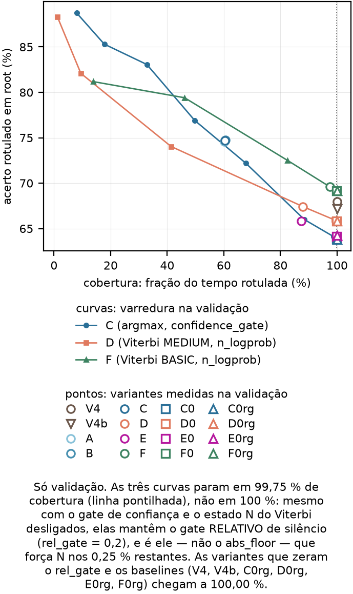
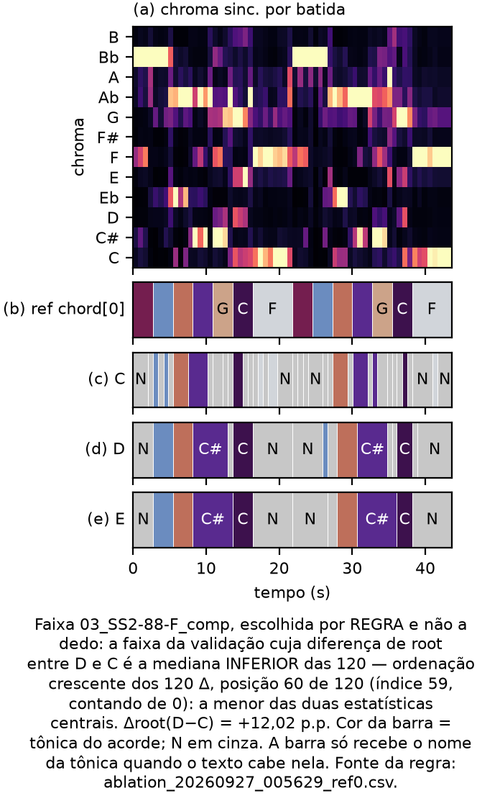
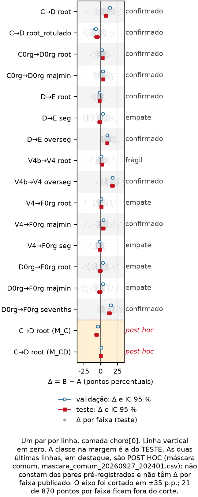

# Resultados

Todos os números desta seção vêm de CSVs em `data/results/`; a §6 lista a
origem de cada um, com o filtro que o reproduz. A única exceção é o tamanho dos
dois vocabulários (24 e 60 templates), que é definição de código e não medida. Os valores do **conjunto de teste** (58 excertos dos
músicos 04 e 05) são os principais; os da validação (120 excertos dos músicos
00–03) aparecem entre parênteses, sempre identificados como tais. O conjunto
de teste foi medido em duas invocações do runner, uma por camada de referência
(`--ref-layer 0` e `--ref-layer 1`), ambas com as seis configurações
congeladas em `docs/CONGELAMENTO.md` antes da leitura, e cada uma commitada
antes da seguinte. Não houve nenhuma execução adicional sobre o conjunto de
teste, com nenhuma outra configuração.

**Cobertura das afirmações em chord[1].** Os níveis sensíveis à qualidade do
acorde ponderam bem menos tempo nessa camada, e menos ainda no recorte de
teste: `sevenths` pondera 59,2 % do tempo anotado dos 58 excertos e `majmin`
62,9 %, contra 95,4 % nos dois níveis em chord[0]. Na validação as frações
correspondentes são 66,8 % e 68,5 %. Toda afirmação sobre `majmin` ou
`sevenths` em chord[1] — inclusive as da §4.1 e as da tabela da §5, e as da
validação — repousa sobre tempo parcial. Não repetimos a ressalva em cada
ocorrência; ela vale para todas.

A camada de referência é indicada em cada afirmação. As colunas `root`,
`N est`, `overseg`, `underseg`, `seg` e as contagens de segmentos são
**idênticas** nas duas camadas — elas compartilham fronteiras e tônicas, e
diferem apenas na qualidade do acorde. Por isso as afirmações sobre `majmin`,
`sevenths` e `mirex` sempre nomeiam a camada, e as demais não precisam.

**Convenção para os p-valores de Holm.** Toda correção de Holm citada é a da
camada **chord[0]**, salvo menção contrária. Isso vale mesmo para métricas cujo
valor bruto é idêntico nas duas camadas: o p ajustado depende da família
inteira de comparações, e a família muda quando `majmin` e `sevenths` mudam —
as duas únicas métricas sensíveis à camada entre as seis que os pares
pré-registrados usam. São doze os casos afetados, e **em nenhum deles a
classificação muda de camada**, embora o p possa quase dobrar: o maior desvio é
`V4b vs V4` em `root`, 0,343 em chord[0] contra 0,649 em chord[1]. Onde o
número da outra camada importa para a leitura, ele está citado com a camada
nomeada.

## 0. Limitações do pré-registro que afetam a leitura desta seção

Três ressalvas que condicionam tudo o que segue.

**As 15 comparações pré-registradas foram avaliadas, em duas execuções.** A
primeira leitura do conjunto de teste cobriu 11 das 15: o
`docs/CONGELAMENTO.md` congelou seis configurações (§1) mas pré-registrou
pares que exigem oito (§5), e `C0rg` e `V4b` ficaram fora da lista congelada
por erro de transcrição entre as duas seções. A omissão e a sua correção estão
documentadas em `docs/ADENDO_CONGELAMENTO.md` §1, commitado **antes** da
execução que autoriza; as duas variantes foram então medidas com as
configurações inalteradas desde `b68033d`, verificadas linha a linha contra o
código daquele commit. A família de Holm do teste tem, portanto, as **15**
comparações pré-registradas em cada camada, e os p ajustados do teste e da
validação são calculados sobre famílias do mesmo tamanho.

Duas contagens diferentes aparecem neste texto e as duas estão certas: a
**família de Holm** tem 15 comparações por camada, e é ela que define a
correção; o número de **células de valor distinto** é 19, porque quatro das 15
comparações — as que usam `majmin` ou `sevenths` — dão valores diferentes em
chord[0] e chord[1], e as outras onze são idênticas nas duas camadas.

**A camada principal declarada e a camada do protocolo estatístico divergem.**
O `docs/CONGELAMENTO.md` §6 declara `chord[1]` como referência principal,
seguindo `docs/DATASETS.md` §2, mas o protocolo estatístico pré-registrado foi
ensaiado sobre `chord[0]`, que é também o default do runner. Reportamos as
duas camadas em paralelo e nomeamos a camada em cada afirmação; não elegemos
uma como principal nesta seção.

**Um erro de mecanismo no documento congelado.** A §4 de
`docs/CONGELAMENTO.md` atribui ao piso absoluto de RMS (`abs_floor = 5e-4`) os
0,25 % de tempo rotulado como `N` que restam nas variantes sem outras fontes
de `N`. A atribuição está errada: na validação, as variantes `rg`
(`rel_gate = 0`) têm `frac_n_est` **exatamente zero** em todas as 120 faixas, e
os 0,25 % pertencem ao gate **relativo** de silêncio. Quem os exibe são `C0`,
`D0` e `F0`, que mantêm `rel_gate = 0,2` com `min_dur = 0`; `E0`, que mantém o
mesmo gate mas absorve segmentos curtos (`min_dur = 0,8`), fica em 0,08 %. O
documento congelado não foi corrigido — alterá-lo depois da leitura do teste
destruiria seu valor como pré-registro —, e o registro correto fica aqui. No
conjunto de teste o `abs_floor` tem efeito, mas em **1 excerto de 58**.

## 1. Cobertura e acerto: o que o Viterbi realmente faz

*Curvas de acerto no tempo rotulado contra cobertura, no nível `root` e na
camada chord[0], medidas no conjunto de **validação**. Cada curva varre um
limiar de abstenção — C o `confidence_gate`, D e F o `n_logprob` — e os pontos
marcam as variantes medidas. As curvas param em 99,75 % de cobertura por causa
do gate relativo de silêncio (`rel_gate = 0,2`), não do piso absoluto de RMS; as
variantes que zeram esse gate e os dois baselines alcançam 100,00 %.*

O sistema pode recusar-se a rotular um trecho, devolvendo `N`. Como a
referência do GuitarSet não contém nenhum `N`, todo `N` emitido é erro na
métrica usual — mas é um erro de omissão, não de confusão. Separar os dois é o
que permite dizer o que cada etapa faz.

Na métrica usual, sobre a faixa toda, o Viterbi vale **+7,88 pontos** em
`root` (IC 95 % [+5,26, +10,48], Holm 0,0011, **confirmado**; validação
+13,90, confirmado; 45 faixas melhores contra 12). A direção da validação se
manteve, com efeito menor.

No tempo que o sistema de fato rotula, o mesmo Viterbi **piora** o acerto:
**−5,49 pontos** em `root` (IC [−9,23, −1,85], Holm 0,028, **confirmado**;
validação −7,26, confirmado; 16 faixas melhores contra 41). A direção também se
manteve.

As duas medidas juntas dizem que o ganho do Viterbi na métrica usual **não vem
de classificar melhor**: vem de cobrir tempo que o argmax recusava. A variante
C rotula 57,10 % da faixa; D rotula 77,12 %. Chamar o Viterbi de "suavização
que aumenta a acurácia" descreve o efeito observado pela causa errada.

O par pré-registrado `C0rg vs D0rg` mede isso com a cobertura igualada, as duas
rotulando 99,97 % do tempo. No teste, o Viterbi vale ali **+2,72 pontos** em
`root` (IC [+1,01, +4,59], Holm 0,020, **confirmado**; validação +2,02 na mesma
direção, confirmado; 39 faixas melhores contra 17) e **+3,93** em `majmin` em
chord[0] (IC [+1,95, +6,02], Holm 0,0015, confirmado; validação +3,21; +3,08 em
chord[1] no teste, confirmado). Ou seja: dos 7,88 pontos que o Viterbi rende na métrica usual,
cerca de 2,7 são classificação e o resto é cobertura.

Esse par **não isola o Viterbi sozinho**: `C0rg` tem `confidence_gate = 0`, e
`D0rg` o mantém em 0,72, de modo que as duas configurações diferem em três
campos e não em um. É uma limitação do pré-registro, não desta leitura.

*Um excerto do conjunto de **validação**, escolhido por regra e não a dedo: a
faixa cuja diferença de `root` entre D e C é a mediana das 120 (mediana
inferior, índice 59 da ordenação crescente). É `03_SS2-88-F_comp`, com
Δ = +12,02 pontos — `root` de 64,33 % em C e 76,34 % em D. De cima para baixo: o
chromagrama sincronizado por batida, a referência chord[0], e as saídas de C, D e
E; `N` em cinza. C produz 40 segmentos, D 17 e E 12, contra 14 da referência.*

### 1.1 A mesma comparação sobre o mesmo tempo

Uma análise complementar isola o efeito sem depender da configuração: pontuar C
e D sobre a **mesma** porção de tempo. Duas máscaras, no nível `root` e na
camada chord[0]:

- **M_C** — as células em que C não estimou `N`, isto é, o domínio de C;
- **M_CD** — as células em que **nenhum** dos dois estimou `N`, a interseção em
  que as duas se comprometeram.

| máscara | conjunto | C | D | Δ = D − C | IC 95 % | tempo coberto |
|---|---|---:|---:|---:|---:|---:|
| M_C | validação | 77,30 % | 73,39 % | **−3,91** | [−6,06, −1,88] | 59,3 % |
| M_C | teste | 72,70 % | 66,32 % | **−6,39** | [−9,83, −3,49] | 54,6 % |
| M_CD | validação | 79,48 % | 80,27 % | +0,79 | [−0,91, +2,42] | 54,1 % |
| M_CD | teste | 77,57 % | 77,78 % | +0,22 | [−1,74, +2,10] | 45,9 % |

Na interseção em que as duas se comprometem, **a diferença desaparece**: o IC
cruza zero nos dois conjuntos, e a estimativa pontual é de dois décimos de ponto
no teste. Em M_C o Viterbi é pior, e a razão é estrutural: essa máscara inclui
as células em que C se arriscou e D preferiu `N`, onde D pontua zero por
construção.

Isto **reforça** a leitura acima e a torna independente de configuração: onde as
duas variantes rotulam, elas acertam o mesmo. O ganho do Viterbi na métrica
usual é cobertura.

Duas ressalvas. A análise sobre o conjunto de teste é **pós-especificada (post
hoc)**: não consta dos pares do §5 do congelamento e foi concebida depois da
leitura do teste — está marcada como tal no CSV e no `meta.json`, e não
substitui nem reinterpreta nenhuma comparação pré-registrada. E as máscaras
cobrem cerca de metade do tempo comparável, o que é intrínseco à pergunta: o
domínio em que as duas se comprometem é, por definição, menor que a faixa.

Sobre o eixo horizontal da figura: as três curvas varridas param em **99,75 %**
de cobertura, não em 100 %. A causa não é o piso absoluto de RMS — é o gate
**relativo** de silêncio, que as curvas mantêm em `rel_gate = 0,2`. As
variantes `rg`, que zeram esse gate e por isso não aparecem nas curvas,
alcançam **100,00 % exatos** na validação, assim como o V4. No conjunto de
teste as mesmas variantes `rg` ficam em 99,97 %, e aí o responsável é o
`abs_floor`, atuando em 1 excerto de 58.

## 2. Abstenção e acerto no tempo rotulado

> **Análise exploratória.** Os contrastes que esta subseção desenha — C contra
> `F0rg`, `D0rg` e o V4 no tempo rotulado, e C contra `C0rg` — **não** constam
> dos pares pré-registrados da §5 do congelamento, e portanto não têm IC,
> p-valor nem classificação. O mesmo vale para a coluna Δ e para os valores por
> variante da tabela. São descritivos, e reportados como tais conforme a própria
> §5 exige. (O par C contra D, que aparece nas duas primeiras linhas da tabela,
> é o par pré-registrado nº 1, e está quantificado na §1.)

| variante | cobertura | `root` faixa toda | `root` tempo rotulado | Δ |
|---|---:|---:|---:|---:|
| C | 57,10 % | 41,51 % | **65,26 %** | +23,74 |
| D | 77,12 % | 49,39 % | 59,76 % | +10,37 |
| E | 75,26 % | 47,71 % | 59,13 % | +11,42 |
| F0rg | 99,97 % | 56,89 % | 56,91 % | +0,01 |
| D0rg | 99,97 % | 57,73 % | 57,75 % | +0,02 |
| V4 | 100,00 % | 55,87 % | 55,87 % | 0,00 |

A variante que mais se abstém é a mais exata quando se arrisca: C acerta
**65,26 %** do tempo que rotula, acima de qualquer configuração que rotule
quase tudo (F0rg 56,91 %, D0rg 57,75 %, V4 55,87 %). O mesmo padrão aparece na
validação, com valores mais altos (C 74,69 %; V4 67,95 %).

Na validação, a configuração que rotula 100 % do tempo (`C0rg`) acerta
**63,78 %**, contra os 74,69 % que C acerta no tempo que escolhe rotular.
Atribuir essa diferença ao `confidence_gate` sozinho seria errado: `C0rg`
difere de C em **dois** campos, o `confidence_gate` (0 contra 0,72) e o
`rel_gate` (0 contra 0,2). O que os dados sustentam é que **desligar as fontes
de abstenção** custa acurácia no tempo rotulado — não que um parâmetro
específico seja responsável, e não que a abstenção selecione bem por algum
mecanismo identificado. No teste essa medida não existe, porque `C0rg` não foi
congelada.

Esta é uma propriedade do sistema, não uma vantagem em nenhuma métrica
agregada: em `root` sobre a faixa toda, C é a **pior** das seis configurações
(41,51 %).

## 3. Acurácia e segmentação são objetivos distintos

### 3.1 A absorção de segmentos curtos troca acurácia por fronteiras

A etapa `min_dur = 0,8 s` (D → E) **custa** 1,68 pontos de `root` (IC
[−2,79, −0,66], Holm 0,008, **confirmado**; validação −1,59, confirmado; 19
faixas melhores contra 31) e **rende** 9,54 pontos de `overseg` (IC
[+7,80, +11,33], Holm 0,0011, **confirmado**; validação +9,39, confirmado; 54
faixas melhores contra 0 piores). As duas direções se mantiveram do conjunto de
validação para o de teste.

No `seg` — o mínimo entre `overseg` e `underseg`, tomado **por excerto** antes
da média ponderada, razão pela qual os agregados publicados não satisfazem a
relação entre si — o efeito **não se
sustentou**: −1,47 pontos, IC [−4,46, +1,47], Holm 1, **empate**, contra +3,47
confirmado na validação. É uma das quatro inversões de sinal **que mudaram de
classificação** entre os conjuntos — três delas aparecem em chord[0], e uma é
exclusiva de chord[1] (§5). O ganho de `overseg` de E é real; o efeito líquido
sobre o `seg` não é distinguível de ruído nestes 58 excertos.

A leitura defensável é que `min_dur` melhora a granularidade das fronteiras
(`overseg`) ao custo de acurácia (`root`), e que o saldo no `seg` fica
indeterminado.

### 3.2 A inércia temporal do baseline: efeito grande em segmentação, frágil em `root`

O par pré-registrado é `V4b vs V4`, e a diferença reportada é `V4 − V4b`: o
efeito de **manter** os dois termos temporais (o bônus de +0,5 no acorde
repetido e a penalidade de −0,1 no nome mais longo).

Em `overseg`, manter os termos vale **+17,36 pontos** (IC [+14,29, +20,57],
Holm 0,0015, **confirmado**; validação +17,54, confirmado; 56 faixas melhores
contra 2). É o maior efeito de qualquer comparação pré-registrada, e se sustenta
nos dois conjuntos.

Em `root`, a classificação **mudou entre os conjuntos**: na validação era
`empate` (+0,78, IC [−0,82, +2,38], Holm 0,343, 63 faixas melhores contra 55) e
no teste é **`frágil`** (+1,68, IC [+0,18, +3,25], Holm 0,176, 32 contra 25). O
IC do teste exclui zero por margem estreita — o limite inferior é +0,18 — mas a
correção múltipla não rejeita. Pela regra do §5.1, isso é efeito frágil, não
efeito confirmado: os dados do teste **não** estabelecem que a inércia melhora a
acurácia em `root`, e a mudança de classe em relação à validação é ela própria
motivo de cautela.

O termo temporal do baseline, portanto, serve à timeline, não ao acerto de
tônica — e é essa a única afirmação que as duas leituras sustentam juntas.

### 3.3 Duas observações em que a contagem de segmentos e as métricas de fronteira discordam

O V4 produz 62,7 segmentos por excerto contra 12,0 da referência — mais de
cinco vezes — e ainda assim tem o **maior** `seg` das oito configurações
(74,14 % no teste). "Maior" e não "melhor": o único par pré-registrado em `seg`
que envolve o V4 é `V4 vs F0rg`, e ele é **empate** no teste (§4.1); as outras
quatro comparações do V4 em `seg` não foram pré-registradas nem testadas. As
duas contagens de segmentos desta subseção são médias simples por excerto, não
ponderadas por duração (§6).

V4 e V4b produzem exatamente o mesmo número de segmentos e têm `overseg` bem
diferente: 75,51 % contra 58,15 % no teste, 80,21 % contra 62,67 % na validação.
A contagem de segmentos e a concordância de fronteiras medem coisas diferentes.

## 4. Vocabulário: 24 contra 60 acordes

As duas configurações que rotulam quase tudo diferem **apenas** no vocabulário:
`F0rg` usa os 24 templates de `BASIC` (maior e menor) e `D0rg` os 60 de
`MEDIUM` (maior, menor, 7, maj7, m7).

Em `sevenths` sobre a camada **chord[0]** (o lead sheet instruído), `F0rg`
supera `D0rg` em **12,56 pontos** (IC [+9,48, +15,80], Holm 0,0011,
**confirmado**; validação +14,86 na mesma direção, confirmado; 50 faixas
melhores contra 6).

**Esse resultado não significa que um vocabulário de 24 acordes reconheça
sétimas melhor que um de 60 — ele não reconhece nenhuma.** O nível `sevenths`
exige tônica, qualidade e sétima corretas. O lead sheet instruído é composto
majoritariamente de tríades: 86,5 % do tempo é `maj` ou `min` e 9,0 % é `7`
(medido sobre os 178 excertos anotados do GuitarSet). `MEDIUM` pode emitir
sétimas onde a referência tem tríade, e cada uma dessas sétimas **falsas** é
penalizada em `sevenths`; `BASIC` não pode cometer esse erro, porque não tem o
rótulo. A vantagem é a ausência de uma classe de erro, não a presença de uma
capacidade.

Os números do teste, somados à distribuição de qualidades da referência **nos
mesmos 58 excertos**, permitem pôr um piso nessa classe de erro sem supor nada
sobre o estimador. `D0rg` acerta 53,53 % em `majmin` e 34,50 % em `sevenths`:
uma folga de **19,03 pontos** de tempo em que a tônica e a qualidade
maior/menor estão certas e a sétima não. Os dois níveis ponderam exatamente o
mesmo conjunto de segmentos comparáveis — 95,42 % do tempo anotado do teste, e
o que fica fora é o `hdim7` nos dois casos —, e dentro dele a referência rotula
como `7` no máximo 9,59 pontos (a mesma quantidade dos 9,0 % citados acima,
agora restrita aos 58 excertos e normalizada pelo tempo comparável). Logo **pelo menos 9,43 pontos** dessa folga são
sétimas emitidas sobre tempo que a referência rotula como tríade: cerca de
metade. Para `F0rg` a folga é de 5,06 pontos, que cabe inteira no tempo de `7`
que ela perde por não ter o rótulo.

O que continua não medido é a distribuição das emissões em si — a coluna
`frac_tonica_ok_qualidade_erro` existe na ablação e não foi usada nesta
análise. O piso acima é um limite inferior dedutivo, não a medida direta.

Na camada **chord[1]**, que registra o que foi efetivamente tocado, a vantagem
**desaparece**: `F0rg` fica 5,33 pontos **abaixo** de `D0rg` em `sevenths` (IC
[−12,07, +1,00], Holm 0,551, **empate**), contra +6,68 confirmado na validação
da mesma camada — a quarta inversão de sinal com mudança de classificação. Isso é compatível com a leitura
acima, mas não a confirma: um empate é ausência de efeito detectável, não
evidência a favor de um mecanismo.

Duas ressalvas sobre essa comparação em chord[1]. Primeira: nos 58 excertos de
teste, o nível `sevenths` dessa camada pondera apenas **59,2 %** do tempo
anotado — o mir_eval descarta o resto, porque a referência sai do vocabulário
do nível, e o descarte é maior no teste que no conjunto todo (64,3 %). Em
chord[0] o mesmo nível pondera 95,4 %. Ou seja: a comparação que fundamenta
este parágrafo roda sobre pouco mais da metade do tempo anotado — é a de IC
mais largo (13,07 pontos) e menor cobertura comparável entre as catorze que
reportamos. Pelo p de Holm ela não é a mais fraca: há quatro comparações do
teste em chord[0] com p = 1.

Segunda: o IC é **assimétrico**, e a assimetria diz mais que o empate. Como a
diferença é `F0rg − D0rg`, o limite superior de +1,00 deixa de fora qualquer
vantagem de `F0rg` maior que um ponto, enquanto o limite inferior admite uma
desvantagem de até doze. Em chord[1], portanto, uma vantagem substancial de
`MEDIUM` é compatível com os dados e uma vantagem substancial de `BASIC` **não
é sustentada pelo IC 95 %** — sem que nenhuma das duas alcance significância
com 58 excertos.

Em `root` e `majmin`, as duas configurações **empatam** no teste: −0,84 pontos
em `root` (IC [−3,96, +2,52], Holm 1) e −1,42 em `majmin` em chord[0] (IC
[−4,70, +1,85], Holm 1). Em chord[1], o `majmin` do teste também é **empate**, e na mesma direção:
**−3,68 pontos** (IC [−8,14, +0,62], Holm 0,551; 21 faixas melhores contra 28,
com 9 empates). Na validação, as duas eram confirmadas a favor de `F0rg`:
+3,35 em `root` (nas duas camadas, já que `root` não depende da camada) e +3,07
em `majmin` **em chord[0]** — em chord[1], o `majmin` da validação já era
**empate** (+1,56, IC [−1,60, +4,57]).
Não há base nos dados de teste para preferir um vocabulário ao outro em `root`
ou `majmin`.

### 4.1 Contra o baseline

`F0rg` é a variante que a validação apontou como mais forte; nos números do
próprio teste ela não lidera: `D0rg` tem `root` mais alto (57,73 % contra
56,89 %) e `majmin`/chord[0] mais alto (53,53 % contra 52,12 %) — as duas
diferenças classificadas como **empate**. Os parágrafos abaixo a comparam com o
baseline porque ela é uma das seis configurações congeladas, não porque seja "a
melhor" no teste.

`F0rg` supera o V4 em `majmin` na camada chord[0] por **3,81 pontos** (IC
[+1,11, +6,58], Holm 0,030, **confirmado**; validação +4,02, confirmado; 33
faixas melhores contra 22). Na camada chord[1] o mesmo par é **empate** (+2,86,
IC [−0,52, +6,04], Holm 0,551).

Em `root`, `F0rg` e V4 **empatam**: +1,03 pontos, IC [−1,21, +3,40], Holm 1 —
27 faixas melhores contra 27. Na validação essa comparação já era a mais fraca
da tabela (classificada `frágil`: IC excluía zero por +0,06 mas Holm não
rejeitava). Não afirmamos superioridade em `root`.

Em `seg`, `F0rg` fica abaixo do V4 (−1,48, IC [−2,89, +0,10], Holm 0,322,
**empate**; validação −1,58, confirmado).

O resumo defensável: **`F0rg` supera o baseline em `majmin` na camada chord[0],
e empata com ele em `root`, em `seg` e em `majmin`/chord[1].** Qualquer
formulação mais forte que essa não se sustenta nos dados de teste.

## 5. Divergências entre validação e teste

*As 15 comparações pré-registradas na camada chord[0], com Δ e IC 95 % da
validação e do teste em marcadores distintos, a classe do teste na margem e os Δ
por faixa do teste como pontos semitransparentes. As duas últimas linhas são a
análise de máscara comum, **pós-especificada**, e não têm Δ por faixa publicado.
O eixo é cortado em ±35 pontos; 21 dos 870 Δ por faixa ficam fora do corte.*

Nenhuma comparação inverteu de sinal **e** permaneceu confirmada. Sete células
mudaram de classificação, das quais **seis perderam força e uma ganhou** — a
única a ganhar é a inércia do V4 em `root`, que foi de `empate` a `frágil`, e
"frágil" não é uma confirmação (§3.2).

As inversões de sinal são **cinco**, e **não são as mesmas** que mudaram de
classe: quatro inversões mudaram de classe e uma não. A que não mudou é o
`majmin` de chord[1] no par `D0rg vs F0rg`: +1,56 na validação e −3,68 no teste,
`empate` nos dois lados — inverte o sinal sem mudar o que se pode concluir.

| par | métrica | camada | validação | teste | inverteu? |
|---|---|---|---|---|---|
| D vs E | seg | ambas | +3,47 confirmado | −1,47 empate | sim |
| D0rg vs F0rg | root | ambas | +3,35 confirmado | −0,84 empate | sim |
| D0rg vs F0rg | majmin | chord[0] | +3,07 confirmado | −1,42 empate | sim |
| D0rg vs F0rg | sevenths | chord[1] | +6,68 confirmado | −5,33 empate | sim |
| V4 vs F0rg | root | ambas | +1,20 frágil | +1,03 empate | não |
| V4 vs F0rg | seg | ambas | −1,58 confirmado | −1,48 empate | não |
| V4 vs F0rg | majmin | chord[1] | +5,32 confirmado | +2,86 empate | não |
| V4b vs V4 | root | ambas | +0,78 empate | +1,68 **frágil** | não |

O que **sobreviveu** ao teste nas duas camadas, porque não depende da qualidade
do acorde: o efeito do Viterbi em `root` (+7,88, confirmado), no tempo rotulado
(−5,49, confirmado) e com a cobertura igualada (+2,72, confirmado); o custo do
`min_dur` em `root` (−1,68) com o ganho em `overseg` (+9,54); e o ganho de
`overseg` da inércia do V4 (+17,36).

O que sobreviveu **apenas em chord[0]**: a vantagem de `F0rg` sobre `D0rg` em
`sevenths` (+12,56) e sobre o V4 em `majmin` (+3,81). Em chord[1] as duas são
empate.

Todas as oito configurações pontuam mais baixo no teste que na validação — o V4
vai de 67,95 % para 55,87 % em `root`, e as demais acompanham. Não sabemos a
causa: os excertos dos músicos 04 e 05 podem ser mais difíceis de reconhecer,
mas diferença de anotação, de instrumento ou de mixagem produziria o mesmo
padrão. Distinguir essas hipóteses exigiria medir o conjunto de teste
novamente, o que o protocolo não permite.

## 6. Origem dos números

Cada arquivo tem um `_meta.json` ao lado, com versões de biblioteca, o commit
do projeto e o estado da árvore de trabalho na geração.

A convenção de agregação é a **média ponderada pela duração da faixa**
(`duracao_s`), agrupada por variante, para todas as colunas de fração e de
acurácia. As **contagens de segmentos** (`n_segmentos_est`, `n_segmentos_ref`,
citadas na §3.3) são médias **simples** por excerto, porque são contagens e não
frações de tempo — ponderá-las daria 66,36 e 12,46 em vez de 62,7 e 12,0.

| Número citado | Arquivo | Filtro |
|---|---|---|
| Ablação do teste, chord[0] (§1, §2, §3.1, §3.3, §4) | `data/results/ablation_20260927_014253_ref0.csv` **+** `ablation_20260927_201422_ref0.csv` | `split=test`; o primeiro tem as 6 variantes congeladas, o segundo `C0rg` e `V4b` (adendo §1); união por variante, 8 no total; ver a convenção acima |
| Ablação do teste, chord[1] (§4, §5) | `data/results/ablation_20260927_014445_ref1.csv` **+** `ablation_20260927_201649_ref1.csv` | idem |
| Ablação da validação, chord[0] (parênteses de §1–§4) | `data/results/ablation_20260927_005629_ref0.csv` | `split=val`; idem |
| Ablação da validação, chord[1] (§4, §5) | `data/results/ablation_20260927_010621_ref1.csv` | idem |
| Estatística do teste, chord[0] (Δ, IC, Holm, classe) | `data/results/stats_test_ref0_20260927_202140.csv` | linha por `(par, metrica)`, **15 comparações**; colunas `diferenca`, `ic95_min`, `ic95_max`, `p_bootstrap_holm`, `classificacao`, `b_melhor`/`b_pior`/`empate`. Calculado sobre os dois CSVs de ablação unidos (`entradas` no meta) |
| Estatística do teste, chord[1] | `data/results/stats_test_ref1_20260927_202219.csv` | idem |
| Estatística da validação, chord[0] | `data/results/stats_val_ref0_20260927_020511.csv` | idem |
| Estatística da validação, chord[1] | `data/results/stats_val_ref1_20260927_020513.csv` | idem |
| Cobertura em chord[1] no teste — 59,2 % em `sevenths` e 62,9 % em `majmin` (cabeçalho, §4) | `data/results/coverage.csv` | `camada=chord[1]`, **`split=test`**, coluna `comparavel_frac`, por `nivel`. O mesmo motivo da linha do piso vale aqui: a linha `split=todos` daria 64,3 % e 66,7 %, fazendo a comparação do teste parecer mais sólida do que é |
| Cobertura de referência em chord[0] no teste — 95,4 % (cabeçalho, §4) | `data/results/coverage.csv` | `camada=chord[0]`, `split=test`, `nivel` em (`majmin`, `sevenths`), `comparavel_frac` — os dois dão 0,954234; `root` e `mirex` dariam 100 % |
| Cobertura agregada em chord[1] — 64,3 % (§4, como contraste) | `data/results/coverage.csv` | `camada=chord[1]`, `nivel=sevenths`, `split=todos` |
| Distribuição de qualidades de chord[0] — 86,5 % de tríades, 9,0 % de `7` (§4) | `data/results/coverage.csv` | `camada=chord[0]`, `split=todos`, coluna `top_qualidades`, frações do tempo total |
| Tamanho dos vocabulários — 24 e 60 templates (§4) | `chord_templates.py` | `BASIC = ['', 'm']` e `MEDIUM = ['', 'm', '7', 'maj7', 'm7']`, × 12 tônicas. É definição de vocabulário, não resultado medido |
| Comparável de 95,42 % e teto de 9,59 pontos (§4) | `data/results/coverage.csv` | `camada=chord[0]`, `nivel=sevenths`, **`split=test`**; `comparavel_frac` = 0,954234 e o `7` de `top_qualidades` = 0,091533, com o teto = 9,1533 % / 95,4234 % = 9,5923 pontos. A linha `split=todos` **não** serve aqui: ela agrega os 178 excertos, o teste tem mais `7` que a média (9,15 % contra 9,02 %) e usá-la inflaria o piso em 0,15 ponto |
| Piso de 9,43 pontos de sétimas falsas (§4) | as duas linhas acima | `majmin − sevenths` de `D0rg` no teste (19,0266) menos o teto de 9,5923 |
| Curvas de cobertura × acerto (figura §1) | `data/results/curvas_20260926_015602.csv` | `split=val`, chord[0]; agrupado por `(curva, valor)` |
| `rel_gate = 0,2` das curvas (§1) | — | o CSV das curvas **não** tem coluna `rel_gate`; o valor é o das variantes-base C, D e F, das quais cada ponto deriva variando só `confidence_gate` ou `n_logprob` |
| Cobertura = 1 − `frac_n_est` | os CSVs de ablação acima | coluna `frac_n_est` |
| `rel_gate = 0,2` e `abs_floor = 5e-4` (§0, §1) | `data/results/ablation_20260927_005629_ref0_meta.json` | `config_base.post` |
| Faixas com `N` residual: 0/120 nas variantes `rg` da validação, 1/58 no teste (§0, §1) | os CSVs de ablação acima | contagem de linhas com `frac_n_est > 0`, por `variante` |
| Máscara comum M_C e M_CD (§1.1) | `data/results/mascara_comum_20260927_202401.csv` | linha por `(split, mascara)`; colunas `acerto_a`, `acerto_b`, `diferenca`, `ic95_min`, `ic95_max`, `frac_tempo_na_mascara`. A coluna `status` marca `post_hoc` nas linhas de teste |
| Configurações congeladas | `docs/CONGELAMENTO.md` | §1 a §3 |
| Correção do registro do congelamento | `docs/ADENDO_CONGELAMENTO.md` | §1 (as duas variantes omitidas), §2 (a árvore suja), §3 (o `N` residual) |

As figuras de `artigo-ACDSA/figuras/` são geradas por `figuras_artigo.py` e as
tabelas de `artigo-ACDSA/tabelas/` por `tabelas_artigo.py`, ambos a partir
desses mesmos CSVs; nenhum número foi transcrito à mão. As tabelas completas
são: `tab_config.tex` (todos os parâmetros, com os valores testados em cada um e
"fixo" onde nenhum variou), `tab_ablacao.tex` (as **oito** configurações no
teste, nas duas camadas), `tab_camadas.tex` (as duas
camadas lado a lado), `tab_segmentacao.tex` (`overseg`/`underseg`/`seg`),
`tab_stats.tex` (as 15 comparações do teste) e `tab_stats_val.tex` (as 15 da
validação).

## 7. Análises pós-revisão

Todas **pós-especificadas** (ver `METODOLOGIA.md` §7 e
`docs/ADENDO_REVISAO.md`). Δ em pontos percentuais (p.p.), camada chord[0]
salvo indicação, IC 95 % por bootstrap pareado por faixa. Val = 120 faixas
(executantes 00–03), teste = 58 (04–05).

### R2.1 — Consistência entre executantes

Origem: `data/results/por_executante_20261117_004132.csv`; tabela
`tabelas/tab_executantes.tex`. Primeira métrica de cada par pré-registrado:

| par | métrica | 00 | 01 | 02 | 03 | 04ᵗ | 05ᵗ | mesmo sinal | min–max |
|---|---|---|---|---|---|---|---|---|---|
| C→D | root | +16,3 | +11,7 | +17,6 | +10,0 | +11,2 | +4,7 | 6/6 | +4,7 a +17,6 |
| C0rg→D0rg | root | +2,8 | +1,0 | +2,0 | +2,3 | +4,0 | +1,5 | 6/6 | +1,0 a +4,0 |
| D→E | root | −1,6 | −2,7 | −1,4 | −0,7 | −1,2 | −2,1 | 6/6 | −2,7 a −0,7 |
| V4b→V4 | root | +2,6 | −1,2 | −1,9 | +3,5 | +1,3 | +2,1 | 4/6 | −1,9 a +3,5 |
| V4→F0rg | root | −0,5 | +3,0 | +2,1 | +0,3 | +0,6 | +1,4 | 5/6 | −0,5 a +3,0 |
| D0rg→F0rg | root | −4,3 | +11,1 | +8,8 | −2,3 | −2,4 | +0,7 | 3/6 | −4,3 a +11,1 |

ᵗ executantes do teste. Os efeitos do Viterbi e do `min_dur` têm o mesmo
sinal nos seis executantes; o ganho do vocabulário de 24 vem
sobretudo de dois executantes (01 e 02; o 05 tem +0,7) e não generaliza.

IC 95 % por executante (bootstrap dentro do executante; mesma origem; tabela
`tab:executantes_ic`). \* = IC exclui zero.

| par | 00 | 01 | 02 | 03 | 04ᵗ | 05ᵗ |
|---|---|---|---|---|---|---|
| C→D | +16,3 [12,3; 20,2]\* | +11,7 [7,9; 15,8]\* | +17,6 [13,4; 21,7]\* | +10,0 [5,3; 15,2]\* | +11,2 [8,0; 14,5]\* | +4,7 [0,9; 8,5]\* |
| C0rg→D0rg | +2,8 [0,2; 5,8]\* | +1,0 [−1,9; 4,3] | +2,0 [−1,1; 5,0] | +2,3 [0,4; 4,1]\* | +4,0 [2,2; 5,7]\* | +1,5 [−1,3; 4,9] |
| D→E | −1,6 [−3,4; 0,1] | −2,7 [−4,6; −0,8]\* | −1,4 [−2,8; −0,0]\* | −0,7 [−2,3; 0,7] | −1,2 [−2,6; −0,0]\* | −2,1 [−3,8; −0,5]\* |
| V4b→V4 | +2,6 [−0,5; 5,9] | −1,2 [−4,5; 2,3] | −1,9 [−4,4; 0,6] | +3,5 [0,4; 6,6]\* | +1,3 [−1,0; 3,6] | +2,1 [0,2; 4,1]\* |
| V4→F0rg | −0,5 [−2,8; 1,4] | +3,0 [0,6; 5,6]\* | +2,1 [−0,2; 4,5] | +0,3 [−1,9; 2,5] | +0,6 [−2,0; 3,2] | +1,4 [−2,0; 5,5] |
| D0rg→F0rg | −4,3 [−8,1; −0,4]\* | +11,1 [6,7; 16,6]\* | +8,8 [5,4; 12,7]\* | −2,3 [−6,2; 2,0] | −2,4 [−8,2; 3,7] | +0,7 [−1,9; 3,3] |

Só C→D exclui zero nos seis executantes. D0rg→F0rg exclui zero com sinais
opostos (00 negativo; 01 e 02 positivos): o efeito do vocabulário depende do
executante.

### R2.3 — Fatorial 2×2×2 e cobertura igualada

Origem: `data/results/fatorial_20261117_004134.csv`; tabela
`tabelas/tab_fatorial.tex`. Efeitos (p.p.) em `root` faixa toda:

| termo | val | teste |
|---|---|---|
| decodificador (D − C) | +8,02 [6,54; 9,52] | +5,55 [3,82; 7,27] |
| abstenção própria | −10,99 [−12,33; −9,71] | −10,45 [−12,29; −8,70] |
| gate relativo | −0,12 [−0,24; −0,03] | −0,47 [−1,27; 0,04] |
| decodificador × abstenção | +12,02 [9,85; 14,26] | +5,53 [2,89; 8,13] |

O efeito do Viterbi depende quase todo da abstenção: sem nenhuma fonte de N
própria, D0 − C0 é +1,99 (val) e +2,84 (teste); com ela, D − C é +13,90 e
+7,88. O gate relativo muda `root` em menos de 1 p.p. em todas as células,
exceto D no teste (49,39 → 50,42 em Drg, +1,03; a cobertura sobe 3,37).

Cobertura igualada (origem: `data/results/cobertura_igualada_20261117_004134.csv`):

| par | split | Δ root | Δ cobertura | Δ root rotulado |
|---|---|---|---|---|
| Cmatch→D | val | +1,07 [−0,68; 2,82] | −0,58 [−3,78; 2,47] | +1,44 [−0,25; 3,11] |
| Cmatch→D | teste | −1,81 [−4,05; 0,32] | −8,89 [−14,04; −4,06] | +2,51 [−0,20; 5,43] |
| C→Dmatch | val | +1,57 [−1,21; 4,33] | +5,96 [0,59; 11,26] | −4,70 [−8,00; −1,57] |
| C→Dmatch | teste | −0,94 [−3,97; 2,08] | +1,22 [−4,61; 7,33] | −3,06 [−8,08; 2,25] |

Com a cobertura igualada, nenhum Δ `root` exclui zero. Ressalva: o casamento
feito na validação não se manteve no teste para Cmatch (8,9 p.p. a mais de
cobertura que D), e o de Dmatch já era grosso na validação (+5,96).

Mesma cobertura medida no próprio teste, por interpolação das curvas
(origem: `data/results/cobertura_igualada_teste_20261117_004111.csv`, pontos em
`data/results/curvas_teste_20261117_004111.csv`; tabela
`tabelas/tab_cobertura_igualada.tex`; figura `figuras/fig_cobertura_teste.pdf`).
`root` em %, Δ = D − C em p.p.; 10 000 reamostragens válidas em todos os alvos:

| cobertura | métrica | C | D | Δ [IC 95 %] |
|---|---|---|---|---|
| 60 % | rotulado | 63,90 | 61,98 | −1,92 [−6,70; 2,73] |
| 60 % | faixa toda | 42,63 | 41,36 | −1,27 [−3,74; 0,80] |
| 70 % | rotulado | 60,73 | 60,69 | −0,04 [−3,65; 3,43] |
| 70 % | faixa toda | 46,35 | 46,05 | −0,30 [−2,41; 1,78] |
| 77 % | rotulado | 58,87 | 59,78 | +0,91 [−1,83; 3,93] |
| 77 % | faixa toda | 48,60 | 49,33 | +0,74 [−1,28; 2,81] |
| 90 % | rotulado | 56,65 | 59,55 | +2,90 [0,62; 5,21] |
| 90 % | faixa toda | 52,55 | 55,23 | +2,67 [0,85; 4,50] |

Até 77 % de cobertura, C e D não se distinguem; a 90 % D é melhor em cerca de
3 p.p. Ressalva: entre 58 % e 89 % de cobertura a curva D só tem três pontos
(`n_logprob` = −2,25, −2,5 e −2,75, com 58,32 %, 77,12 % e 89,26 % de
cobertura), de modo que os valores de D em 60, 70 e 77 % vêm de um único
segmento de reta, de 58,32 % a 77,12 % de cobertura.

### R2.4 — De onde vem o ganho do Viterbi

Origem: `data/results/decomposicao_20261117_004137.csv`; tabela
`tabelas/tab_decomposicao.tex`. Δ`root`(C→D) no teste = +7,88 p.p.; soma das
parcelas confere com o CSV de ablação (resíduo 4,3e-11).

| região (teste) | tempo (s) | % tempo | faixas | root C | root D | parcela (p.p.) |
|---|---|---|---|---|---|---|
| rotulada por ambos | 870,8 | 48,7 | 58 | 77,57 | 77,78 | +0,11 [−0,80; 1,04] |
| só por D | 508,7 | 28,4 | 58 | 0 | 40,51 | +11,52 [9,43; 13,70] |
| só por C | 150,6 | 8,4 | 42 | 44,58 | 0 | −3,75 [−4,93; −2,69] |
| por nenhum | 258,6 | 14,5 | 39 | 0 | 0 | 0 |

Na validação (Δ = +13,90): +0,43 / +16,26 / −2,80 / 0. Onde os dois rotulam,
C e D empatam; o ganho de D vem de rotular tempo que C devolve como N.

Os 48,7 % acima e os 45,9 % citados na §1.1 (45,87 % em
`mascara_comum_20260927_202401.csv`, coluna `frac_tempo_na_mascara`) contam as mesmas células da máscara comum, com o mesmo
denominador por faixa; diferem só na agregação. Os 48,68 % são agregados por
duração (Σ tempo na máscara / Σ tempo comparável). Os 45,87 % são a média
simples por faixa da fração, com peso 1 por faixa. Recalculadas sobre a mesma
grade, as duas dão 48,68 % e 45,87 % no teste e 55,28 % e 54,08 % na
validação. Para "fração do tempo de teste rotulada por ambos", o número
correto é **48,7 %**: é uma fração de tempo, e todas as outras métricas do
artigo agregam por duração.

Viés de seleção (origem: `data/results/vies_selecao_20261117_004137.csv`):
`root` de D0rg é 80,15 % dentro da máscara comum e 48,07 % fora (val;
diferença pareada +21,98 [18,84; 25,19]); 77,80 % e 38,69 % no teste (+18,29
[12,84; 23,75]). A máscara comum seleciona o tempo fácil: a comparação da §1.1
mede C e D no subconjunto mais fácil, não no sinal todo.

### R2.5 — Quanto da referência cada vocabulário representa

Origem: `data/results/representabilidade_20261117_004150.csv`; tabela
`tabelas/tab_vocabulario.tex` (`tab:vocabulario`). % do tempo de referência:

| camada | split | 24 (maj/min) | 60 (+7/maj7/min7) |
|---|---|---|---|
| chord[0] | val | 86,57 | 95,52 |
| chord[0] | teste | 86,27 | 95,42 |
| chord[1] | val | 50,45 | 66,85 |
| chord[1] | teste | 37,02 | 59,15 |

Em chord[0] a única sétima presente é `7` (≈ 9 % do tempo); maj7 e min7 só
aparecem em chord[1].

### R2.6 — Sétimas e penalidade de transição

Origem: `data/results/setimas_20261117_004150.csv` e, para os IC,
`data/results/setimas_resumo_20261117_004150.csv`. Precisão / revocação de
sétimas de D0rg (%, ponderadas por tempo, IC 95 % por bootstrap de faixas):

| camada | split | precisão | revocação |
|---|---|---|---|
| chord[0] | val | 2,40 [1,21; 3,81] | 11,50 [6,24; 17,42] |
| chord[0] | teste | 3,29 [1,70; 5,15] | 18,28 [11,75; 24,30] |
| chord[1] | val | 9,74 [6,35; 13,67] | 25,52 [18,65; 32,62] |
| chord[1] | teste | 14,18 [9,18; 19,59] | 32,54 [24,20; 40,44] |

D0rg emite
muito mais tempo de sétima do que a referência contém, e a maior parte está
errada. F0rg não emite sétima (precisão indefinida, revocação 0).

Transição (origem: `data/results/transicao_20261117_004150.csv` e
`data/results/calibracao_revisao_20261116_231220.csv`; figura
`figuras/fig_transicao.pdf`; `tab:transicao`). Na validação, cp = 2,0 não era
o ótimo: o melhor valor foi 1,5 para 60 acordes (+0,98 p.p.) e 1,0 para 24
(+1,37). No teste, o ganho encolhe e não se distingue de zero:

| camada | par | Δ root | Δ majmin | Δ sevenths |
|---|---|---|---|---|
| chord[0] | D0rg → D0rg_cal | +0,31 [−0,25; 0,88] | +0,31 [−0,29; 0,89] | +0,29 [−0,40; 1,02] |
| chord[0] | F0rg → F0rg_cal | +0,55 [−0,48; 1,58] | −0,09 [−0,87; 0,67] | +0,14 [−0,56; 0,80] |
| chord[1] | D0rg → D0rg_cal | +0,31 [−0,25; 0,88] | +0,58 [−0,09; 1,26] | +0,45 [−0,75; 1,40] |
| chord[1] | F0rg → F0rg_cal | +0,55 [−0,48; 1,58] | +0,15 [−0,62; 0,91] | +0,09 [−0,34; 0,52] |

Na validação, a vantagem de 24 sobre 60 em `root` fica entre +2,81 (cp 6) e +4,08
(cp 0,5) p.p. em todos os oito valores de `change_penalty` (mesma origem): a ordem entre
os vocabulários não depende da escolha de cp nessa grade.

## 8. Bases externas e baselines (pós-revisão)

Protocolo: `docs/ADENDO_REVISAO.md` §8; método: `METODOLOGIA.md` §9. Nenhuma
configuração ajustada fora do GuitarSet. Origens: resumo por sistema
`data/results/externo_resumo_20261117_122651.csv` (`tab:externo`),
contrastes `data/results/transferencia_20261117_122651.csv`
(`tab:transferencia`, `figuras/fig_transferencia.pdf`), por guitarra
`data/results/transferencia_guitarra_20261117_122651.csv`. Ablações:
`ablation_20261117_110819_ref0.csv` (IDMT-SMT-Guitar) e
`ablation_20261117_111622_ref0.csv` (IDMT-SMT-Chords); estatística:
`stats_external_ref0_20261117_111716.csv` e
`stats_eval_ref0_20261117_111718.csv`.

### 8.1 Desempenho absoluto (`tab:externo`)

Médias ponderadas pela duração, em %:

| base | melhor variante (root) | Chordino root | madmom root |
|---|---|---|---|
| GuitarSet teste | D0rg 57,7 | 66,5 | 73,1 |
| IDMT-SMT-Guitar | D0rg 63,2 | 72,8 | 76,7 |
| IDMT-SMT-Chords | C0rg 80,4 | 80,7 | 80,4 |

Os dois baselines de terceiros superam todas as variantes no GuitarSet e no
IDMT-SMT-Guitar (madmom: +15,4 e +13,6 p.p. de `root` sobre a melhor
variante); no IDMT-SMT-Chords, C0rg fica no mesmo nível deles em `root` (sem teste formal). Na validação do
GuitarSet (`chord[0]`), Chordino tem root 81,20 / majmin 73,87 / sevenths
58,27 e madmom 85,30 / 79,56 / 71,37
(`baseline_chordino_20261117_111649_ref0.csv`,
`baseline_madmom_20261117_122156_ref0.csv`).

No IDMT-SMT-Chords, D e E ficam com cobertura de 8,4 % (`root` 5,8 %): o
Viterbi com estado N fica parado em N (34–55 segmentos estimados por faixa,
contra 273 de referência). A base troca de acorde a cada ~2 s: 273 segmentos
por faixa (84 rótulos distintos); sem o estado N (D0rg), a cobertura
volta a 100 %. Interpretação (sustentada pelo diagnóstico do §8.6):
com trocas tão frequentes, a penalidade de transição acumulada torna N, que
não paga troca, o caminho mais barato. Nada foi ajustado.

### 8.2 Transferência dos 15 contrastes (`tab:transferencia`)

No **IDMT-SMT-Guitar**, os 15 Δ têm o mesmo sinal do teste do GuitarSet
(15/15). Dos 9 contrastes confirmados no GuitarSet, 4 se confirmam também
lá: C→D `root_rotulado` (−5,5 → −2,3), D→E `root` (−1,7 → −2,3), D→E
`overseg` (+9,5 → +6,8) e V4b→V4 `overseg` (+17,4 → +12,4). Os outros 5 mantêm
o sinal, mas encolhem para empate ou frágil: C→D `root` (+7,9 → +1,4),
C0rg→D0rg `root` (+2,7 → +0,3) e `majmin` (+3,9 → +1,3), V4→F0rg `majmin`
(+3,8 → +0,2) e D0rg→F0rg `sevenths` (+12,6 → +1,1). Quatro empates do
GuitarSet viram confirmados com o mesmo sinal: D→E `seg` (−6,7), V4→F0rg `seg`
(−2,1) e D0rg→F0rg `root`/`majmin` (−2,6 / −3,7).

No **IDMT-SMT-Chords** (6 faixas), 5 dos 12 Δ não nulos mantêm o sinal; os 3
contrastes D→E têm Δ = 0 exato (D e E produzem a mesma saída). Os efeitos do
Viterbi com N invertem (C→D `root` −67,9), pelo colapso para N descrito acima,
e os do Viterbi sem N também (C0rg→D0rg `root` −6,0, `majmin` −8,7), assim
como D0rg→F0rg `sevenths` (−30,9), V4→F0rg `root` (−5,5) e `majmin` (−5,3) e V4b→V4 `root` (−1,1, frágil). Mantêm o sinal:
C→D `root_rotulado`, V4b→V4 `overseg` (+0,01 p.p., confirmado mas
desprezível), V4→F0rg `seg` e D0rg→F0rg `root`/`majmin`.

### 8.3 Por guitarra (IDMT-SMT-Guitar)

Com 122–128 faixas por guitarra, os contrastes de segmentação são estáveis
nas quatro: D→E `overseg` entre +5,9 e +7,3 e V4b→V4 `overseg` entre +10,7 e
+13,6, todos com IC acima de zero; D→E `root` entre −1,8 e −2,8, todos com IC
abaixo de zero. C→D `root` varia de sinal entre guitarras (Career SG −1,2,
Ibanez +4,0, acústica com microfone +2,2, com captador +0,4), todos com IC
cruzando zero. D0rg→F0rg `sevenths` fica entre +0,1 e +2,5, todos com IC
cruzando zero.

### 8.4 Leitura

Os efeitos de **segmentação** (a inércia do V4 e o filtro de duração da E
aumentam `overseg`; a E perde `root`) transferem-se para o IDMT-SMT-Guitar com
o mesmo sinal e classe. Os ganhos de **acurácia** do Viterbi (C→D, C0rg→D0rg)
e do vocabulário de 60 em sétimas (D0rg→F0rg) mantêm o sinal, mas ficam
pequenos (empate, ou frágil em C0rg→D0rg `majmin`); no IDMT-SMT-Chords, invertem. Em `root`,
nenhuma variante alcança os baselines de terceiros no GuitarSet e no IDMT-SMT-Guitar; no IDMT-SMT-Chords, C0rg fica no nível deles em `root` e acima em `majmin` (97,2 contra 94,5 e 95,7), e em `sevenths` no GuitarSet teste F0rg (47,1) e V4 (43,6) superam o Chordino (41,0).

### 8.5 O rótulo `13` do IDMT-SMT-Guitar (adendo §9.1)

A descrição oficial do dataset não define os sufixos. A notação distingue
`13` de `713` e `7913`, e o chroma dos trechos `13` não tem 7ª menor (energia
0,034 contra 0,144 em `7` e 0,188 em `713`). `13` não é dominante: o
mapeamento `maj(13)` fica e a base **não foi repontuada**; nenhuma classe da
`tab:transferencia` muda. Peso dos rótulos discutíveis no tempo anotado:
`13` 5,00 % (63 faixas), `GB5` 0,05 %, `D/7Gb` 0,12 %.

### 8.6 Diagnóstico do estado N (adendo §9.2)

Origem: `data/results/diagnostico_n_resumo_20261117_135637.csv`;
`figuras/fig_diagnostico_n.pdf`. max_k ℓ_i(k) por célula de batida; β = −2,5.

| base | caso | células | mediana | IQR | < β |
|---|---|---|---|---|---|
| GuitarSet teste | D | 3 528 | −1,553 | [−1,854; −1,252] | 0,8 % |
| GuitarSet teste | D0rg-60 | 3 639 | −1,566 | [−1,867; −1,257] | 1,4 % |
| GuitarSet teste | D0rg-24 | 3 639 | −1,174 | [−1,624; −0,756] | 0,1 % |
| IDMT-SMT-Guitar | D | 23 710 | −1,588 | [−1,975; −1,263] | 4,5 % |
| IDMT-SMT-Guitar | D0rg-60 | 26 141 | −1,641 | [−2,043; −1,294] | 6,0 % |
| IDMT-SMT-Guitar | D0rg-24 | 26 141 | −1,232 | [−1,660; −0,784] | 0,2 % |
| IDMT-SMT-Chords | D | 1 633 | −1,299 | [−1,519; −1,066] | 0,0 % |
| IDMT-SMT-Chords | D0rg-60 | 1 633 | −1,299 | [−1,519; −1,066] | 0,0 % |
| IDMT-SMT-Chords | D0rg-24 | 1 633 | −0,747 | [−0,942; −0,538] | 0,0 % |

Na D, as células forçadas a N pelo gate de RMS ficam fora (111 de 3 639 no
GuitarSet, 2 431 de 26 141 no IDMT-SMT-Guitar, 0 no IDMT-SMT-Chords).
Leitura: em nenhuma base a emissão sozinha explica o N da D. Só 0,8 % das
células do GuitarSet ficam abaixo de β, mas a cobertura da D no teste é
77,1 %. No IDMT-SMT-Chords nenhuma célula fica abaixo de β, e mesmo assim a
cobertura é 8,4 %. O N vence pelas transições: trocar de acorde custa 2,0,
ficar em N custa 2,5 por célula e não paga troca, e o IDMT-SMT-Chords muda de
acorde a cada célula (1 633 células para 1 638 segmentos de referência). Com
24 templates o softmax concentra mais (mediana −1,17 contra −1,57 no
GuitarSet).

### 8.7 Beat tracking contra o andamento nominal (adendo §9.3)

Origem: `data/results/beat_tracking_idmt_20261117_135654.csv` e
`beat_tracking_contrastes_20261117_135654.csv`. Razão estimado/nominal nas
506 faixas: ~1 em 326, ~2 em 47, ~0,5 em 58 (erro de oitava: 105) e outro em
75: 30 entre 1,25 e 1,40 (perto de 4/3), 18 entre 0,70 e 0,85, 15 entre 0,55 e 0,70 (perto de 2/3), 7 perto de 1,5 e 5 acima de 2. O dobro concentra-se nos andamentos
lentos (34 de 47 entre 50 e 75 BPM) e a metade nos rápidos (36 de 58 em 120 e 180 BPM).

Seis contrastes principais por grupo (Δ em p.p., IC 95 % do bootstrap pareado,
descritivo, sem Holm):

| contraste | razão ~1 (326) | erro de oitava (105) |
|---|---|---|
| C→D `root` | +1,80 [−1,31; +4,99] | −0,00 [−2,81; +2,81] |
| C0rg→D0rg `majmin` | +0,88 [−0,39; +2,11] | +0,93 [−1,03; +2,96] |
| D→E `overseg` | +7,08 [+6,18; +8,07] | +6,97 [+5,61; +8,38] |
| V4b→V4 `overseg` | +12,46 [+11,21; +13,74] | +12,08 [+9,94; +14,29] |
| V4→F0rg `majmin` | +0,79 [−0,76; +2,38] | −1,96 [−4,04; +0,14] |
| D0rg→F0rg `sevenths` | +1,46 [−1,68; +4,65] | +0,18 [−3,23; +3,54] |

Os efeitos de segmentação não dependem do erro de oitava. Os de acurácia são
pequenos nos dois grupos, com IC cruzando zero. V4→F0rg `majmin` troca de
sinal no grupo de oitava, também com IC cruzando zero.
