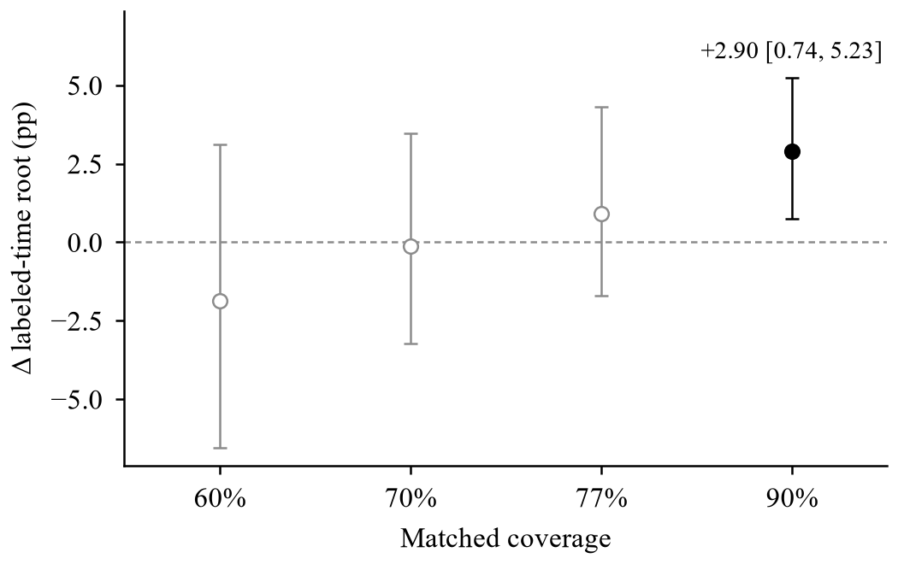
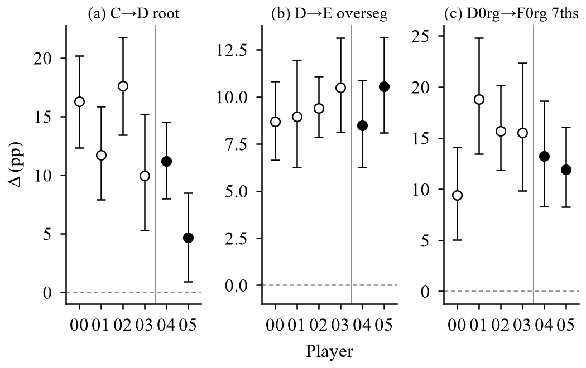
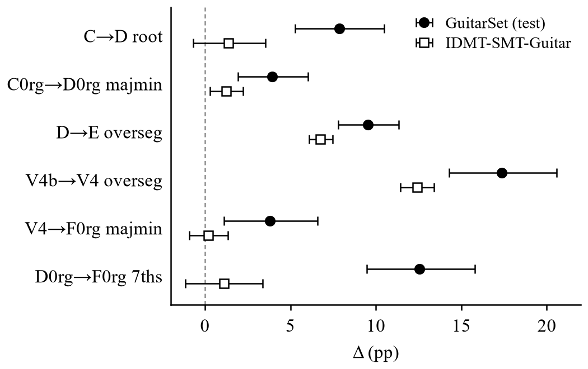

# Camera-ready ACDSA 2027 — o que mudou e como escrever

Paper ID 1766 — *Disentangling Classical DSP-Based Automatic Chord
Recognition: Component Contributions and Coverage–Accuracy Trade-offs*.
Documento para quem vai redigir a versão final. Não é preciso conhecer o
código: cada número cita o arquivo de onde sai (pasta `dados/`), e os
detalhes técnicos estão em `detalhes/`.

## 1. Resumo executivo

- **Status:** aceito com revisão menor (Reviewers #2 e #4; texto integral em `REVISOES.md`).
- **Prazo:** versão final até **30/11/2026** pelo **CMT**; PDF validado no **IEEE PDF eXpress** (Conference ID **68084X**); similaridade **< 25 %** (reescrever, não colar).
- **Rigor:** nenhuma configuração foi ajustada no teste nem nas bases externas. A calibração usou só a validação, e cada análise nova teve o protocolo commitado antes de rodar (`detalhes/ADENDO_REVISAO.md`).
- **O que mudou na mensagem do artigo:**
  1. O +7,9 p.p. de C→D é efeito da **configuração** D (decodificador + tratamento do "sem acorde") e vem do tempo que só D rotula.
  2. A diferença na máscara comum (+0,22 p.p.) é **não resolvida**, não equivalência, e a máscara seleciona o tempo fácil.
  3. A vantagem de 24 acordes em `sevenths` é **restrição do espaço de rótulos**, não melhor reconhecimento.
  4. No IDMT-SMT-Guitar, os efeitos de **segmentação** mantêm o sinal (os de `overseg`, também a classe); os principais de **acurácia** (decodificador, vocabulário) encolhem, e no IDMT-SMT-Chords invertem.
  5. O pipeline fica **abaixo** de Chordino e madmom em `root`; a contribuição é a análise de componentes.

## 2. Como ler este documento

A §3 tem uma seção por ponto do revisor, sempre com os mesmos seis campos:
o que o revisor pediu, o que fizemos, resultados (com o que **não** se pode
concluir), texto sugerido em inglês com o lugar onde entra no artigo,
figura/tabela sugerida e onde ver mais. A §4 traz as mudanças que atravessam
o artigo inteiro: resumo, introdução, correção da II-F, limitações e frases
a remover. As §§5–7 tratam de espaço, da lista final de figuras e tabelas e
das decisões que ficam com os autores.

O artigo aceito (PDF/LaTeX) não está no repositório. Por isso o destino de
cada texto sugerido é dado pela seção (II, III, IV-A…). "Localizar no
aceito" indica que o trecho exato precisa ser encontrado no PDF.

**Arquivos desta pasta**

| caminho | conteúdo |
|---|---|
| `CAMERA_READY.md` | este documento |
| `REVISOES.md` | texto integral das revisões, com os IDs R2.1–R2.6 e R4 |
| `RESPOSTA_REVISORES.md` | tabela curta em inglês para a carta de resposta |
| `figuras/` | figuras propostas (pdf + png) |
| `figuras_todas/` | todas as 13 figuras utilizáveis, conferidas contra os dados atuais, com índice em `LEIAME.md`; as que estavam em português têm versão em inglês (`*_en`) |
| `tabelas/` | tabelas e algoritmos propostos (.tex) |
| `detalhes/` | especificação, baselines, adendo (protocolos), congelamento, metodologia e resultados completos, splits |
| `dados/` | CSVs resumidos citados aqui, cada um com seu `_meta.json` (commit, seeds, configuração) |

**Glossário**

| termo | significado |
|---|---|
| C | rótulo acorde a acorde (argmax por batida) com viés pró-tríade e abstenção: devolve N quando a confiança é baixa |
| D | C + decodificação de Viterbi com um estado N ("sem acorde") |
| E | D + filtro de duração mínima (segmentos curtos absorvidos pelo vizinho) |
| C0rg, D0rg | C e D sem nenhuma fonte de N (sem abstenção e sem gate relativo de silêncio): rotulam ~100 % do tempo |
| F0rg | D0rg com 24 acordes (maior/menor) em vez de 60 (mais `7`, `maj7`, `m7`) |
| V4, V4b | baselines legados do projeto; V4b = V4 sem o termo temporal guloso (descrição em `detalhes/BASELINES.md`) |
| Chordino, madmom | baselines externos padrão (NNLS-Chroma/Chordino; CNN+CRF do madmom), rodados sem ajuste |
| `chord[0]` / `chord[1]` | as duas camadas de anotação do GuitarSet: `chord[0]` = acordes instruídos (lead sheet, camada secundária); `chord[1]` = acordes executados (camada principal do congelamento) |
| cobertura | fração do tempo em que o sistema emite um acorde (não N) |
| root rotulado | acurácia de tônica só no tempo em que o sistema emitiu acorde |
| máscara comum | tempo comparável em que nem C nem D emitiram N |
| overseg | medida de segmentação do mir_eval; **maior = menos fragmentação** (menos fronteiras espúrias) |
| confirmado ("supported") | IC 95 % do bootstrap pareado por faixa exclui zero **e** sobrevive à correção de Holm sobre as 15 comparações pré-registradas |
| frágil ("fragile") | IC exclui zero, mas Holm não confirma |
| não resolvido / empate ("unresolved") | IC cruza zero: não distinguível de zero; **não** significa equivalência |
| p.p. | pontos percentuais |

## 3. Pontos dos revisores

### R2.1 — Pouca diversidade de executantes no teste

**O que o revisor pediu.** "Limited test-set diversity and statistical
generalizability": o teste tem 58 faixas de só dois executantes (04 e 05), e o
bootstrap por faixa não captura a variação entre executantes. Pede avaliar em
mais executantes não vistos, se possível; senão, marcar os achados como
exploratórios e condicionados aos executantes, sem afirmações amplas.

**O que fizemos.**
1. *Não há mais executantes no GuitarSet.* O corpus tem exatamente seis
   executantes (00–05); os quatro primeiros (00–03, 120 faixas) foram usados
   para escolher todos os parâmetros e os dois últimos (04–05, 58 faixas; o 04
   tem 28 porque duas faixas com erro de sincronização da anotação foram
   excluídas, issue #5 do GuitarSet) são o teste. Não existe um sétimo
   executante para segurar fora.
2. *Análise por executante.* Para cada uma das 15 comparações pré-registradas,
   calculamos o Δ separadamente em cada um dos seis executantes (média ponderada
   pela duração), com IC 95 % por bootstrap **reamostrando faixas dentro do
   executante** (10 000, seed 0). Contamos em quantos executantes o Δ tem o
   mesmo sinal do Δ agregado. Script `analise_executantes.py`; método em
   `METODOLOGIA.md` §7 (seção "Análises pós-revisão"). É análise
   pós-especificada (`post_review: true` no meta); não escolhe nenhum valor e
   usa as mesmas ablações de teste já commitadas em setembro (sem nova leitura
   do teste). Ressalva importante: quatro dos seis executantes são os do
   desenvolvimento, nos quais os parâmetros foram escolhidos; a consistência
   neles não é evidência independente.
3. *Corpora externos* (detalhados na seção R4, outro sub-agente): as oito
   variantes congeladas rodaram sem nenhum ajuste no IDMT-SMT-Guitar (506
   faixas, quatro instrumentos) e no IDMT-SMT-Chords (6 faixas de guitarra),
   com protocolo commitado antes (`docs/ADENDO_REVISAO.md` §8, commit `9966d81`,
   2026-11-17 10:32; primeira avaliação externa em `ac894a9`, 11:08). Isso
   amplia instrumentos e gravações, **não** executantes identificados (o número
   de executantes do IDMT não está documentado no repositório).

**Resultados.** Os seis contrastes principais (primeira métrica de cada par
pré-registrado), por executante. ᵗ = executante do teste; \* = IC 95 % do
executante exclui zero. Coluna "teste" = Δ agregado das 58 faixas, com IC e
classe pré-registrada.

| contraste (métrica) | 00 | 01 | 02 | 03 | 04ᵗ | 05ᵗ | mesmo sinal | teste: Δ [IC 95 %], classe |
|---|---|---|---|---|---|---|---|---|
| C→D (root) | +16,3\* | +11,7\* | +17,6\* | +10,0\* | +11,2\* | +4,7\* | 6/6 | +7,88 [+5,26; +10,48], supported |
| C0rg→D0rg (root) | +2,8\* | +1,0 | +2,0 | +2,3\* | +4,0\* | +1,5 | 6/6 | +2,72 [+1,01; +4,59], supported |
| D→E (root) | −1,6 | −2,7\* | −1,4\* | −0,7 | −1,2\* | −2,1\* | 6/6 | −1,68 [−2,79; −0,66], supported |
| V4b→V4 (root) | +2,6 | −1,2 | −1,9 | +3,5\* | +1,3 | +2,1\* | 4/6 | +1,68 [+0,18; +3,25], fragile |
| V4→F0rg (root) | −0,5 | +3,0\* | +2,1 | +0,3 | +0,6 | +1,4 | 5/6 | +1,03 [−1,21; +3,40], unresolved |
| D0rg→F0rg (root) | −4,3\* | +11,1\* | +8,8\* | −2,3 | −2,4 | +0,7 | 3/6 | −0,84 [−3,96; +2,52], unresolved |

Fontes: `dados/por_executante_20261117_004132.csv` (por executante) e
`dados/stats_test_ref0_20260927_202140.csv` (coluna "teste").

Leitura:
- C→D, C0rg→D0rg e D→E têm o mesmo sinal nos seis executantes; só C→D exclui
  zero em todos os seis. Com o filtro de duração (D→E) acontece o mesmo em
  `overseg` (+8,5 a +10,6, IC exclui zero nos seis).
- O efeito do vocabulário (24 contra 60 templates, D0rg→F0rg) em `root` exclui
  zero com sinais opostos: negativo no 00, positivo no 01 e no 02. Os três
  casos que excluem zero são executantes do **desenvolvimento**; nos dois do
  teste o IC cruza zero. Em `majmin` o padrão é o mesmo (01 e 02 positivos).
  Em `sevenths` na camada `chord[0]`, ao contrário, o sinal é o mesmo nos seis
  (+9,4 a +18,8, todos com IC excluindo zero): o vocabulário de 24 acerta mais
  sétimas porque o de 60 emite sétimas falsas (ver R2.6 em `RESULTADOS.md` §7).
  Em `chord[1]` esse acordo desaparece (3/6).
- Na ponte para os corpora externos: no IDMT-SMT-Guitar os 15 Δ mantêm o sinal
  do teste do GuitarSet (15/15), mas só 4 dos 9 confirmados continuam
  confirmados (`RESULTADOS.md` §8.2).

**O que NÃO se pode concluir.** Com dois executantes no teste não há inferência
**sobre executantes**: o IC por faixa mede a incerteza dentro desses dois, e
seis executantes (quatro deles usados no ajuste) não sustentam um IC entre
executantes. "Mesmo sinal em 6/6" é consistência descritiva, não generalização
para a população de violonistas. Não se pode dizer que o vocabulário de 24 é
melhor (ou pior) em `root`: depende do executante.

**Texto sugerido para o artigo (inglês).** Destino: V (Discussão/Limitações),
novo parágrafo "Performer dependence" — localizar no aceito; uma frase-resumo
também no fim de IV.

> GuitarSet contains six performers, so no further held-out performer is
> available: performers 00–03 (120 excerpts) were used for all tuning and
> performers 04–05 (58 excerpts) form the test set. Our track-level bootstrap
> therefore quantifies uncertainty within these two test performers only, and
> all test results should be read as exploratory and performer-conditional. To
> expose performer dependence, Table [tab:executantes_ic] reports each
> pre-registered contrast separately for each of the six performers, with
> bootstrap intervals resampling tracks within performer. C→D, C0rg→D0rg and
> D→E keep the sign of the pooled effect in all six performers, and C→D
> excludes zero in every one of them. In contrast, the vocabulary contrast
> D0rg→F0rg on root excludes zero with opposite signs (negative for performer
> 00, positive for 01 and 02, all development performers) and is unresolved for
> both test performers; the effect of vocabulary size on root accuracy is
> therefore performer-dependent. Because four of the six performers were used
> for tuning, this consistency is descriptive rather than independent evidence.
> Transfer to other recordings and instruments is examined in Section [R4]:
> on IDMT-SMT-Guitar all 15 contrasts keep their GuitarSet sign, but only 4 of
> the 9 supported ones remain supported.

**Figura/tabela sugerida.** `tab_executantes.tex`, tabela `tab:executantes_ic`
(seis contrastes × seis executantes com IC) — **essencial** (é a resposta
direta). A primeira tabela do mesmo arquivo (`tab:executantes`, 15 contrastes)
é **opcional** (material suplementar). Atenção: as legendas estão em português
e precisam de versão em inglês (PENDENTE abaixo).

**Mais detalhes em.** `detalhes/RESULTADOS.md` §7 "R2.1 — Consistência entre
executantes"; `detalhes/METODOLOGIA.md` §7 (análises pós-revisão, R2.1) e §1.3
(divisão por músico); `detalhes/splits/val.txt`, `detalhes/splits/test.txt`,
`detalhes/splits/excluidas.txt`; `dados/por_executante_20261117_004132.csv`,
`dados/stats_test_ref0_20260927_202140.csv`; corpora externos em
`detalhes/RESULTADOS.md` §8 e `dados/externo_resumo_20261117_122651.csv`.

---

### R2.2 — Reprodutibilidade e detalhes de implementação

**O que o revisor pediu.** "Reproducibility and implementation details":
implementação reprodutível ou pseudocódigo, versões de software, split e
exclusões exatos, como o chroma é agregado por batida, como os templates são
construídos, regras determinísticas de desempate, e como o filtro de duração
trata bordas da faixa, vizinhos de mesma duração e reatribuição repetida.

**O que fizemos.** Escrevemos uma especificação a partir do código, linha a
linha, sem nenhum experimento novo (`ESPECIFICACAO.md`, commit `60a7f3b`,
2026-11-17), dois pseudocódigos em LaTeX (`alg_pipeline.tex`,
`alg_duracao.tex`), os arquivos de split, e testes automáticos que fixam os
casos de borda do filtro de duração (`tests/test_filtro_duracao.py`: borda,
vizinhos iguais, cadeia). Em linguagem simples, o que está especificado:

- **Versões** (lidas dos `_meta.json` das execuções de teste; idênticas em
  todas): Python 3.14.6, NumPy 2.4.6, SciPy 1.18.0, librosa 0.11.0,
  mir_eval 0.8.2. Baselines externos: Chordino (NNLS Chroma, plugin versão 5)
  via Sonic Annotator 1.7, parâmetros default; madmom 0.17.dev0 (commit
  `27f032e`) num ambiente separado com Python 3.10.20, NumPy 1.26.4,
  SciPy 1.15.3 (`BASELINES.md` §9).
- **Split**: por executante. 00–03 → validação (120 faixas), 04–05 → teste
  (58 faixas); 2 excluídas, ambas do executante 04, por erro de sincronização
  da anotação (`04_BN3-154-E_comp`, +0,409 s; `04_Jazz1-200-B_comp`, +0,309 s;
  issue #5 do GuitarSet). Total 180 = 120 + 58 + 2. As listas exatas estão em
  `detalhes/splits/`.
- **Agregação batida → chroma**: chroma CQT (36 bins/oitava, hop 512 a
  22 050 Hz, normalizado pelo máximo por quadro), filtro de mediana de 21
  quadros (~0,49 s) por classe de altura, depois **mediana** dos quadros entre
  duas batidas consecutivas. As bordas 0 e fim do áudio são sempre acrescentadas
  à lista de batidas, de modo que o trecho antes da primeira batida e depois da
  última viram segmentos próprios; uma faixa sem batida vira um único segmento.
- **Templates**: vetores binários de 12 posições (1 nas notas do acorde),
  normalizados em L2; a decisão usa cosseno. 24 templates = maior e menor × 12
  tônicas; 60 = + `7`, `maj7`, `m7`. Um viés pró-tríade subtrai
  0,06·max(0, 1 − 4·ĉ[nota de extensão]) dos acordes de quatro notas, isto é,
  penaliza a tétrade quando a nota que a distingue da tríade é fraca no chroma.
- **Desempates** (todos determinísticos): argmax → menor índice de coluna
  (ordem C, C#, …, B; maior antes de menor antes de `7`…); Viterbi → no
  retrocesso, o estado anterior de menor índice; no último quadro, o estado de
  menor índice (N, que é a última coluna, perde empates). Limiares estritos: o
  gate de confiança rotula quando o escore é igual ao limiar; o gate de RMS só
  marca silêncio se o RMS for menor que o limiar.
- **Filtro de duração** (só na variante E, `min_dur = 0,8 s`): não é uma
  varredura da esquerda para a direita. A cada passo pega o segmento **mais
  curto da faixa inteira** (empate → o mais à esquerda); se ele tem ≥ 0,8 s,
  para. Senão, ele recebe o rótulo do vizinho **mais longo** (empate de
  duração → vizinho da esquerda); na **borda** da faixa usa o único vizinho
  que existe, qualquer que seja a duração dele. Depois funde vizinhos de mesmo
  rótulo e recalcula as durações; um segmento que cresceu pode voltar a ser
  absorvido (cadeia). N é tratado como qualquer acorde. Termina em no máximo
  n − 1 passos; um único segmento curto restante sobrevive.
- **Determinismo**: o pipeline não tem nenhum componente aleatório; os únicos
  processos estocásticos são os bootstraps (seed 0, registrada).

**Resultados.** Não há número novo neste ponto: é especificação. Ver a seção
"Comportamentos não determinísticos ou não especificados" de
`ESPECIFICACAO.md`, que lista honestamente o que o código **não** fixa (defaults
de biblioteca, versões de numba/soxr/libsndfile que nenhuma meta registra,
cache de features sem versão de biblioteca, empates de ponto flutuante).

**O que NÃO se pode concluir.** Que o resultado seja idêntico em outra versão
de librosa/scipy ou em outra máquina: vários parâmetros são defaults de
biblioteca, e `requirements.txt` não fixa versões.

**Texto sugerido para o artigo (inglês).** Destino: III (Experimental setup),
novo parágrafo "Reproducibility" — localizar no aceito; os dois algoritmos
entram em II (Method) ou em material suplementar, conforme o espaço.

> **Reproducibility.** The split is by performer: performers 00–03 form the
> validation set (120 excerpts) and 04–05 the test set (58 excerpts); two
> test excerpts (04_BN3-154-E, 04_Jazz1-200-B) are excluded because of
> annotation offsets reported in GuitarSet issue #5. All runs used Python
> 3.14.6, NumPy 2.4.6, SciPy 1.18.0, librosa 0.11.0 and mir_eval 0.8.2. The
> pipeline is deterministic. Chroma (CQT, 36 bins per octave, hop 512 at
> 22.05 kHz, max-normalized per frame) is median-filtered over 21 frames and
> then aggregated per beat as the median of the frames between consecutive
> beats; the start and end of the track are always added as boundaries, so
> audio before the first and after the last beat forms its own segment.
> Templates are binary 12-dimensional pitch-class vectors, L2-normalized and
> scored by cosine similarity; four-note chords receive a penalty
> 0.06·max(0, 1 − 4ĉ_ext) when their distinguishing extension note is weak.
> Ties are broken by the lowest template index (roots C to B; major, minor,
> 7, maj7, m7), in the arg-max and in Viterbi back-tracking alike. The
> minimum-duration filter (Algorithm [alg:duracao]) repeatedly takes the
> shortest segment of the whole track (leftmost on ties) and, if it is shorter
> than 0.8 s, relabels it with its longer neighbour (left neighbour on equal
> durations, the only neighbour at track edges), merges equal neighbours and
> recomputes durations, so that a grown segment can be absorbed again; it
> stops when the shortest segment reaches 0.8 s or one segment remains.
> Library defaults not set in our code, and all other implementation details,
> are listed in the supplementary specification [URL].

**Figura/tabela sugerida.** `alg_duracao.tex` (`alg:duracao`) — **essencial**
(responde diretamente às perguntas sobre bordas, empates e reatribuição;
cabe em ~12 linhas). `alg_pipeline.tex` (`alg:pipeline`) — **opcional**
(suplementar se faltar espaço). Os dois estão em português (comentários e
legenda) e precisam ser traduzidos.

**Mais detalhes em.** `detalhes/ESPECIFICACAO.md` (§1 versões, §2 split, §3–4
agregação, §5 templates, §6 desempates, §7 filtro de duração, seção final
sobre o não especificado); `detalhes/alg_pipeline.tex`,
`detalhes/alg_duracao.tex`; `detalhes/splits/`; `detalhes/METODOLOGIA.md` §7
"Reprodutibilidade" (determinismo, oráculo, cache) e §1;
`detalhes/BASELINES.md` §9 (versões do Chordino e do madmom).

---

### R2.3 — Isolar a contribuição de cada componente

**O que o revisor pediu.** "Isolation of component contributions": C→D é
apresentado como decodificação temporal, mas o Viterbi também muda o
tratamento de "sem acorde" (N); gate, abstenção e decodificador interagem. Pede
deixar claro o que muda em cada ablação, experimentos fatoriais ou com
condições igualadas que separem suavização de abstenção e gate, ou então
interpretar como efeitos de configuração.

**O que fizemos.**
1. *Tabela de mecanismos.* Para cada contraste pré-registrado, o que muda de
   fato (a partir da tabela campo a campo de `docs/CONGELAMENTO.md` §3 e de
   `METODOLOGIA.md` §4):

| contraste | o que muda | o que **não** muda |
|---|---|---|
| C→D | decodificador (argmax por batida → Viterbi) **e** mecanismo de abstenção (limiar de confiança 0,72 → estado N do Viterbi, −2,5) | gate relativo de silêncio, vocabulário de 60 |
| C0rg→D0rg | só o decodificador, em termos funcionais (nenhum dos dois tem abstenção própria nem gate relativo; o limiar 0,72 que D0rg guarda na configuração é inerte com Viterbi) | vocabulário, piso absoluto de silêncio |
| D→E | só o filtro de duração mínima (0 → 0,8 s) | todo o resto |
| V4b→V4 | só os dois termos temporais gulosos do V4 (+0,5 por repetir o acorde anterior, −0,1 por nome mais longo) | front-end e classificador do V4 |
| V4→F0rg | toda a decisão (normalização, escore, fontes de N, Viterbi) e o filtro de mediana do chroma | vocabulário de 24, cobertura ≈ 100 % |
| D0rg→F0rg | só o vocabulário (60 → 24 templates) | decodificador, ausência de N |

2. *Fatorial 2×2×2.* Cruzamos três fatores com as oito combinações:
   decodificador (argmax C / Viterbi D) × abstenção própria (ligada/desligada:
   `confidence_gate` em C, estado N em D) × gate relativo de RMS (0,2 / 0).
   As duas células que faltavam (`Crg`, `Drg`) foram definidas sem escolher
   valor nenhum e commitadas antes de rodar no teste (`docs/ADENDO_REVISAO.md`
   §1, commit `996aabe`, 2026-11-16 23:14; execução única no teste em `b5065ef`
   / `8ca8b2e`, 23:16–23:17). Efeito principal = média das quatro diferenças
   pareadas do fator; interação = diferença de diferenças (quanto o efeito do
   decodificador muda quando a abstenção está ligada). Script
   `analise_fatorial.py`.
3. *Mesma cobertura, medida no próprio teste.* Varremos o limiar de abstenção
   de cada decodificador (C: `confidence_gate` 0 e 0,50–0,90; D: `n_logprob`
   −1 a −8, mais "N proibido") e comparamos C e D por interpolação linear nos
   alvos de cobertura 60, 70, 77 e 90 %, com IC por bootstrap pareado que
   reinterpola as curvas a cada reamostragem. Nenhum valor é escolhido.
   Protocolo commitado antes (`docs/ADENDO_REVISAO.md` §5, commit `7fb80a3`,
   2026-11-17 00:39; execução `7e782af`, 00:41). A primeira execução mostrou
   que a curva D tinha só três pontos entre 58 % e 89 % de cobertura; um
   refinamento da grade de D (8 pontos novos entre −2,25 e −2,75) foi
   registrado antes de rodar (adendo §7, commit `98ba69b`, 01:15; execução
   `c5b64ea`, 01:19). O CSV antigo foi mantido; as conclusões não mudaram
   (a 90 %: +2,90 [+0,62; +5,21] antes, +2,90 [+0,74; +5,23] depois).
4. *Casamento de cobertura escolhido na validação* (`Cmatch`, `Dmatch`, adendo
   §2): falhou no teste (Cmatch ficou 8,89 p.p. de cobertura acima de D), por
   isso a análise 3 é a principal.

**Resultados.** Teste, `chord[0]`, `root` na faixa toda salvo indicação.

| termo | Δ (p.p.) | IC 95 % | leitura |
|---|---|---|---|
| decodificador, efeito principal | +5,55 | [+3,82; +7,27] | IC exclui zero (sem Holm) |
| abstenção própria, efeito principal | −10,45 | [−12,29; −8,70] | IC exclui zero |
| gate relativo, efeito principal | −0,47 | [−1,27; +0,04] | IC cruza zero |
| decodificador × abstenção | +5,53 | [+2,89; +8,13] | IC exclui zero |
| decodificador × abstenção × gate | −0,99 | [−1,87; −0,28] | IC exclui zero, pequeno |
| decodificador, efeito principal em root **rotulado** | −1,40 | [−3,78; +0,99] | IC cruza zero |
| células: D0 − C0 (sem abstenção, com gate) | +2,84 | — (diferença de células) | — |
| C0rg→D0rg (pré-registrado) | +2,72 | [+1,01; +4,59] | supported |
| C→D (pré-registrado) | +7,88 | [+5,26; +10,48] | supported |

Fonte: `dados/fatorial_20261117_004134.csv` (linhas `split=test`,
`ref_camada=chord[0]`); pré-registrados de
`dados/stats_test_ref0_20260927_202140.csv`. Na validação o padrão é o mesmo,
mais forte (decodificador +8,02 [+6,54; +9,52]; interação +12,02 [+9,85;
+14,26]).

C contra D na mesma cobertura (teste, `root` no tempo rotulado; entre
parênteses, `root` na faixa toda):

| cobertura | C | D | Δ = D − C [IC 95 %] | Δ faixa toda [IC 95 %] |
|---|---|---|---|---|
| 60 % | 63,90 | 62,03 | −1,87 [−6,54; +3,11] | −1,19 [−3,71; +1,08] |
| 70 % | 60,73 | 60,60 | −0,13 [−3,22; +3,48] | −0,21 [−2,20; +1,91] |
| 77 % | 58,87 | 59,78 | +0,91 [−1,71; +4,30] | +0,74 [−1,20; +3,12] |
| 90 % | 56,65 | 59,55 | +2,90 [+0,74; +5,23] | +2,67 [+0,91; +4,52] |

Fonte: `dados/cobertura_igualada_teste_20261117_011711.csv` (grade refinada;
10 000 reamostragens válidas em todos os alvos). Coberturas observadas das
configurações congeladas: C 57,10 %, D 77,12 % (`RESULTADOS.md` §2).

Leitura: o ganho do Viterbi depende quase todo da abstenção. Com a abstenção
de cada decodificador ligada, D − C vale +7,88; sem ela, +2,84 (com gate) ou
+2,72 (sem gate, o par pré-registrado). Comparados na mesma cobertura, C e D
não se distinguem até 77 % e D fica cerca de 3 p.p. à frente a 90 %, ou seja,
quando os dois rotulam quase tudo. O gate relativo muda `root` em menos de
meio ponto em média.

**O que NÃO se pode concluir.**
- Que C e D sejam **equivalentes** em 60–77 %: o IC cruza zero, o que é "não
  resolvido", não "igual" (os IC têm até ~10 p.p. de largura).
- Que C→D meça o decodificador: é um contraste de **configuração**, em que a
  cobertura domina.
- Que os ~3 p.p. a 90 % generalizem: quatro alvos sem correção múltipla,
  valores de D interpolados, dois executantes de teste.
- O fatorial não tem Holm; nada nele é "supported".

**Texto sugerido para o artigo (inglês).** Destino: IV (Results), subseção da
ablação, substitui a interpretação atual de C→D como "temporal smoothing" —
localizar no aceito. A primeira frase também cabe em II, onde as variantes são
definidas.

> C→D changes two mechanisms at once: the decoder (per-beat arg-max vs.
> Viterbi) and the no-chord mechanism (a confidence threshold in C vs. an
> explicit N state in D); Table [tab:mecanismos] lists what differs in each
> contrast. To separate decoding from abstention, Table [tab:fatorial] reports
> a 2×2×2 factorial over decoder, decoder-specific abstention, and relative
> silence gate on the test set. The decoder main effect on root is +5.55 pp
> (95% CI [3.82, 7.27]), but it interacts with abstention (+5.53 pp,
> [2.89, 8.13]): with each decoder's own abstention enabled, Viterbi adds
> +7.88 pp, whereas without it Viterbi adds +2.84 pp (+2.72 pp, [1.01, 4.59],
> in the pre-registered C0rg→D0rg contrast). The relative gate changes root by
> less than 0.5 pp on average. Comparing both decoders along their coverage
> curves on the test set (Fig. [fig_cobertura_igualada]), labeled-time accuracy
> is unresolved at 60%, 70% and 77% coverage and higher for Viterbi at 90%
> (+2.90 pp, [0.74, 5.23]). C→D is therefore a configuration-level contrast in
> which coverage dominates; the decoder's own contribution is resolved only
> at 90% coverage (about 3 pp) and is unresolved at 60–77%. These analyses
> were specified after the reviews, with protocols committed before any test
> run, and are not corrected for multiple comparisons.

**Figura/tabela sugerida.**
- `fig_cobertura_igualada.pdf` — **essencial** (os quatro Δ com IC; só o de
  90 % exclui zero). Já está em inglês e no estilo comum (§6.1).
  `fig_cobertura_teste.pdf` (as curvas inteiras, rótulos em português) passa
  ao suplementar.
- `tab_fatorial.tex` — **essencial em forma compacta**: o arquivo atual é
  `table*` (duas colunas) com val e teste; para o artigo basta o bloco de
  teste, ou só as linhas de efeitos. PENDENTE: versão compacta em inglês.
- `tab_cobertura_igualada.tex` — **opcional** (os números cabem no texto).
- Tabela de mecanismos (acima) — **recomendada**, curta; PENDENTE: não existe
  `.tex`.

**Mais detalhes em.** `detalhes/RESULTADOS.md` §7 "R2.3 — Fatorial 2×2×2 e
cobertura igualada" (atenção à discrepância 1 abaixo), §1 e §1.1;
`detalhes/METODOLOGIA.md` §4 (variantes e as três fontes de N) e §7 (R2.3);
`detalhes/ADENDO_REVISAO.md` §1, §2, §5, §7; `detalhes/CONGELAMENTO.md` §3;
`dados/fatorial_20261117_004134.csv`,
`dados/cobertura_igualada_teste_20261117_011711.csv`,
`dados/curvas_teste_20261117_011711.csv`,
`dados/cobertura_igualada_20261117_004134.csv`,
`dados/stats_test_ref0_20260927_202140.csv`. Decomposição complementar do ganho
(R2.4) fica com o outro sub-agente.

---

### R2.4 — Máscara comum C–D: definição, tamanho e viés de seleção

**O que o revisor pediu.** "the reported C–D common-mask difference is only
+0.22 pp, 95% CI [−1.74, 2.10]; does not establish improvement or
equivalence." Pede: definir a máscara e a agregação de forma reproduzível,
informar quantas faixas e quanto tempo ficam nela, discutir o viés de seleção
(o tempo que os dois rotulam pode ser o mais fácil) e não ler resultado não
significativo como equivalência.

**O que fizemos.**

1. *Definição.* A "máscara comum" é o conjunto das células de batida
   comparáveis (no nível `root`, camada `chord[0]`) em que **nem C nem D**
   devolveu `N` — o tempo em que os dois se comprometeram com um acorde
   (`METODOLOGIA.md` §6.7). Dentro dela, a acurácia de cada sistema é
   Σ tempo acertado / Σ tempo na máscara (agregação por duração, a mesma do
   resto do artigo).
2. *Decomposição exata.* Dividimos todo o tempo comparável do teste em quatro
   regiões — rotulado por ambos, só por D, só por C, por nenhum — e medimos
   quanto cada região contribui para o Δ`root`(C→D) de +7,88 p.p. da faixa
   toda. A soma das quatro parcelas reproduz o +7,88 (resíduo 4e-11).
3. *Viés de seleção.* Para saber se o tempo da máscara é "mais fácil",
   usamos uma configuração que rotula praticamente tudo (D0rg, cobertura
   100 %) e medimos o acerto dela dentro e fora da máscara, com bootstrap
   pareado por faixa.
4. *Reconciliação 45,9 % × 48,7 %.* As duas frações contam as mesmas células;
   45,87 % é a média simples por faixa (peso 1 por faixa), 48,68 % é a razão
   de somas de tempo. O número correto para "fração do tempo de teste" é
   **48,7 %** (é a agregação usada em todo o artigo).

Tudo isso é **pós-especificado** (concebido depois de ler o teste) e não
substitui nenhuma comparação pré-registrada. A máscara comum existe desde
`f1a5126` (2026-09-27); a decomposição e o viés de seleção entraram em
`bc001a8`/`8166c8e` (2026-11-17) e a versão agregada por duração do viés em
`9a4ae0a` (2026-11-17 14:28). Não há congelamento anterior ao teste para
estas análises: são diagnósticas.

**Resultados.**

Tamanho da máscara (origem: `decomposicao_20261117_004137.csv`;
`vies_selecao_agregado_20261117_142816.csv`; `mascara_comum_20260927_202401.csv`):

| split | faixas na máscara | tempo na máscara | tempo comparável total | fração (por duração) | fração (média por faixa) |
|---|---|---|---|---|---|
| val | 120 de 120 | 2021,1 s | 3656,2 s | 55,3 % | 54,1 % |
| teste | 58 de 58 | 870,8 s | 1788,7 s | 48,7 % | 45,9 % |

Decomposição do Δ`root`(C→D) no teste (`decomposicao_20261117_004137.csv`):

| região | % do tempo | faixas | root C | root D | parcela de Δ [IC 95 %] |
|---|---|---|---|---|---|
| rotulada por ambos (máscara) | 48,7 | 58 | 77,57 | 77,78 | +0,11 [−0,80; +1,04] |
| só por D | 28,4 | 58 | — | 40,51 | +11,52 [+9,43; +13,70] |
| só por C | 8,4 | 42 | 44,58 | — | −3,75 [−4,93; −2,69] |
| por nenhum | 14,5 | 39 | — | — | 0 |
| **soma** | 100 | | | | **+7,88** |

Dentro da máscara, a diferença de acurácia é +0,22 p.p. [−1,74; +2,10]
(`mascara_comum_20260927_202401.csv`; D melhor em 22 faixas, pior em 25,
igual em 11); a parcela +0,11 é essa mesma diferença pesada pela fração do
tempo que a máscara ocupa (≈ 0,22 × 0,487). Na validação: +0,79
[−0,91; +2,42].

Viés de seleção (`vies_selecao_agregado_20261117_142816.csv`; D0rg, `root`):

| split | dentro da máscara | fora da máscara | Δ dentro − fora [IC 95 %] |
|---|---|---|---|
| val | 80,15 % | 48,07 % | +32,08 [+27,64; +36,43] |
| teste | 77,80 % | 38,69 % | +39,11 [+32,04; +45,25] |

Leitura: o ganho de +7,88 p.p. do Viterbi vem quase todo do tempo que **só D**
rotula (+11,52), parcialmente devolvido pelo tempo que só C rotula (−3,75).
Onde os dois rotulam, a diferença não se distingue de zero — mas esse tempo
é muito mais fácil (um sistema que rotula tudo acerta 77,8 % ali e 38,7 % no
resto). **O que NÃO se pode concluir:** que C e D sejam equivalentes onde
ambos rotulam (o IC tem 3,8 p.p. de largura e não foi feito teste de
equivalência), nem que seriam equivalentes no tempo difícil, que a máscara
exclui por construção. Atenção: o número antigo "+18,29" (média das
diferenças por faixa, `vies_selecao_20261117_004137.csv`) está substituído
pelo +39,11 e não deve aparecer no artigo.

**Texto sugerido para o artigo (inglês).** Seção IV-A (resultados do
decodificador; localizar no aceito o parágrafo da máscara comum e substituí-lo).

> C→D raises full-track root accuracy by 7.88 pp (95% CI [5.26, 10.48]); the
> sign is the same for all six GuitarSet performers (four in validation, two
> in test: +11.2 and +4.7 pp). Table [tab:decomposicao] decomposes this
> difference exactly over the comparable test time (58 excerpts, 1788.7 s).
> We define the common mask as the beat cells, comparable at the root level,
> where neither C nor D outputs N; accuracy within it is the duration-weighted
> ratio of correctly labeled time to masked time. The mask retains all 58 test
> excerpts and 870.8 s, i.e. 48.7% of comparable time (45.9% if each excerpt
> is weighted equally). Within it, root accuracy is 77.6% for C and 77.8% for
> D (difference +0.22 pp, [−1.74, 2.10]; contribution to the full-track
> difference +0.11 pp, [−0.80, 1.04]). The 28.4% of time labeled only by D is
> scored at 40.5% and contributes +11.52 pp, while the 8.4% labeled only by C
> (scored at 44.6% by C) contributes −3.75 pp. The jointly labeled time is
> easier: D0rg, which labels all time, scores 77.8% inside the mask and 38.7%
> outside it (+39.1 pp, [32.0, 45.3]). The common-mask comparison therefore
> neither establishes that C and D are equivalent where both commit, since
> its interval spans almost 4 pp and no equivalence test was run, nor says
> anything about the harder cells it excludes. All mask analyses are
> post hoc.

**Figura/tabela sugerida.** `tabelas/tab_decomposicao.tex` — **essencial**
(já traz a nota de viés de seleção). Opcional: `figuras/fig_cobertura_acerto.pdf`
(se o aceito já tiver a curva acerto × cobertura, não precisa outra).

**Mais detalhes em.** `detalhes/METODOLOGIA.md` (§6.7), `detalhes/RESULTADOS.md`
(§1.1 e §7 R2.4), `dados/decomposicao_20261117_004137.csv`,
`dados/mascara_comum_20260927_202401.csv`,
`dados/vies_selecao_agregado_20261117_142816.csv`,
`dados/por_executante_20261117_004132.csv`.

---

### R2.5 — Vocabulário 24 × 60: restrição do espaço de rótulos, não reconhecimento

**O que o revisor pediu.** "The reported advantage of the smaller vocabulary
at the secondary annotation layer's sevenths metric is therefore partly a
consequence of the smaller system avoiding false seventh-chord predictions. It
does not show better recognition of seventh chords." Pede: deixar explícito
que é restrição do espaço de rótulos, e reportar (a) desempenho no espaço
maior/menor compartilhado, (b) precisão e revocação de sétimas, (c) que fração
do tempo de referência cada vocabulário consegue representar.

Nota para o colega: a camada principal do congelamento é `chord[1]`; a
"secondary annotation layer" do revisor é `chord[0]`, onde está a vantagem de
24 em `sevenths` (+12,56, confirmada). Em `chord[1]` o teste dá empate com
sinal contrário (−5,33). O revisor está certo.

**O que fizemos.** Comparação F0rg (24 acordes) × D0rg (60 acordes): as duas
rotulam ~100 % do tempo e diferem **só** no vocabulário. Três medidas novas,
pós-especificadas (`bc001a8`, reexecutadas em `7bc182e`, 2026-11-17; IC das
sétimas no protocolo `7fb80a3`; linha do IDMT em `3eb628f`):

1. *Representabilidade*: fração do tempo de referência cuja qualidade é
   exatamente maior/menor (o que 24 acordes conseguem acertar) ou
   maior/menor/7/maj7/m7 (o que 60 conseguem). Baixo/inversão ignorado.
2. *Precisão e revocação de sétimas* de D0rg (acerto = mesma tônica e mesma
   qualidade de sétima), ponderadas por tempo, com IC por bootstrap de faixas.
   F0rg não emite sétima: precisão indefinida, revocação 0.
3. *Espaço compartilhado*: o nível `majmin` do mir_eval compara só tônica e
   maior/menor; um `G7` de referência conta como `G` maior. Nele, os dois
   vocabulários competem nas mesmas condições.

**Resultados.**

Representabilidade, % do tempo de referência
(`representabilidade_20261117_004150.csv`; `representabilidade_externo_20261117_143045.csv`):

| referência | 24 (maj/min) | 60 (+7/maj7/m7) |
|---|---|---|
| GuitarSet `chord[0]`, teste | 86,27 | 95,42 |
| GuitarSet `chord[1]`, teste | 37,02 | 59,15 |
| IDMT-SMT-Guitar (N no denominador) | 50,79 | 73,78 |

(IDMT-SMT-Guitar sem o tempo de N: 57,63 e 83,71; N ocupa 11,87 % e power
chords 8,21 %.)

Precisão / revocação de sétimas de D0rg, teste
(`setimas_20261117_004150.csv`, `setimas_resumo_20261117_004150.csv`):

| camada | tempo de sétima emitido | tempo de sétima na ref. | precisão [IC] | revocação [IC] |
|---|---|---|---|---|
| `chord[0]` | 908,5 s | 163,7 s | 3,29 [1,70; 5,15] | 18,28 [11,75; 24,30] |
| `chord[1]` | 908,5 s | 395,9 s | 14,18 [9,18; 19,59] | 32,54 [24,20; 40,44] |

Dos 908,5 s de sétima emitidos, 671,7 s são `maj7`, qualidade que `chord[0]`
nunca contém. F0rg: revocação 0 nas duas camadas.

Δ = F0rg − D0rg (24 − 60) por nível
(`transferencia_20261117_122651.csv` e `RESULTADOS.md` §4):

| nível | GuitarSet teste `chord[0]` | GuitarSet teste `chord[1]` | IDMT-SMT-Guitar |
|---|---|---|---|
| `root` | −0,84 [−3,96; +2,52] empate | (igual a chord[0]) | −2,60 [−3,77; −1,46] confirmado |
| `majmin` (espaço compartilhado) | −1,42 [−4,70; +1,85] empate | −3,68 [−8,14; +0,62] empate | −3,72 [−5,18; −2,29] confirmado |
| `sevenths` | +12,56 [+9,48; +15,80] confirmado | −5,33 [−12,07; +1,00] empate | +1,10 [−1,15; +3,36] empate |

Leitura: a única vantagem de 24 é em `sevenths` na camada `chord[0]`, cuja
referência é 86 % tríade. Lá, D0rg emite cinco vezes mais tempo de sétima do
que existe na referência e acerta 3 % dele; F0rg simplesmente não pode
cometer esse erro. Pelo menos 9,43 p.p. dos 19,03 p.p. que D0rg perde entre
`majmin` e `sevenths` são sétimas emitidas sobre tríades (piso dedutivo,
`RESULTADOS.md` §4). No espaço maior/menor compartilhado, 24 não é melhor em
nenhuma referência (empate no GuitarSet; pior, confirmado, no
IDMT-SMT-Guitar). **O que NÃO se pode concluir:** que 24 acordes reconheçam
sétimas melhor (não reconhecem nenhuma), nem que os dois vocabulários sejam
equivalentes em `majmin` no GuitarSet (empate, não equivalência), nem que 60
seja melhor em `chord[1]` (empate).

**Texto sugerido para o artigo (inglês).** Seção IV (subseção do vocabulário;
localizar no aceito o parágrafo "24 vs 60 templates"), substituindo a leitura
de "melhor reconhecimento de sétimas".

> The 24-template system cannot output a seventh chord, so its advantage at
> the sevenths level reflects a restricted label space, not better
> recognition. On the chord[0] test reference, F0rg (24) exceeds D0rg (60) by
> 12.56 pp at sevenths ([9.48, 15.80]), but the reference is mostly triadic:
> major/minor qualities cover 86.3% of its time and the 60-chord vocabulary
> covers 95.4% (chord[1]: 37.0% and 59.2%; IDMT-SMT-Guitar: 50.8% and 73.8%).
> D0rg emits 908 s of seventh labels against 164 s of reference sevenths, with
> seventh precision 3.3% ([1.7, 5.1]) and recall 18.3% ([11.7, 24.3]) on
> chord[0] (14.2% and 32.5% on chord[1]); F0rg has zero seventh recall by
> construction. Each false seventh on a triad is penalized at the sevenths
> level, which F0rg cannot incur. In the shared major/minor label space
> (majmin level), the difference is unresolved on GuitarSet test (−1.42 pp,
> [−4.70, 1.85] on chord[0]; −3.68 pp, [−8.14, 0.62] on chord[1]), and on the
> performed-chord layer the sevenths difference is also unresolved (−5.33 pp,
> [−12.07, 1.00]). We therefore do not claim that either vocabulary recognizes
> chords better; the observed trade-off is between avoiding false seventh
> labels and being able to represent the sevenths that the reference
> contains.

**Figura/tabela sugerida.** `tabelas/tab_vocabulario.tex` (`tab:vocabulario`:
representabilidade + P/R de sétimas) — **essencial**. Opcional: a linha do
IDMT-SMT-Guitar (50,79 / 73,78) não está no `.tex`; acrescentá-la exige
regenerar a tabela pelo script (PENDENTE, sessão principal).

**Mais detalhes em.** `detalhes/RESULTADOS.md` (§4, §7 R2.5 e R2.6),
`detalhes/METODOLOGIA.md` (§5.1 níveis do mir_eval; §7),
`dados/representabilidade_20261117_004150.csv`,
`dados/representabilidade_externo_20261117_143045.csv`,
`dados/setimas_20261117_004150.csv`, `dados/setimas_resumo_20261117_004150.csv`,
`dados/transferencia_20261117_122651.csv`.

---

### R2.6 — Força dos baselines e justiça da comparação

**O que o revisor pediu.** "Baseline strength and comparison fairness":
documentar com precisão os algoritmos V4 e V4b e seus parâmetros, justificar a
justiça da comparação, incluir se possível um baseline publicado/padrão mais
forte, e avaliar a sensibilidade à calibração da penalidade de transição por
vocabulário.

**O que fizemos.**
1. *V4 e V4b descritos a partir do código* (`BASELINES.md`; `tab_baselines.tex`).
   Em linguagem simples: os dois usam a mesma extração das variantes C–F
   (separação harmônico/percussivo com margem 3,0, batidas no componente
   percussivo, chroma CQT com 36 bins/oitava, mediana entre batidas), mas
   **sem** o filtro de mediana temporal. O chroma de cada batida é dividido
   pelo seu máximo e cada uma das 24 tríades (maior/menor) recebe o escore
   "energia nas 3 notas do acorde − 0,6 × energia fora + 0,15". V4 soma dois
   termos gulosos que olham só o rótulo anterior: +0,5 se repetir o acorde e
   −0,1 se o nome do candidato tiver mais caracteres que o anterior (efeito
   que depende da grafia em sustenidos, não da qualidade do acorde). V4b é o
   V4 sem esses dois termos, ou seja, cada batida decidida sozinha. A única
   fonte de N é soma do chroma < 0,1 (silêncio digital). Desempate: o primeiro
   na ordem C, Cm, C#, … Todas as constantes são literais do código legado
   (`legacy_v4.py`, não editado); o +0,15 e um limiar de 0,25 não têm efeito
   na prática.
2. *Baselines de terceiros, sem nenhum ajuste* (protocolo `docs/ADENDO_REVISAO.md`
   §8, commit `9966d81`, antes de qualquer execução): Chordino (templates sobre
   NNLS chroma, sem treino) e madmom (CNN + CRF maior/menor, Korzeniowski &
   Widmer 2016, treinado em Isophonics, RWC Popular e Robbie Williams; não viu
   GuitarSet nem IDMT). Avaliados com o mesmo mir_eval e as mesmas referências.
3. *Sensibilidade à penalidade de transição por vocabulário.* Na validação,
   varremos `change_penalty` ∈ {0,5; 1; 1,5; 2; 2,5; 3; 4; 6} para D0rg (60) e
   F0rg (24) e escolhemos o melhor `root` para cada vocabulário; os valores
   foram congelados antes do teste (adendo §3, commit `996aabe`) e as versões
   `_cal` rodaram uma vez no teste.

**Resultados.**

GuitarSet teste, 58 faixas, % ponderado por duração (`chord[0]`):

| sistema | root | root rotulado | cobertura | majmin |
|---|---|---|---|---|
| melhor variante (D0rg) | 57,7 | 57,7 | 100,0 | 53,5 |
| F0rg | 56,9 | 56,9 | 100,0 | 52,1 |
| V4 | 55,9 | 55,9 | 100,0 | 48,3 |
| V4b | 54,2 | 54,2 | 100,0 | 47,4 |
| Chordino | 66,5 | 67,4 | 98,7 | 62,5 |
| madmom | 73,1 | 76,8 | 93,1 | 71,3 |

Fonte: `dados/externo_resumo_20261117_122651.csv` (linhas `base=gs_test`).
Os dois baselines de terceiros superam todas as variantes em `root`; não há
teste formal entre pipeline e baselines (é descritivo).

Contrastes pré-registrados que envolvem os baselines legados (teste):
V4b→V4 `root` +1,68 [+0,18; +3,25], fragile; V4b→V4 `overseg` +17,36
[+14,29; +20,57], supported; V4→F0rg `root` +1,03 [−1,21; +3,40],
unresolved; V4→F0rg `majmin` +3,81 [+1,11; +6,58], supported
(`dados/stats_test_ref0_20260927_202140.csv`).

Penalidade de transição. Validação (`root`, %), de
`dados/calibracao_revisao_20261116_231220.csv` via `docs/ADENDO_REVISAO.md` §3:
o padrão congelado 2,0 não era o ótimo em nenhum vocabulário; o melhor foi
1,5 para 60 (66,78 contra 65,80; +0,98 dentro da amostra) e 1,0 para 24
(70,52 contra 69,15; +1,37). Teste (`dados/transicao_20261117_004150.csv`):

| par | Δ root [IC 95 %] | Δ majmin (`chord[0]`) [IC 95 %] | leitura |
|---|---|---|---|
| D0rg (cp 2,0) → D0rg_cal (cp 1,5) | +0,31 [−0,25; +0,88] | +0,31 [−0,29; +0,89] | IC cruza zero |
| F0rg (cp 2,0) → F0rg_cal (cp 1,0) | +0,55 [−0,48; +1,58] | −0,09 [−0,87; +0,67] | IC cruza zero |

Na validação, a vantagem de 24 sobre 60 em `root` fica entre +2,81 (cp 6) e
+4,08 (cp 0,5) em todos os oito valores (`dados/transicao_20261117_004150.csv`,
linhas `curva_val`): a ordem entre os vocabulários na validação não vem de um
cp específico. No teste, D0rg→F0rg `root` é não resolvido (−0,84 [−3,96;
+2,52]) com cp 2,0; depois da calibração os valores pontuais ficam 58,04 (60) e
57,44 (24) (`media_cal` no mesmo CSV), sem IC para essa diferença (PENDENTE).

**O que NÃO se pode concluir.**
- Nunca que o pipeline supera ou empata com Chordino/madmom: no GuitarSet
  teste eles ficam 8,8 e 15,4 p.p. acima da melhor variante em `root`. (Há
  células isoladas em que uma variante passa o Chordino, p. ex. `sevenths`;
  sem teste formal, **não** usar no texto.)
- Que a calibração por vocabulário "não importa": o teste não resolve ganhos
  dessa ordem (≤ ~1,6 p.p. no limite superior), e a calibração só foi feita
  nas variantes sem estado N. A sensibilidade de D e E (com estado N) a cp
  **não** foi testada no GuitarSet; o colapso para N no IDMT-SMT-Chords,
  explicado pela relação entre cp e o custo de N (`RESULTADOS.md` §8.6), mostra
  que essa sensibilidade existe fora do GuitarSet (detalhe no R4).
- Justiça V4 × C–F: as configurações C–F foram escolhidas na validação; as
  constantes do V4 são literais do código legado e **não** foram reajustadas
  neste estudo. A assimetria favorece C–F, e mesmo assim V4→F0rg em `root` é
  não resolvido.

**Texto sugerido para o artigo (inglês).** Destino: III (Experimental setup),
subseção dos baselines, substitui a descrição atual de V4/V4b; o segundo
parágrafo vai para IV (Results) junto da tabela principal — localizar no
aceito.

> **Baselines.** V4 and V4b share our front end (HPSS with margin 3.0, beat
> tracking on the percussive part, 36-bin CQT chroma, median aggregation
> between beats) but apply no temporal median filter (Table [tab:baselines]).
> Each beat's chroma ĉ is max-normalized and every major and minor triad T
> (24 labels) is scored as Σ_{k∈T} ĉ_k − 0.6 Σ_{k∉T} ĉ_k; ties go to the first
> label in the order C, Cm, C#, …, B, Bm, and the only no-chord output is a
> beat whose chroma sum is below 0.1. V4 adds two greedy terms that look only
> at the previous output: +0.5 for repeating it and −0.1 for a candidate whose
> name is longer than the previous label. V4b removes both terms and labels
> each beat independently. All V4 constants are literals of the legacy code
> and were not re-tuned in this study, whereas variants C–F were selected on
> the validation performers; the comparison therefore favours C–F. As
> stronger, standard references we ran Chordino (NNLS chroma with templates,
> default parameters) and the pretrained madmom CNN+CRF major/minor model,
> without any adjustment; neither was trained on GuitarSet.
>
> On the GuitarSet test set, both third-party systems outperform every
> variant in root accuracy (Chordino 66.5%, madmom 73.1%, best variant D0rg
> 57.7%; Table [tab:principal]). Our results are therefore an ablation of a
> lightweight template pipeline, not a claim of state-of-the-art accuracy. The
> transition penalty, fixed at 2.0 before testing, was not optimal on
> validation for either vocabulary (best: 1.5 for 60 chords, 1.0 for 24), but
> the calibrated values change test root accuracy by +0.31 pp ([−0.25, 0.88])
> and +0.55 pp ([−0.48, 1.58]), both unresolved. On validation, the 24-chord
> vocabulary leads the 60-chord one in root at all eight penalties tested
> (+2.81 to +4.08 pp), so the vocabulary ordering there does not depend on the
> penalty; on test the vocabulary contrast is unresolved. Sensitivity of the
> N-state variants (D, E) to the penalty was not calibrated on GuitarSet.

**Figura/tabela sugerida.**
- `tab_principal.tex` (`tab:principal`; 8 variantes + Chordino + madmom no
  teste) — **essencial** (provavelmente já coberta pelo sub-agente do R4;
  coordenar para não duplicar).
- `tab_baselines.tex` (`tab:baselines`) — **essencial** (é o "documentar V4 e
  V4b"); em português, precisa de tradução.
- `fig_transicao.pdf` — **opcional** (curvas root × cp na validação, com os
  pontos de teste); rótulos em português.

**Mais detalhes em.** `detalhes/BASELINES.md` (§1–8 V4/V4b com
`arquivo:linha`; §9 Chordino e madmom: versões, parâmetros, corpora de
treino); `detalhes/ADENDO_REVISAO.md` §3 (grade e escolha de cp) e §8
(protocolo dos baselines externos); `detalhes/RESULTADOS.md` §7 "R2.6" e §8.1;
`detalhes/METODOLOGIA.md` §8 (limitação: cp nunca ablacionado no
pré-registro) e §9.2; `dados/externo_resumo_20261117_122651.csv`,
`dados/transicao_20261117_004150.csv`,
`dados/calibracao_revisao_20261116_231220.csv`,
`dados/stats_test_ref0_20260927_202140.csv`,
`dados/baseline_chordino_20261117_111656_ref0.csv` e
`dados/baseline_madmom_20261117_122203_ref0.csv` (GuitarSet teste, `chord[0]`).

---

### R4 — Só GuitarSet, só dois executantes no teste

**O que o revisor pediu.** "only GuitarSet, two test performers; bootstrap
conditional on performers." Sugere estender a outras bases (mais
executantes, gêneros, condições de gravação) e verificar se os efeitos e
compromissos dos componentes se mantêm sob outros esquemas de anotação e
condições acústicas.

**O que fizemos.**

1. *Protocolo congelado antes de rodar.* `docs/ADENDO_REVISAO.md` §8, commit
   `9966d81` (2026-11-17 10:32), registrado **antes** de qualquer execução nas
   bases externas (as variantes rodaram depois: `ac894a9`, 11:08). Regra:
   **nada é ajustado fora do GuitarSet** — rodam as oito variantes já
   congeladas (V4, V4b, C, D, E, C0rg, D0rg, F0rg), com os mesmos
   hiperparâmetros do teste; os 15 contrastes pré-registrados são recalculados
   com o mesmo bootstrap e Holm sobre 15. "Transfere" = mesmo sinal do Δ do
   GuitarSet teste.
2. *Duas bases novas.*
   - **IDMT-SMT-Guitar** (subconjunto 4): 506 gravações avaliáveis, 11 761,3 s
     anotados; quatro instrumentos (guitarra elétrica Career SG, Ibanez 2820,
     violão com microfone, violão com captador), duas velocidades de execução
     (fast/slow), oito estilos, andamentos nominais de 50 a 200 BPM; anotação
     por tempo de batida, com esquema de rótulos próprio (157 rótulos,
     traduzidos para Harte).
   - **IDMT-SMT-Chords** (só `guitar/`): 6 gravações de 546 s, troca de acorde
     a cada ~2 s (273 segmentos por faixa). Com 6 faixas, IC são descritivos.
3. *Dois baselines de terceiros*, sem ajuste: Chordino e madmom (CNN+CRF,
   treinado em Isophonics, RWC Popular e Robbie Williams — não viu nenhuma
   das três bases).
4. *Diagnósticos fixados antes de rodar* (adendo §9, `8d94000`, 13:55):
   (a) beat tracking contra o andamento nominal no IDMT-SMT-Guitar,
   descritivo e sem Holm; (b) por que D colapsa para `N` no IDMT-SMT-Chords.

**Resultados.** Seis contrastes principais (`tab_transferencia_curta`;
origem `transferencia_20261117_122651.csv`). S = confirmado com o sinal do
GuitarSet; R = confirmado invertido; U = IC cruza zero; F = frágil.

| contraste | GuitarSet teste | IDMT-SMT-Guitar [IC 95 %] | IDMT-SMT-Chords |
|---|---|---|---|
| C→D `root` | +7,9 S | +1,4 [−0,7; +3,5] U | −67,9 R |
| C0rg→D0rg `majmin` | +3,9 S | +1,3 [+0,3; +2,2] F | −8,7 R |
| D→E `overseg` | +9,5 S | +6,8 [+6,1; +7,5] S | 0 (D = E) |
| V4b→V4 `overseg` | +17,4 S | +12,4 [+11,4; +13,4] S | +0,01 S |
| V4→F0rg `majmin` | +3,8 S | +0,2 [−0,9; +1,3] U | −5,3 R |
| D0rg→F0rg `sevenths` | +12,6 S | +1,1 [−1,1; +3,4] U | −30,9 R |

- IDMT-SMT-Guitar: os 15 Δ mantêm o sinal (15/15); dos 9 confirmados no
  GuitarSet, 4 se confirmam (C→D `root_rotulado`, D→E `root`, D→E `overseg`,
  V4b→V4 `overseg`), 5 encolhem para empate ou frágil.
- Por guitarra (`transferencia_guitarra_20261117_122651.csv`): `overseg` de
  D→E (+5,9 a +7,3) e de V4b→V4 (+10,7 a +13,6) com IC acima de zero nas
  quatro; C→D `root` muda de sinal entre guitarras (−1,2 a +4,0), sempre com IC
  cruzando zero.
- Beat tracking (`beat_tracking_idmt_20261117_135654.csv`,
  `beat_tracking_contrastes_20261117_135654.csv`): razão estimado/nominal ~1
  em 326 faixas, erro de oitava em 105 (47 dobradas, 58 pela metade), outra
  razão em 75. Descritivo, sem Holm: D→E `overseg` +7,08 (~1) vs +6,97
  (oitava), V4b→V4 `overseg` +12,46 vs +12,08, todos com IC acima de zero; os
  contrastes de acurácia têm IC cruzando zero nos dois grupos; V4→F0rg
  `majmin` troca de sinal no grupo de oitava (−1,96 [−4,04; +0,14]), também
  com IC cruzando zero. As 75 faixas "outro" não entram nessa comparação.
- IDMT-SMT-Chords: D e E ficam com cobertura de 8,4 % (`root` 5,8 %), contra
  89,3 % de C (`externo_resumo_20261117_122651.csv`). Mecanismo
  (`mecanismo_n_20261117_143154.csv`): a referência troca de acorde em 98,9 %
  das células de batida (1 célula por segmento); seguir os acordes custa
  change_penalty = 2,0 por célula, ficar em `N` custa a diferença entre a
  melhor emissão e β, mediana 1,20 por célula — então `N` vence. No GuitarSet
  (4 células por segmento) a troca custa ≈ 0,5 por célula contra 0,95 de `N`,
  e o acorde vence; o IDMT-SMT-Guitar (2 células por segmento, ≈ 1,0 contra
  0,91) fica no limite, coerente com a cobertura intermediária de D lá
  (63,7 %).
- Baselines (`externo_resumo_20261117_122651.csv`, `root`): Chordino e madmom
  têm `root` maior que todas as variantes no GuitarSet teste (66,5 e 73,1
  contra 57,7 da melhor, D0rg) e no IDMT-SMT-Guitar (72,8 e 76,7 contra
  63,2); no IDMT-SMT-Chords, C0rg (80,4) fica no nível deles (80,7 e 80,4),
  sem teste formal. Em `sevenths`/`chord[0]` no GuitarSet teste, madmom (que
  só emite maior/menor) tem 63,5 e Chordino (que emite sétimas) 41,0.

**O que NÃO se pode concluir:** generalização para "violão em geral" ou para
outra população de executantes — são duas bases a mais, não uma amostra de
condições; o bootstrap do IDMT-SMT-Guitar reamostra gravações, não
executantes (o número de executantes do IDMT não consta do repositório); o
IDMT-SMT-Chords tem 6 faixas e seus IC estreitos refletem faixas longas e
homogêneas, não muitas observações independentes. Empate (U) nos ganhos de
acurácia não é "efeito nulo" nem equivalência. A comparação com os
baselines é descritiva.

**Texto sugerido para o artigo (inglês).**

*Seção IV-D (nova subseção "External corpora"; localizar no aceito após os
resultados do GuitarSet):*

> To test whether component effects hold beyond GuitarSet, the frozen
> configurations were applied without recalibration, under a protocol
> committed before any external run, to the IDMT-SMT-Guitar chord subset
> (506 recordings, 3.3 h annotated; two electric and two acoustic guitar
> recording setups, fast and slow playing, eight styles, nominal tempi
> 50–200 BPM, beat-level annotations) and to the guitar part of
> IDMT-SMT-Chords (6 recordings of 546 s, a chord change about every 2 s).
> Table [tab:transferencia_curta] summarizes six main contrasts. On
> IDMT-SMT-Guitar, all 15 pre-registered contrasts keep the GuitarSet sign.
> Segmentation effects remain supported (D→E overseg +6.8 pp, [6.1, 7.5];
> V4b→V4 overseg +12.4 pp, [11.4, 13.4]), with intervals above zero for each
> of the four guitars. Accuracy effects shrink: C→D root (+1.4 pp,
> [−0.7, 3.5]) and D0rg→F0rg sevenths (+1.1 pp, [−1.1, 3.4]) are unresolved,
> and C0rg→D0rg majmin (+1.3 pp, [0.3, 2.2]) does not survive Holm
> correction. Beat tracking returns double or half the nominal tempo for 105
> of 506 recordings; descriptively, both groups show over-segmentation
> contrasts with intervals above zero (D→E overseg +6.97 pp for these
> recordings, +7.08 pp for the 326 tracked at the nominal tempo), and
> the accuracy contrasts are unresolved in both groups. On IDMT-SMT-Chords, D
> labels only 8.4% of time and C→D root becomes −67.9 pp; with six
> recordings, these intervals are descriptive. These corpora add recording
> setups, styles and annotation schemes, but they do not make the results a
> population-level estimate: resampling is over recordings, and the GuitarSet
> test set still comprises two performers.

*Seção V (Discussion; localizar no aceito o parágrafo sobre o decodificador
ou sobre limitações):*

> The IDMT-SMT-Chords failure follows from the decoder's cost structure. When
> the reference changes chord at nearly every beat cell (98.9% of cells), a
> chord path pays the 2.0 transition penalty per cell, whereas remaining in N
> costs only the gap between the best emission log-probability and β, a
> median of 1.20 per cell. On GuitarSet, with a median of four cells per
> reference segment, the transition cost amortizes to about 0.5 per cell,
> below the 0.95 median cost of N, and chords win. The decoder's effect on
> accuracy thus depends on how the transition cost, the no-chord score and
> the harmonic rate of the corpus interact, consistent with reading C→D as a
> configuration-level contrast rather than a property of Viterbi decoding.
> Both third-party systems achieve higher root accuracy than every variant
> on GuitarSet test (Chordino 66.5%, madmom 73.1%, best variant 57.7%) and on
> IDMT-SMT-Guitar. The madmom model, trained on major/minor labels from
> corpora that exclude all three datasets used here, scores 63.5% at the
> chord[0] sevenths level, above Chordino (41.0%), which emits seventh
> labels. This is consistent with the vocabulary analysis: this level largely
> rewards avoiding seventh labels on a mostly triadic reference.

**Figura/tabela sugerida.**
- `tabelas/tab_transferencia_curta.tex` — **essencial** (cabe em uma coluna).
- `tabelas/tab_principal.tex` ou `tabelas/tab_externo.tex` — essencial uma
  delas para os números absolutos e os baselines (`tab_externo` é de duas
  colunas; `tab_principal` só o GuitarSet).
- `figuras/fig_transferencia.pdf` — opcional (redundante com a tabela curta).
- `figuras/fig_diagnostico_n.pdf` — opcional (apoia o parágrafo da Discussão).
- `tabelas/tab_transferencia.tex` (15 contrastes completos) — opcional/material
  suplementar.

**Mais detalhes em.** `detalhes/ADENDO_REVISAO.md` (§8 protocolo; §9
diagnósticos), `detalhes/METODOLOGIA.md` (§9), `detalhes/RESULTADOS.md`
(§8.1–8.7), `detalhes/BASELINES.md` (§9), `detalhes/CONGELAMENTO.md`,
`dados/transferencia_20261117_122651.csv`,
`dados/transferencia_guitarra_20261117_122651.csv`,
`dados/externo_resumo_20261117_122651.csv`,
`dados/stats_external_ref0_20261117_111716.csv`,
`dados/stats_eval_ref0_20261117_111718.csv`,
`dados/coverage_externo_20261117_102831.csv`,
`dados/beat_tracking_idmt_20261117_135654.csv`,
`dados/beat_tracking_contrastes_20261117_135654.csv`,
`dados/diagnostico_n_resumo_20261117_135637.csv`,
`dados/mecanismo_n_20261117_143154.csv`.

## 4. Mudanças globais no texto

### G1 — Resumo

**O que mudar.** Trocar o abstract inteiro.

**Por quê.** O resumo aceito apresentava o ganho do Viterbi como efeito de
decodificação e lia a máscara comum como "sem diferença". A revisão trouxe três
fatos novos: (i) uma decomposição exata do ganho, (ii) a comparação com a
cobertura igualada, (iii) duas bases externas e dois baselines de terceiros.
O resumo precisa dizer isso sem afirmar generalização nem equivalência.

**Conferência do texto de partida (anexo B), número a número.**

| trecho do anexo B | confere? | valor e origem |
|---|---|---|
| "7.9-pp root-accuracy gain of temporal decoding" | número sim, rótulo não | C→D `root` = +7,88 [+5,26; +10,48], Holm 0,0015 (`stats_test_ref0_20260927_202140.csv`; também `decomposicao_20261117_004137.csv`, `delta_agregado_csv` = 0,07876). Mas C e D diferem em mais do que a decodificação: D tem estado N e não tem `confidence_gate` (revisor R2.3). Escrever "of the decoder configuration", não "of temporal decoding". |
| "on jointly labeled time the two systems differ by 0.1 pp" | **não** | Na região rotulada por ambos, as acurácias são 77,57 % (C) e 77,78 % (D), diferença de **0,22 p.p.** (`mascara_comum_20260927_202401.csv`, M_CD: +0,22 [−1,74; +2,10]). O "0,1" é a **parcela** dessa região no ganho de 7,88: +0,11 [−0,80; +1,04] (`decomposicao_20261117_004137.csv`, linha `test, ambos`, `parcela_delta` = 0,00106). Escrever "contributes +0.1 pp". |
| "comes from time that only the decoder labels" | sim | parcela "só D" = +11,52 [+9,43; +13,70]; parcela "só C" = −3,75 [−4,93; −2,69]; soma confere com o Δ (resíduo 4,3e−11) (`decomposicao_20261117_004137.csv`). |
| "indistinguishable ... up to 77% coverage" | sim | Δ `root` faixa toda a 60/70/77 %: −1,19 / −0,21 / +0,74, todos com IC cruzando zero (`cobertura_igualada_teste_20261117_011711.csv`, a versão com a curva D refinada que gera `tab_cobertura_igualada.tex`). |
| "adds about 3 pp at near-full coverage" | **impreciso** | O ponto de ~3 p.p. é **90 %** de cobertura: +2,67 [+0,91; +4,52] faixa toda, +2,90 [+0,74; +5,23] rotulado (mesmo CSV). "Near-full" seria o par C0rg→D0rg (99,97 %), que dá +2,72 [+1,01; +4,59] mas difere em três campos. Escrever "at 90%". |
| "Duration filtering trades root accuracy for fewer spurious boundaries" | sim, com ressalva | D→E: `root` −1,68 [−2,79; −0,66], confirmado; `overseg` +9,54 [+7,80; +11,33], confirmado, 54 faixas melhores e 0 piores (`stats_test_ref0_20260927_202140.csv`). `overseg` = 1 − DHD(ref‖est): **maior = menos supersegmentação**, isto é, menos fronteiras a mais (METODOLOGIA §5.4). "Fewer spurious boundaries" está certo. Ressalva: o `seg` líquido não melhora (−1,47, empate no GuitarSet; −6,67 confirmado no IDMT-SMT-Guitar, `transferencia_20261117_122651.csv`). |
| "24-chord vocabulary at the sevenths level reflects the absence of false seventh labels" | sim | D0rg→F0rg `sevenths` = +12,56 [+9,48; +15,80], confirmado, **em `chord[0]`** (o lead sheet). Em `chord[1]` é −5,33 [−12,07; +1,00], empate (RESULTADOS §4). Precisão de sétimas de D0rg no teste: 3,29 % em `chord[0]`, 14,18 % em `chord[1]` (`setimas_resumo_20261117_004150.csv`). |
| "two external corpora, segmentation effects keep their sign" | **só no IDMT-SMT-Guitar** | No IDMT-SMT-Guitar os 15 Δ mantêm o sinal (15/15) e D→E `overseg` (+6,76) e V4b→V4 `overseg` (+12,41) seguem confirmados. No IDMT-SMT-Chords D e E dão saída idêntica (Δ = 0 exato nos três contrastes D→E), e V4b→V4 `overseg` é +0,01 p.p. (`transferencia_20261117_122651.csv`). |
| "accuracy effects shrink or reverse" | **em parte**: vale para os efeitos de decodificação e vocabulário; no IDMT-SMT-Guitar, C→D `root_rotulado` e D→E `root` seguem confirmados, e D0rg→F0rg `root`/`majmin` passam de empate a confirmados (mesmo sinal) | IDMT-SMT-Guitar: C→D `root` +7,88 → +1,38 (empate), C0rg→D0rg `root` +2,72 → +0,29 (empate), D0rg→F0rg `sevenths` +12,56 → +1,10 (empate). IDMT-SMT-Chords: C→D `root` −67,87, C0rg→D0rg `root` −6,03, D0rg→F0rg `sevenths` −30,87, todos confirmados com sinal invertido (mesmo CSV). |
| "remains below standard classical and neural references" | **só em `root`, e só em duas bases** | `root`: GuitarSet teste D0rg 57,7 contra Chordino 66,5 e madmom 73,1; IDMT-SMT-Guitar D0rg 63,2 contra 72,8 e 76,7. No IDMT-SMT-Chords C0rg tem 80,39 contra 80,74 (Chordino) e 80,36 (madmom), sem teste formal; em `majmin` C0rg tem 97,2 contra 94,5 e 95,7; em `sevenths` no GuitarSet teste F0rg (47,1) e V4 (43,6) ficam acima do Chordino (41,0) (`externo_resumo_20261117_122651.csv`). Escrever "in root accuracy on GuitarSet and IDMT-SMT-Guitar". |

**Texto sugerido (destino: Abstract; 205 palavras).**

> Classical DSP-based automatic chord recognition (ACR) pipelines combine
> several stages whose individual contributions are hard to separate. We
> present an exploratory, performer-conditional ablation of a fixed classical
> pipeline on GuitarSet (two held-out test performers), covering abstention,
> Viterbi decoding, duration filtering and vocabulary size, with full-track
> accuracy, accuracy on labeled time, coverage and segmentation measures. An
> exact decomposition shows that the 7.9-pp root-accuracy gain of the decoder
> configuration comes from time that only the decoder labels; time labeled by
> both systems contributes +0.1 pp, with a confidence interval spanning zero.
> At matched coverage, decoding is statistically indistinguishable from
> frame-wise labeling up to 77% coverage and adds about 3 pp at 90%. Duration
> filtering removes spurious boundaries at a cost of 1.7 pp in root accuracy.
> The advantage of a 24-chord vocabulary on the sevenths metric reflects the
> absence of false seventh labels, not better recognition. Applied without
> recalibration to IDMT-SMT-Guitar (506 tracks) and IDMT-SMT-Chords (6 tracks),
> segmentation effects keep their sign on the larger corpus, whereas the main
> accuracy effects of decoding and vocabulary shrink there and reverse on the
> smaller one. The pipeline remains below Chordino and madmom in
> root accuracy on GuitarSet and IDMT-SMT-Guitar; the contribution is the
> component analysis, not a competitive recognizer.

Notas para quem cola:
- "statistically indistinguishable" fica; **não** trocar por "equivalent" ou
  "equally accurate". IC cruzando zero não é equivalência.
- "frame-wise labeling" descreve a variante C (argmax por batida, com
  abstenção). Se o artigo aceito usa outro nome para C ("independent
  labeling", "argmax with abstention"), usar o do aceito — localizar no aceito
  a definição das variantes (provavelmente seção II ou III, tabela de
  configurações).
- Se for preciso cortar palavras, o primeiro corte é "(two held-out test
  performers)", que a Introdução e a Seção de dados repetem.

**Mais detalhes em:** `detalhes/RESULTADOS.md` §1, §1.1, §3.1, §4, §7 (R2.3,
R2.4, R2.6), §8.1–§8.4; `detalhes/METODOLOGIA.md` §5.4 (definição de
`overseg`); `dados/decomposicao_20261117_004137.csv`,
`dados/cobertura_igualada_teste_20261117_011711.csv`,
`dados/stats_test_ref0_20260927_202140.csv`,
`dados/mascara_comum_20260927_202401.csv`,
`dados/transferencia_20261117_122651.csv`,
`dados/externo_resumo_20261117_122651.csv`,
`dados/setimas_resumo_20261117_004150.csv`.

---

### G2 — Introdução (RQ3 e contribuições)

**O que mudar.** (a) Acrescentar uma RQ3 sobre transferência dos efeitos a
outros corpora. (b) Substituir a lista de contribuições.

**Por quê.** O revisor 4 pediu avaliação em corpora independentes para ver se
os efeitos de componente se mantêm; agora há duas bases externas e dois
baselines de terceiros, rodados com as configurações congeladas no GuitarSet.
A pergunta precisa estar na introdução para que a Seção de resultados externos
não pareça apêndice. As contribuições antigas também não citam a decomposição
exata nem o fatorial.

Localizar no aceito: a lista de perguntas de pesquisa (RQ1, RQ2) no fim da
Introdução e o parágrafo/lista "Our contributions are...". Manter a redação de
RQ1 e RQ2 como está, a menos que outro sub-agente a altere.

**Texto sugerido — RQ3 (destino: Seção I, logo após RQ2).**

> **RQ3.** Do the component effects measured on GuitarSet transfer, without
> any recalibration, to independently recorded and annotated guitar corpora,
> and does the answer differ between accuracy effects and segmentation
> effects?

**Texto sugerido — contribuições (destino: Seção I, substitui a lista atual).**

> The contributions of this paper are:
>
> 1. An exact decomposition of the decoder's full-track gain by labeling
>    region, which shows that the root-accuracy gain of the decoder
>    configuration comes from time that only the decoder labels, while time
>    labeled by both systems contributes a difference whose confidence
>    interval spans zero.
> 2. A 2×2×2 factorial design (decoder × own abstention × relative silence
>    gate) and a matched-coverage comparison of the coverage–accuracy curves,
>    which separate temporal decoding from abstention and gating.
> 3. A quantification of the selection bias of common-mask evaluation: the
>    cells labeled by both systems are markedly easier than the remaining
>    cells, so a common-mask comparison describes the easy subset, not the
>    whole signal.
> 4. A separation of label-space restriction from recognition quality in the
>    vocabulary comparison, using the fraction of reference time each
>    vocabulary can represent and seventh-chord precision and recall.
> 5. A transfer study of all 15 preregistered contrasts to two external
>    corpora (IDMT-SMT-Guitar, subset 4, 506 tracks; IDMT-SMT-Chords, 6
>    guitar tracks) with frozen configurations, alongside two third-party
>    references (Chordino and madmom).
> 6. A reproducible specification of the pipeline and of the legacy
>    baselines (pseudocode, library versions, exact split and exclusions,
>    beat-to-chroma aggregation, template construction, tie-breaking and
>    duration-filter edge cases).

Notas:
- Item 3: se quiser o número na introdução, usar "77.8% vs 38.7% root
  accuracy for D0rg inside and outside the common mask" (teste,
  `vies_selecao_agregado_20261117_142816.csv`). Sugiro deixar o número para a
  Seção de resultados.
- Item 5: "15 preregistered contrasts" são os 15 pares × métrica da família de
  Holm (RESULTADOS §0). Localizar no aceito como o artigo os chama
  ("preregistered comparisons"?) e usar o mesmo termo.
- Item 6: o pseudocódigo está em `alg_pipeline.tex` e `alg_duracao.tex`;
  localizar no aceito se esses algoritmos entram no corpo ou em material
  suplementar e ajustar a frase.

**Mais detalhes em:** `REVISOES.md` (R4, pontos 1–2; R2.3; R2.4; R2.5; R2.2);
`detalhes/RESULTADOS.md` §7 (R2.3, R2.4, R2.5, R2.6), §8;
`detalhes/METODOLOGIA.md` §9; `detalhes/ESPECIFICACAO.md`;
`detalhes/BASELINES.md`; `detalhes/alg_pipeline.tex`,
`detalhes/alg_duracao.tex`; `dados/fatorial_20261117_004134.csv`,
`dados/vies_selecao_agregado_20261117_142816.csv`,
`dados/representabilidade_20261117_004150.csv`,
`dados/setimas_resumo_20261117_004150.csv`,
`dados/transferencia_20261117_122651.csv`.

---

### G3 — Correção da II-F

**O que mudar.** A frase "all variants share the feature representation" na
Seção II-F está errada e precisa ser substituída.

**Por quê.** Ela vale para a família C–F, mas não para os baselines legados V4
e V4b. Os dois compartilham as primeiras etapas da extração (carga a 22 050 Hz
mono, HPSS com margem 3,0, beat tracking sobre o componente percussivo, chroma
CQT com 36 bins por oitava sobre o componente harmônico, agregação por batida
pela mediana), mas **não** aplicam o filtro de mediana temporal de 21 quadros
(≈ 0,49 s) que C–F aplicam ao chroma. Na decisão, diferem em quase tudo:
normalização, escore, vocabulário, gate de silêncio, fontes de N, modelo
temporal, fusão e absorção de segmentos.

O que BASELINES.md §7 lista, eixo a eixo:

| eixo | V4 / V4b | C–F |
|---|---|---|
| carga, HPSS (margem 3,0), beat tracking (percussivo), CQT (36 bins, harmônico), sync por mediana | iguais | iguais |
| suavização temporal do chroma | nenhuma | mediana de 21 quadros por classe de altura (≈ 0,49 s) |
| normalização na decisão | divisão pelo máximo | norma L2, cosseno |
| escore | soma de energia nas notas do acorde, 0,6 fora | cosseno − penalidade de complexidade (0,06; `ext_sharpness` 4,0) |
| vocabulário | 24 (maior/menor) | 60 (C, D, E) ou 24 (F) |
| gate de silêncio | soma do chroma < 0,1 | RMS do áudio por segmento, `max(5e-4, 0,2·mediana)` |
| outras fontes de N | nenhuma | `confidence_gate` 0,72 (C), estado N com `n_logprob` −2,5 (D–F) |
| modelo temporal | V4: guloso (+0,5 repetição / −0,1 nome longo); V4b: nenhum | C: nenhum; D–F: Viterbi, `temp` 0,1, `change_penalty` 2,0 |
| segmentos | um por batida, sem fusão | fusão de vizinhos iguais; `min_dur` 0,8 s em E |

**Texto sugerido (destino: Seção II-F, substitui a frase).**

> Variants C–F share the same feature representation: HPSS (margin 3.0), beat
> tracking on the percussive component, a 36-bin-per-octave CQT chroma of the
> harmonic component smoothed by a 21-frame temporal median filter, and
> beat-synchronous median aggregation. The legacy baselines V4 and V4b use the
> same front end except for the temporal median filter, which they omit, and
> differ from C–F in the decision stage: max-normalized energy-sum template
> scoring instead of cosine similarity, a fixed 24-chord vocabulary, a silence
> gate on chroma energy instead of signal RMS, no abstention or no-chord
> state, one segment per beat without merging, and, in V4 only, a greedy
> temporal bonus. Comparisons between the legacy baselines and C–F are
> therefore configuration-level comparisons, not single-component ablations.

Notas:
- A última frase responde ao pedido de R2.3/R2.6 de dizer o que cada
  comparação isola. Se o sub-agente que trata R2.6 já escreveu frase
  equivalente, ficar com uma só.
- Se o artigo aceito descreve a variante `A` (front-end sem mediana), BASELINES
  §7 registra que o front-end de A é idêntico ao de V4/V4b; nesse caso a
  diferença V4b→A está inteira na decisão. Localizar no aceito se A aparece;
  se não aparecer, ignorar esta nota.
- Os números das linhas do código (`pipeline.py:108-109` etc.) ficam fora do
  artigo; estão em BASELINES §7 para quem quiser conferir.

**Mais detalhes em:** `detalhes/BASELINES.md` §2 e §7;
`detalhes/ESPECIFICACAO.md` §3–§4.

---

### G4 — Limitações

**O que mudar.** Acrescentar um parágrafo novo à seção de limitações e
substituir qualquer frase do aceito que diga que as conclusões valem só para o
GuitarSet porque nenhuma outra base foi avaliada.

**Por quê.** Os dois revisores pedem que os achados sejam declarados
exploratórios e condicionados aos executantes do teste. As bases externas
reduzem a limitação de corpus, mas trazem limitações próprias (tamanho,
anotação, beat tracking) que precisam estar escritas, para que a transferência
não seja lida como generalização populacional.

Fatos conferidos para o parágrafo:
- Teste = 58 excertos, 28 do executante 04 e 30 do 05 (`detalhes/splits/test.txt`).
- C→D `root` exclui zero nos seis executantes; D0rg→F0rg `root` exclui zero
  com sinais opostos (00 negativo; 01 e 02 positivos)
  (`por_executante_20261117_004132.csv`, RESULTADOS R2.1).
- IDMT-SMT-Chords: 6 faixas de 546 s; IC estreitos porque as faixas são longas
  e homogêneas (METODOLOGIA §9.4).
- Beat tracking no IDMT-SMT-Guitar: razão estimado/nominal ~1 em 326 faixas,
  ~2 em 47, ~0,5 em 58 (erro de oitava em 105 de 506), outro em 75
  (`beat_tracking_idmt_20261117_135654.csv`). Os contrastes de segmentação não
  mudam entre os grupos (`beat_tracking_contrastes_20261117_135654.csv`).
- Referência do IDMT-SMT-Guitar dada por tempo de batida (início explícito,
  fim implícito no próximo rótulo) (METODOLOGIA §9.1).
- Rótulo `13` → `maj(13)`: a descrição oficial não define os sufixos; a
  energia na 7ª menor nos trechos `13` é 0,034, contra 0,144 em `7` e 0,188 em
  `713`; peso 5,00 % do tempo anotado em 63 faixas; nenhuma classe muda
  (ADENDO_REVISAO §9.1, RESULTADOS §8.5).
- Viterbi com estado N colapsa para N no IDMT-SMT-Chords (cobertura 8,4 %),
  porque a base troca de acorde a cada célula de batida (RESULTADOS §8.6).
- Hiperparâmetros congelados no GuitarSet; `change_penalty` = 2,0 nunca
  ablacionado no estudo principal (METODOLOGIA §8; CONGELAMENTO).

**Texto sugerido (destino: Seção de limitações, parágrafo novo; localizar no
aceito o título exato, provavelmente "Limitations" dentro da Discussão ou
antes da Conclusão).**

> **Scope of inference.** All GuitarSet test results are performer-conditional:
> the test split contains 58 excerpts from only two performers (04 and 05),
> and the track-level bootstrap describes uncertainty over these excerpts, not
> over the population of guitarists. Per-performer estimates show that the
> decoder-configuration effect keeps its sign for all six performers, whereas
> the vocabulary effect changes sign across performers; we therefore treat
> the findings as exploratory. The two external corpora reduce, but do not
> remove, this limitation. IDMT-SMT-Chords contributes only six guitar
> tracks; its narrow confidence intervals reflect long, homogeneous tracks,
> not many independent observations. On IDMT-SMT-Guitar, beat tracking
> returns double or half the nominal tempo in 105 of 506 tracks; we did not
> correct this, because doing so would mean tuning outside GuitarSet; descriptively,
> both groups show segmentation contrasts with intervals above zero. Its annotations are given
> per beat, and the label `13` was mapped to maj(13) after an acoustic check
> showed no minor-seventh energy; this label covers 5.0% of the annotated time
> and does not change any classification. All hyperparameters were frozen on
> GuitarSet, and the transition penalty was not ablated; the decoder's
> collapse to the no-chord state on IDMT-SMT-Chords, where chords change at
> almost every beat, shows that this choice does not transfer to all
> annotation rates. Finally, the analyzed pipeline remains below Chordino and
> madmom in root accuracy on GuitarSet and IDMT-SMT-Guitar, so the results
> describe component behavior within a classical pipeline, not
> state-of-the-art recognition.

Notas:
- "almost every beat": no IDMT-SMT-Chords a mediana é 1 troca da referência
  por célula, com troca em 98,9 % das células (`mecanismo_n_20261117_143154.csv`,
  RESULTADOS §8.6).
- Se o aceito já tem um parágrafo sobre "only two test performers", fundir os
  dois em vez de repetir.
- Localizar no aceito qualquer frase do tipo "all conclusions concern
  GuitarSet; generalization to other corpora remains unverified" (era a
  posição da METODOLOGIA §8 antes da revisão). Ela precisa sair: ver G5,
  linha 6.

**Mais detalhes em:** `REVISOES.md` (R2.1; R4, pontos 1–2);
`detalhes/RESULTADOS.md` §7 R2.1, §8.5–§8.7; `detalhes/METODOLOGIA.md` §8,
§9.1, §9.4; `detalhes/ADENDO_REVISAO.md` §9.1–§9.3; `detalhes/CONGELAMENTO.md`;
`detalhes/splits/test.txt`; `dados/por_executante_20261117_004132.csv`,
`dados/beat_tracking_idmt_20261117_135654.csv`,
`dados/beat_tracking_contrastes_20261117_135654.csv`,
`dados/mecanismo_n_20261117_143154.csv`,
`dados/externo_resumo_20261117_122651.csv`.

---

### G5 — Frases a remover ou substituir

**O que mudar.** Sete trechos do aceito que a revisão tornou errados,
desnecessários ou fracos demais.

**Por quê.** Alguns desses trechos ficaram superados por análises novas (a
decomposição exata, a especificação de reprodutibilidade). Outros leem um
resultado não resolvido como equivalência ou leem restrição de vocabulário como
reconhecimento, que é o que R2.4 e R2.5 apontaram.

| # | trecho a localizar no aceito | motivo | substituição em inglês |
|---|---|---|---|
| 1 | "could not be independently verified". Provavelmente na Seção II ou nas limitações, sobre detalhes de implementação. R2.2 cita que os autores "acknowledge uncertainty regarding CQT alignment, initialization, numerical ties, and duration-filter edge cases". | Agora esses pontos estão especificados a partir do código: versões (python 3.14.6, numpy 2.4.6, scipy 1.18.0, librosa 0.11.0, mir_eval 0.8.2), agregação, templates, desempates por índice, bordas do filtro de duração, pseudocódigo. O que continua dependendo da biblioteca está listado à parte. | "These details are specified in Algorithms 1–2 and in the reproducibility specification released with the code, including library versions, tie-breaking rules and duration-filter edge cases. The remaining dependence on library defaults (librosa 0.11.0, SciPy 1.18.0) is listed explicitly there." (Ajustar a numeração dos algoritmos à do aceito.) |
| 2 | "consistent with, but does not prove" (sobre o ganho do Viterbi vir da cobertura, provavelmente na leitura da máscara comum ou da curva cobertura × acerto). | A decomposição exata mostra de onde vem o ganho, sem inferência: a soma das parcelas reproduz o Δ com resíduo 4,3e−11. | "An exact decomposition by labeling region confirms this: of the +7.88 pp root gain of D over C, time labeled by both systems contributes +0.11 pp (95% CI [−0.80, 1.04]), time labeled only by D contributes +11.52 pp, and time labeled only by C contributes −3.75 pp." |
| 3 | "45.87%" (ou "45.9%") como fração de tempo na máscara comum. Também a coluna "tempo coberto" da tabela da máscara comum, se estiver no aceito. | 45,87 % é a média simples por faixa (peso 1 por faixa). As outras métricas do artigo agregam por duração; nessa agregação o valor é 48,68 %. As duas contam as mesmas células com o mesmo denominador. R2.4 pede também o número de faixas e a duração retida. | "The common mask retains 48.7% of the comparable test time (870.8 s across all 58 tracks), aggregated by duration as all other metrics in this paper." Se o aceito precisar manter a média por faixa: "(45.9% as an unweighted per-track mean)". |
| 4 | Qualquer leitura de +0.22 pp [−1.74, 2.10] na máscara comum como equivalência: "the difference disappears", "both systems are equally accurate", "they achieve the same accuracy", "no difference". | Um IC que cruza zero não estabelece equivalência (R2.4). Além disso, a máscara seleciona o tempo fácil: D0rg acerta 77,80 % dentro dela e 38,69 % fora (Δ +39,11 [+32,04; +45,25]). | "On the common mask, the difference between C and D is +0.22 pp (95% CI [−1.74, 2.10]); the data do not resolve a difference in either direction, and this result does not establish equivalence. The mask is also not representative: D0rg reaches 77.8% root accuracy inside it and 38.7% outside it, so the comparison describes the easiest half of the signal." |
| 5 | Leitura da vantagem do vocabulário de 24 em `sevenths` como "better recognition" ou "the smaller vocabulary recognizes sevenths better". **Atenção:** a vantagem confirmada (+12,56 [+9,48; +15,80]) é na camada `chord[0]` (lead sheet), que o congelamento declara **secundária** (por isso R2.5 fala em "secondary annotation layer"). Em `chord[1]` o Δ é −5,33 [−12,07; +1,00], empate. | O sistema de 24 não emite sétima nenhuma. A vantagem vem de ele não poder cometer o erro de sétima falsa; D0rg tem precisão de sétimas de 3,29 % em `chord[0]` no teste. Em `chord[0]`, 86,27 % do tempo de teste é representável com 24 acordes e 95,42 % com 60. | "This advantage reflects label-space restriction, not recognition: the 24-chord system cannot emit seventh chords and therefore cannot produce false sevenths, whereas D0rg's seventh-chord precision on the test set is 3.3% (recall 18.3%) on the lead-sheet layer. On the performed layer the difference is −5.33 pp (95% CI [−12.07, 1.00]) and remains unresolved." |
| 6 | Afirmações de que nenhuma outra base foi avaliada ou de que a generalização "remains unverified" / "is left for future work" (p.ex., "IDMT-SMT-Chords is left for future work", "all conclusions concern GuitarSet"). | Agora há duas bases externas, rodadas com as configurações congeladas. Mas a frase nova não pode virar afirmação de generalização. | "Transfer was tested on two external corpora without recalibration (Section X): segmentation effects keep their sign on IDMT-SMT-Guitar (over-segmentation effects also keep their classification), whereas the main accuracy effects of decoding and vocabulary shrink there and reverse on IDMT-SMT-Chords. This is evidence about two further corpora, not about guitar recordings in general." |
| 7 | Frases que atribuem o ganho de C→D à continuidade temporal: "smoothing increases accuracy", "temporal decoding improves accuracy by 7.9 pp", "the Viterbi improves recognition". | C e D diferem também no tratamento de N (D tem estado N, C tem `confidence_gate`); o ganho vem de cobertura (R2.3; decomposição). | "The +7.88 pp full-track gain of configuration D over C is a configuration-level effect: D differs from C both in temporal decoding and in how it abstains, and the gain comes from time that only D labels." |

Notas:
- Linha 3: os 870,8 s e as 58 faixas são da linha `test, ambos` de
  `decomposicao_20261117_004137.csv` (`duracao_s` = 870,837,
  `n_faixas_contribuem` = 58). Os 45,87 % estão em
  `mascara_comum_20260927_202401.csv`, coluna `frac_tempo_na_mascara`
  (RESULTADOS R2.4).
- Linha 5: o prompt desta tarefa falava em "sevenths chord[1]". Pelos CSVs, a
  vantagem confirmada está em `chord[0]`; em `chord[1]` é empate negativo. A
  "secondary annotation layer" de R2.5 é `chord[0]`, porque o congelamento
  declara `chord[1]` como principal (METODOLOGIA §2.1). Conferir no aceito como
  ele chama cada camada antes de colar.
- Linha 5, precisão/revocação: `setimas_resumo_20261117_004150.csv`
  (`chord[0]`, teste: precisão 3,29 [1,70; 5,15], revocação 18,28
  [11,75; 24,30]). Representabilidade: `representabilidade_20261117_004150.csv`.
- Linha 6: "Section X" = seção de resultados externos no aceito revisado
  (quem monta o documento principal define o número).
- G3 também é uma substituição ("all variants share the feature
  representation"); está à parte por ser maior.

**Mais detalhes em:** `REVISOES.md` (R2.2, R2.3, R2.4, R2.5);
`detalhes/RESULTADOS.md` §1, §1.1, §4, §7 (R2.4, R2.5, R2.6), §8.2, §8.4;
`detalhes/ESPECIFICACAO.md` §1 e "Comportamentos não determinísticos";
`detalhes/alg_pipeline.tex`, `detalhes/alg_duracao.tex`;
`dados/decomposicao_20261117_004137.csv`,
`dados/mascara_comum_20260927_202401.csv`,
`dados/vies_selecao_agregado_20261117_142816.csv`,
`dados/setimas_resumo_20261117_004150.csv`,
`dados/representabilidade_20261117_004150.csv`,
`dados/stats_test_ref0_20260927_202140.csv`,
`dados/transferencia_20261117_122651.csv`.

---

### G6 — O que mudou na mensagem (5 itens)

**O que mudar.** Nada no artigo. Este quadro serve ao resumo executivo do
documento principal.

**Por quê.** Quem revisa o camera-ready precisa ver em cinco linhas o que o
artigo deixou de afirmar e o que passou a afirmar.

| # | antes (aceito) | agora (camera-ready) | base |
|---|---|---|---|
| 1 | O ganho do Viterbi (+7,9 p.p. em `root`) vinha da cobertura, numa leitura "consistente com, mas sem prova". | O ganho é da **configuração** D, não da decodificação sozinha, e vem do tempo que só D rotula: decomposição exata, parcela do tempo comum +0,11 [−0,80; +1,04]. | `decomposicao_20261117_004137.csv` |
| 2 | A máscara comum (+0,22 p.p.) era lida como "a diferença desaparece". | Resultado **não resolvido**, não equivalência; a máscara cobre 48,7 % do tempo e seleciona o tempo fácil (77,8 % contra 38,7 % de acerto dentro e fora). Na cobertura igualada, C e D não se distinguem até 77 %; a 90 %, D ganha ~3 p.p. | `vies_selecao_agregado_20261117_142816.csv`, `cobertura_igualada_teste_20261117_011711.csv` |
| 3 | O vocabulário de 24 vencia em `sevenths`. | A vantagem é **restrição de rótulos**, não reconhecimento: só existe no lead sheet (`chord[0]`) e some no `chord[1]`; em `root`, o efeito do vocabulário muda de sinal entre executantes. | `setimas_resumo_20261117_004150.csv`, `representabilidade_20261117_004150.csv`, `por_executante_20261117_004132.csv` |
| 4 | Conclusões só sobre o GuitarSet, sem teste fora dele. | **Transferência parcial** a duas bases: segmentação mantém o sinal no IDMT-SMT-Guitar (`overseg`, também a classe); os efeitos principais de acurácia do decodificador e do vocabulário encolhem lá e invertem no IDMT-SMT-Chords. Nenhuma afirmação populacional. | `transferencia_20261117_122651.csv` |
| 5 | Baselines só legados (V4, V4b); detalhes de implementação incertos. | Pipeline **abaixo** de Chordino e madmom em `root` no GuitarSet e no IDMT-SMT-Guitar; a contribuição é a análise de componentes. Implementação especificada (versões, split, desempates, filtro de duração). | `externo_resumo_20261117_122651.csv`; ESPECIFICACAO.md, BASELINES.md |

**Mais detalhes em:** `detalhes/RESULTADOS.md` §7–§8;
`detalhes/BASELINES.md` §7, §9; `detalhes/ESPECIFICACAO.md`.

## 5. Distribuição de páginas

O limite rígido ainda não foi confirmado com a organização. As duas versões
abaixo partem do texto aceito e mudam só o que a revisão acrescenta. As
tabelas citadas estão em `tabelas/`, e "1 col." / "2 col." indicam a largura
no formato IEEE de duas colunas.

**Versão de 6 páginas (mínimo necessário para responder aos revisores)**

| entra | onde | custo aproximado |
|---|---|---|
| resumo, RQ3, contribuições e limitações novos (§4) | I, V | reescrita; ~0,3 pág. a mais |
| `tab_principal` (1 col.), com Chordino e madmom | IV | substitui a tabela de resultados principal do aceito, se houver |
| `tab_decomposicao` (2 col.) **ou** só os números no texto | IV-A | 0,25 pág. como tabela |
| `tab_vocabulario` (1 col.) | IV (vocabulário) | 0,2 pág. |
| `tab_transferencia_curta` (1 col.) | IV-D | 0,2 pág. |
| `fig_cobertura_igualada` (1 col.) | IV-A | 0,25 pág.; pode substituir a figura de cobertura do aceito |
| `alg_duracao` (1 col.) | II | 0,15 pág. |
| texto dos fatoriais, executantes e mecanismo do N | IV-A, IV-D, V | só números no texto, sem tabela |

Ficam fora (material suplementar ou repositório): `tab_fatorial`,
`tab_executantes`, `tab_externo`, `tab_transferencia`,
`tab_cobertura_igualada`, `tab_baselines`, `alg_pipeline`,
`fig_transferencia`, `fig_transferencia_corpora`, `fig_executantes`,
`fig_cobertura_teste`, `fig_diagnostico_n`, `fig_transicao`.

**Versão de 7 páginas**

Tudo da versão de 6, mais:

| entra | por quê |
|---|---|
| versão compacta de `tab_fatorial` (1 col., só teste) | é a resposta mais direta a R2.3 |
| `fig_transferencia_corpora` (1 col.) | os 6 contrastes principais no GuitarSet e no IDMT-SMT-Guitar com IC; responde a R4 visualmente |
| `fig_executantes` (1 col., opcional) | Δ por executante nos três contrastes principais; responde a R2.1 |
| `tab_baselines` (1 col.) | documenta V4/V4b (R2.6) sem depender do texto |
| `alg_pipeline` (1 col.) | pseudocódigo completo pedido em R2.2 |

Na versão de 7, `tab_decomposicao` entra como tabela, não só no texto.
`tab_executantes`, `tab_externo`, `fig_transferencia`, `fig_cobertura_teste`,
`fig_diagnostico_n` e `fig_transicao` continuam fora: vão para o material
suplementar.

## 6. Figuras e tabelas propostas (com legenda sugerida)

As tabelas estão hoje com cabeçalhos em português, porque foram geradas
pelos scripts do projeto. A versão em inglês ainda não existe (ver §7).

### 6.1 Figuras novas no estilo comum (prontas, em inglês)

Geradas por `artigo-ACDSA/gerar_fig_*.py` com `artigo-ACDSA/estilo_figuras.py`:
3,5 × 2,2 pol (uma coluna), Times 8 pt, legíveis em preto e branco, sem título
interno. Cada figura tem PDF vetorial, PNG 300 dpi e um `_dados.csv` com
exatamente os números desenhados e o CSV de origem de cada um.

**`figuras/fig_cobertura_igualada.pdf`** — responde a **R2.3** (e apoia R2.4).
Versão de 6 páginas: **essencial** (substitui `fig_cobertura_teste`, que vai
para o suplementar). Versão de 7: **essencial**.

> Fig. X. Difference in labeled-time root accuracy between Viterbi and
> independent decoding (D − C) at matched coverage on the GuitarSet test
> split. Error bars show 95% bootstrap confidence intervals over tracks. Only
> at 90% coverage does the interval exclude zero (+2.90 pp, 95% CI [0.74,
> 5.23]).

Valores (`figuras/fig_cobertura_igualada_dados.csv`, origem
`dados/cobertura_igualada_teste_20261117_011711.csv`): 60 % −1,87 [−6,54;
3,11]; 70 % −0,13 [−3,22; 3,48]; 77 % +0,91 [−1,71; 4,30]; 90 % +2,90 [0,74;
5,23]. IC: bootstrap pareado por faixa (10 000 reamostragens, seed 0, 58
faixas), com as curvas C e D reagregadas e reinterpoladas linearmente no alvo
de cobertura em cada reamostragem; percentis 2,5/97,5.

**`figuras/fig_executantes.pdf`** — responde a **R2.1**. Versão de 6 páginas:
fora (suplementar; os números vão no texto de R2.1). Versão de 7:
**opcional**.

> Fig. X. Per-performer differences for three main contrasts on the chord[0]
> layer: (a) C→D root, (b) D→E over-segmentation, (c) D0rg→F0rg sevenths.
> Open markers: development performers (00–03); filled markers: test
> performers (04–05). Error bars show 95% bootstrap confidence intervals
> within each performer; all 18 intervals exclude zero.

Origem: `dados/por_executante_20261117_004132.csv`. Os IC de (b) e (c) estão
no CSV mas não em nenhuma tabela (`tab_executantes` traz IC só para `root`).

**`figuras/fig_transferencia_corpora.pdf`** — responde a **R4**. Versão de 6
páginas: fora (a `tab_transferencia_curta` cobre o mesmo conteúdo). Versão de
7: **opcional**, no lugar de `fig_transferencia` (15 contrastes), que vai para
o suplementar.

> Fig. X. Main contrasts on GuitarSet (test) and IDMT-SMT-Guitar, using
> configurations frozen on GuitarSet without recalibration. Error bars show
> 95% confidence intervals. IDMT-SMT-Chords (6 tracks) is omitted from the
> axis; its values, including −67.9 pp for C→D root and −30.9 pp for
> D0rg→F0rg sevenths, are given in Table X.

Origem: `dados/transferencia_20261117_122651.csv`. O IDMT-SMT-Chords ficou
fora do eixo (opção b). Com triângulos na borda, a figura ficava com 18
linhas em 2,2 pol, a legenda colidia com os dados, e dois dos seis valores (0
e +0,01 p.p.) nem estão fora da escala.

### 6.2 Lista completa (figuras e tabelas)

| arquivo | prioridade | legenda sugerida (inglês) |
|---|---|---|
| `tabelas/tab_principal.tex` | essencial | GuitarSet test (58 excerpts): frozen variants and the third-party references Chordino and madmom. Duration-weighted accuracy (%), labeled-time root accuracy, coverage, majmin and sevenths on chord[0], and over-segmentation score. |
| `tabelas/tab_decomposicao.tex` | essencial (6 p.: no texto) | Exact decomposition of the C→D root difference on the test set into time labeled by both systems, by one only, or by neither; the note reports D0rg accuracy inside and outside the common mask as a selection-bias check. Post-hoc analysis. |
| `tabelas/tab_vocabulario.tex` | essencial | Share of reference time representable by the 24- and 60-chord vocabularies, and seventh-chord precision and recall of D0rg; F0rg emits no sevenths, so its seventh recall is zero by construction. |
| `tabelas/tab_transferencia_curta.tex` | essencial | Six main contrasts on GuitarSet test and on two external corpora, with configurations frozen on GuitarSet. S: supported with the GuitarSet sign; R: supported with reversed sign; U: 95% CI includes zero; F: CI excludes zero but not supported after Holm correction. |
| `figuras/fig_cobertura_igualada.pdf` | essencial | Ver §6.1. |
| `figuras/fig_cobertura_teste.pdf` | suplementar | Test-set root accuracy versus coverage for per-beat arg-max (C, sweeping the confidence threshold) and Viterbi (D, sweeping the N log-probability); top: labeled time only, bottom: whole track. Dotted lines mark the 60, 70, 77 and 90% coverage targets. |
| `tabelas/alg_duracao.tex` | essencial | Minimum-duration filter: the shortest segment of the track is repeatedly relabeled with its longer neighbor (left on ties; the only neighbor at track edges) and merged, until every segment lasts at least d_min or one segment remains. |
| `tabelas/tab_fatorial.tex` | 7 p. (versão compacta) | 2×2×2 factorial (decoder × decoder-specific abstention × relative silence gate) on the test set, chord[0]: cell means and main and interaction effects with paired-bootstrap 95% CIs; post-specified, no multiplicity correction. |
| `figuras/fig_transferencia_corpora.pdf` | 7 p. (opcional) | Ver §6.1. |
| `figuras/fig_executantes.pdf` | 7 p. (opcional) | Ver §6.1. |
| `figuras/fig_transferencia.pdf` | suplementar | Differences for the 15 pre-registered contrasts on GuitarSet test, IDMT-SMT-Guitar and IDMT-SMT-Chords, with 95% paired-bootstrap intervals; configurations frozen on GuitarSet. |
| `tabelas/tab_baselines.tex` | 7 p. | Legacy baselines V4 and V4b compared with variants C–F: shared front end, and differences in smoothing, scoring, vocabulary, no-chord handling and temporal model. |
| `tabelas/alg_pipeline.tex` | 7 p. | Per-track chord recognition: beat-synchronous median chroma, cosine scores against L2-normalized binary templates with a pro-triad penalty, and either thresholded arg-max (C) or Viterbi decoding with an N state (D–F). |
| `tabelas/tab_executantes.tex` | suplementar | Per-performer contrasts on GuitarSet (chord[0]): Δ = b − a in pp with 95% CIs from a bootstrap that resamples tracks within each performer. Performers 00–03 were used for development; 04–05 form the test set. |
| `tabelas/tab_externo.tex` | suplementar | Frozen variants and third-party references on GuitarSet test, IDMT-SMT-Guitar and IDMT-SMT-Chords, with the comparable share of reference time per evaluation level. |
| `tabelas/tab_transferencia.tex` | suplementar | All 15 pre-registered contrasts on GuitarSet test and on the external corpora, with classes and sign agreement. |
| `tabelas/tab_cobertura_igualada.tex` | suplementar | C and D compared at equal test-set coverage by linear interpolation of their coverage curves; Δ = D − C in pp with paired-bootstrap 95% CIs that re-interpolate in every resample. |
| `figuras/fig_diagnostico_n.pdf` | suplementar | Distribution of the best per-cell emission log-probability of D on each corpus, with the no-chord score β; few cells fall below β, so N wins through transition costs rather than weak emissions. |
| `figuras/fig_cobertura_acerto.pdf` | opcional (só se o aceito não tiver a curva acerto × cobertura) | Labeled-time accuracy versus coverage: (a) root, (b) majmin. Curves sweep the confidence threshold (C) or the N log-probability (D, 60 chords; F, 24 chords) on the validation set; markers are the frozen variants measured on the test set. |
| `figuras/fig_transicao.pdf` | suplementar | Validation root accuracy versus Viterbi change penalty for the 60- and 24-chord vocabularies, with the value chosen on validation and the test result before and after calibration. |

## 7. Decisões em aberto para os autores

**Decisões**

1. **Limite de páginas:** 6 ou 7 (§5). Depende da confirmação da
   organização.
2. **Tabela principal:** `tab_principal` (só GuitarSet, 1 col.) no corpo e
   `tab_externo` (três corpora, 2 col.) no suplementar, ou o inverso.
3. **Tabelas em português:** quem gera a versão em inglês? Pode ser à mão no
   LaTeX ou pelos scripts do projeto, se um dos autores pedir à sessão do
   código. Os números não mudam.
4. **Disponibilidade do código:** o texto de R2.2 tem um "[URL]". Existe uma
   cópia limpa pronta (sem áudio e sem histórico, em
   `..\Decifra-Violao-publico`), mas nada foi publicado. O repositório
   original não pode ir a público como está, porque o histórico do Git
   contém gravações comerciais. Decidir se publica, onde, e se a URL entra
   já no camera-ready.
5. **Valores de Holm de C→D:** o texto aceito provavelmente cita os p
   ajustados da família de 11 comparações (0,0011 e 0,028). Na família de 15,
   pré-registrada, eles são 0,0015 e 0,032. A classe não muda; recomenda-se
   citar a família de 15 (`stats_test_ref0_20260927_202140.csv`).
6. **Nome das variantes e das camadas no aceito:** alinhar C, D, E, C0rg,
   D0rg, F0rg e `chord[0]`/`chord[1]` com os nomes usados no PDF.

**Pendências (não existem no repositório; nada aqui foi inventado)**

- PENDENTE: texto exato do artigo aceito para os trechos da §4 (G3, G5) e a
  numeração final de seções e algoritmos. O PDF/LaTeX aceito não está no
  repositório.
- PENDENTE: confirmar se a variante `A` aparece no aceito (nota de G3).
- PENDENTE: versão compacta em inglês de `tab_fatorial.tex`; `.tex` da tabela
  de mecanismos proposta em R2.3. Hoje ela existe só como tabela Markdown
  neste documento.
- PENDENTE: linha do IDMT-SMT-Guitar em `tab_vocabulario.tex`. Os números
  existem (50,79 / 73,78 %, `dados/representabilidade_externo_20261117_143045.csv`);
  falta regenerar a tabela.
- PENDENTE: precisão e revocação de sétimas no IDMT-SMT-Guitar, e
  representabilidade e P/R no IDMT-SMT-Chords. Não foram calculadas.
- PENDENTE: IC da diferença D0rg_cal → F0rg_cal no teste. Só existem os
  valores pontuais 58,04 e 57,44 % (`dados/transicao_20261117_004150.csv`).
- PENDENTE: número de executantes do IDMT-SMT-Guitar e do IDMT-SMT-Chords.
  Não consta do manifest nem da documentação dos datasets, então o texto não
  os chama de "novos executantes".
- PENDENTE: `requirements.txt` sem versões fixadas; versões de numba,
  llvmlite, soxr e soundfile não registradas nos metas. As versões que
  importam para os números (Python, numpy, scipy, librosa, mir_eval) estão em
  `detalhes/ESPECIFICACAO.md`.
- PENDENTE: acurácia restrita ao tempo de referência estritamente
  maior/menor. O "espaço compartilhado" usado em R2.5 é o nível `majmin` do
  mir_eval, que reduz `7`/`maj7`/`m7` à tríade.
- PENDENTE: a sensibilidade de D e E (com estado N) à penalidade de transição
  calibrada por vocabulário não foi testada. A calibração de R2.6 cobre só
  D0rg e F0rg.
